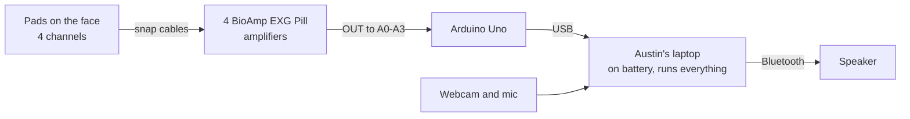

# Hardware

The rig is a short chain, and each part does one job before passing its output on.



## Parts

| Part | What it does |
|---|---|
| Gel pads | Pick up tiny electrical pulses from the face muscles, 3 per channel: IN+, IN−, and REF |
| BioAmp EXG Pill, 4 boards | Boost each channel about 1,000x and cancel the hum shared by all pads |
| Breadboard | Shares the Uno's 5V and ground with all 4 boards |
| Arduino Uno | Reads each board 1,000 times a second and sends the numbers over USB |
| Austin's laptop, RTX 5060, on battery | Reads the Uno, filters out hum with `rig/filters.py`, and runs the EMG model, lip reading, the decoder, Claude, Cartesia, and the dashboard |
| Webcam and mic | Film the lips, and hear the partner's question |
| Bluetooth speaker | Plays the voice loud enough for a noisy room |

The BioAmp is built for 5V boards like the Uno, so its output plugs straight in, and the Uno runs off the laptop's USB with no separate battery.

## Pad sites

We use 4 sites, the best 4-electrode set from [Gaddy and Klein, 2020](https://aclanthology.org/2020.emnlp-main.445.pdf), so our signals look like the Berkeley data we pre-train on.
Six channels don't fit cleanly on the face, and a noisy channel hurts more than a missing one, so the 2 extras (sites 5 and 8) are dropped.
The images below still show the 2 extras on A4 and A5; leave those out.


| Pin | Site in the paper | Where | Reads |
|---|---|---|---|
| A0 | 3 | Under the chin, 3 cm back from the tip | Tongue |
| A1 | 2 | Left corner of the chin | Lower lip and jaw |
| A2 | 6 | Right cheek, just below the mouth | Lower lip |
| A3 | 1 | Left cheek, just above the mouth | Upper lip |

The chin channel matters most.
The muscles that move the tongue sit just above the skin under the chin, so the pad reads the tongue, which no camera can see.
You can feel it with two fingers under your chin while saying "ta ta ta", then "ka ka ka".

- IN+ and IN− go about 2 cm apart on the same muscle, since the amplifier measures the difference between them.
- REF is the zero point, on bone with no muscle on top, so it picks up only the hum for the amplifier to subtract.
  Each board has its own REF pad, 2 behind each ear.
- No pad goes on the throat, since patients lose the voice box.
- Wipe each spot with alcohol, and mark it with a skin marker so pads go back in the same place every session.
- Run every cable back behind the ears, so the webcam can still see the lips.

## Wiring


The diagram shows 6 boards; wire only the 4 on A0 to A3.
Only the breadboard's left + and − columns are used, and each column is one connected strip, so any hole in it works.

| From | To | Wire |
|---|---|---|
| Uno 5V | Breadboard + column | Male-to-male jumper |
| Uno GND | Breadboard − column | Male-to-male jumper |
| Each board's VCC | Breadboard + column | Male-to-female jumper |
| Each board's GND | Breadboard − column | Male-to-female jumper |
| Each board's OUT | Its pin, A0 to A3 | Male-to-female jumper |
| Each board's JST connector | Its electrode cable | Cable from the kit |
| Uno USB | Austin's laptop, on battery | USB-C to USB-B cable |

Check VCC and GND before powering on, since swapping them destroys a board.
Keep the jumpers short, since longer wires pick up more hum.

## Reading and filtering


- `rig/uno/uno.ino` reads the channels on a fixed 1,000 Hz clock, matching the Berkeley dataset, and sends raw numbers with no filtering.
  Each frame starts with a counter, so the reader can spot dropped frames.
  The firmware and reader still read 6 channels (13-byte frames); they switch to the 4 on A0 to A3 (9-byte frames) with the recording tool.
- `rig/reader.py` turns the frames into samples, and saves raw recordings for training.
- `rig/filters.py` removes the 60 Hz hum, its 120 and 180 Hz echoes, and drift below 20 Hz.
  It adds only a few milliseconds of delay, so it runs live.
- Training data and the live demo both go through the same filter, run in order, so the model sees the same signal in both.
  Never clean training data with an offline filter like `filtfilt`.
  That includes the Berkeley data SVR-1 pre-trains on: it is re-filtered with `rig/filters.py` too.
- The hum comes from the room's wiring, not the laptop.
  It gets through when pad contact is uneven, so firm REF pads still matter, and the filter can't fix a signal that hits 0 or 1023.

```bash
python3 -m venv rig/.venv && rig/.venv/bin/pip install -r rig/requirements.txt
rig/.venv/bin/python rig/test_filters.py
rig/.venv/bin/python rig/reader.py /dev/cu.usbmodem2101 40 recording.npy
```

Flash `rig/uno` from Arduino IDE, or with `arduino-cli compile --upload -p /dev/cu.usbmodem2101 --fqbn arduino:avr:uno rig/uno`.
The Serial Plotter can't read this firmware, so for the plotter checks below, flash a sketch that prints `analogRead(A0)` instead.

## Safety

Everything runs on Austin's laptop, so the pads connect to the laptop that runs the GPU.
A charger ties the laptop to mains ground, and that path would run through the USB cable to the pads on Austin's face.

- **The laptop runs on battery whenever pads are on skin.** Never plug in the charger while the Uno is connected.
- To charge, unplug the Uno first. Charge between sessions, and start the demo with a full battery.
- The GPU is slower on battery, so every latency number is measured on battery, the way the demo runs.
- The [BioAmp docs](https://docs.upsidedownlabs.tech/hardware/bioamp/bioamp-exg-pill/index.html) also warn that a charger adds noise.
- Voices are only cloned with the person's permission.
- This is a prototype, not a medical device.

## Build order

1. **Solder each board:** pin headers, the JST connector, and the EMG solder bridge, following the [official docs](https://docs.upsidedownlabs.tech/hardware/bioamp/bioamp-exg-pill/index.html).
   The boards ship set up for brain and eye signals, and the bridge switches them to muscle.
2. **Forearm test** with 1 board on A0: clenching the fist should make clear bursts in the serial plotter.
3. **Chin check** with 1 board on site 3: press the tongue hard against the roof of the mouth, then swallow.
   No bursts means a soldering or wiring problem, not pad placement.
4. **Wire all 4 boards**, and check that every channel bursts when mouthing a phrase.
