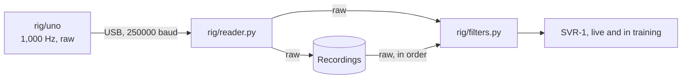

# Hardware

The rig is a short chain, and each part does one job before passing its output on.


## Parts

| Part | What it does |
|---|---|
| Gel pads | Pick up tiny electrical pulses from the face muscles, 3 per channel: IN+, IN−, and REF |
| BioAmp EXG Pill, 4 boards | Boost each channel about 1,000x and cancel the hum shared by all pads |
| Breadboard | Shares the Uno's 5V and ground with all 4 boards |
| Arduino Uno | Reads each board 1,000 times a second and sends the numbers over USB |
| Austin's laptop, RTX 5060, on battery | Reads the Uno, filters out hum, records, and runs the EMG model (SVR-1), lip reading, the joint search, Claude, Cartesia, the Twilio call, and the dashboard |
| Webcam | Films the lips and the face, for lip reading and the voice's emotion |

The BioAmp is built for 5V boards like the Uno, so its output plugs straight in, and the Uno runs off the laptop's USB with no separate battery.

## Pad sites

The 4 sites are the best 4-electrode set from [Gaddy and Klein, 2020](https://aclanthology.org/2020.emnlp-main.445.pdf), so our signals look like the Berkeley data we pre-train on.
A0 to A3 are the paper's sites 3, 2, 6, and 1, in that order.
We tried 2 extra sites on the jaw and back of the cheek, but there wasn't room for clean contact on Austin's face, and hair behind the ear kept their REF pads loose.
In the paper, the best 4 got 76.8% of words wrong on open speech against 68.0% for all 8.
A noisy channel hurts more than a missing one, and in our system EMG is one of three readers, next to the camera and Claude.


| Pin | Site in the paper | Where | Reads |
|---|---|---|---|
| A0 | 3 | Under the chin, 3 cm back from the tip | Tongue |
| A1 | 2 | Left corner of the chin | Lower lip and jaw |
| A2 | 6 | Right cheek, just below the mouth | Lower lip |
| A3 | 1 | Left cheek, just above the mouth | Upper lip |

The chin channel matters most.
The muscles that move the tongue sit just above the skin under the chin, so the pad reads the tongue, which no camera can see.
You can feel it with two fingers under your chin while saying "ta ta ta", then "ka ka ka".

- IN+ and IN− go about 2 cm apart on the same muscle, since the amplifier measures the difference between them.
- REF is the zero point, on bone with no muscle on top, so it picks up only the hum for the amplifier to subtract.
  Each board has its own REF pad on bone, away from hair: A0 and A2 behind the right ear, A1 and A3 behind the left.
- No pad goes on the throat, since the people Reclaim is for have had their voice box removed.
- Wipe each spot with alcohol, and mark it with a skin marker so pads go back in the same place every session.
- Run every cable back behind the ears, so the webcam can still see the lips.

## Wiring


We only use the breadboard's left + and − columns, and each column is one connected strip, so any hole in it works.

| From | To | Wire |
|---|---|---|
| Uno 5V | Breadboard + column | Male-to-male jumper |
| Uno GND | Breadboard − column | Male-to-male jumper |
| Each board's VCC | Breadboard + column | Male-to-female jumper |
| Each board's GND | Breadboard − column | Male-to-female jumper |
| Each board's OUT | Its pin, A0 to A3 | Male-to-female jumper |
| Each board's JST connector | Its electrode cable | Cable from the kit |
| Uno USB | Austin's laptop | USB-C to USB-B cable |

Check VCC and GND before powering on, since swapping them destroys a board.
Keep the jumpers short, since longer wires pick up more hum.

## Reading and filtering



- `rig/uno/uno.ino` reads A0 to A3 on a fixed 1,000 Hz clock, matching the Berkeley dataset, and sends raw numbers with no filtering.
  Each 9-byte frame starts with a counter, so the reader can spot dropped frames.
- `rig/reader.py` turns the frames into samples and saves raw recordings.
- `rig/filters.py` removes the 60 Hz hum, its 120 and 180 Hz echoes, and drift below 20 Hz.
  It adds only a few milliseconds of delay, so it runs live.
- Training data and the live demo both go through the same filter, run in order, so the model sees the same signal in both.
  Never clean training data with an offline filter like `filtfilt`.
  That includes the Berkeley data SVR-1 pre-trains on, which is re-filtered with `rig/filters.py` too.
- The hum comes from the room's wiring, not the laptop.
  It gets through when pad contact is uneven, so firm REF pads still matter, and the filter can't fix a signal that hits 0 or 1023.

## Signal check

Run this after wiring and every time pads go on, before any real recording.
It records rest, "pa pa pa", "ta ta ta", and "I'm thirsty" with spoken cues, then gives each channel a verdict.
It doesn't collect training data, which is what [RECORDING.md](RECORDING.md) covers.

macOS:

```bash
python3 -m venv rig/.venv && rig/.venv/bin/pip install -r rig/requirements.txt
rig/.venv/bin/python rig/test_filters.py
rig/.venv/bin/python rig/signal_check.py check.npz
rig/.venv/bin/python rig/signal_report.py check.npz
```

Windows, in PowerShell:

```powershell
py -m venv rig\.venv
rig\.venv\Scripts\pip install -r rig\requirements.txt
rig\.venv\Scripts\python rig\test_filters.py
rig\.venv\Scripts\python rig\signal_check.py check.npz
rig\.venv\Scripts\python rig\signal_report.py check.npz
```

`rig/signal_check.py` finds the Uno by itself, or takes the port as a second argument, like `/dev/cu.usbmodem…` on macOS or `COM3` on Windows.
It speaks the cues with `say` on macOS and the built-in speech engine on Windows.
Claude sessions follow [.claude/skills/signal-check/SKILL.md](.claude/skills/signal-check/SKILL.md) to run and read it.

Flash `rig/uno` from Arduino IDE, or with `arduino-cli compile --upload -p <port> --fqbn arduino:avr:uno rig/uno`.
On Windows, a clone Uno with a CH340 chip needs the CH340 driver before it shows up as a COM port.
The Serial Plotter can't read this firmware, so for the plotter checks below, flash a sketch that prints `analogRead(A0)` instead.

## Safety

- The pads connect Austin's face to his laptop through the Uno, so the laptop stays off its charger whenever pads are on skin.
  We have no USB isolator, so this rule has no exception.
  To charge, unplug the Uno first, and charge between sessions.
- Every latency number is measured on battery, since the GPU is slower on battery and that's how the demo runs.
- The [BioAmp docs](https://docs.upsidedownlabs.tech/hardware/bioamp/bioamp-exg-pill/index.html) also warn that a charger adds noise.
- No other cable from wall power touches the laptop while pads are on, like a monitor or a powered hub.
- Voices are only cloned with the person's permission.
- This is a prototype, not a medical device.

## Build order

1. **Solder each board:** pin headers, the JST connector, and the EMG solder bridge, following the [official docs](https://docs.upsidedownlabs.tech/hardware/bioamp/bioamp-exg-pill/index.html).
   The boards ship set up for brain and eye signals, and the bridge switches them to muscle.
2. **Forearm test** with 1 board on A0.
   Clenching the fist should make clear bursts in the serial plotter.
3. **Chin check** with 1 board on site 3.
   Press the tongue hard against the roof of the mouth, then swallow.
   No bursts means a soldering or wiring problem, not pad placement.
4. **Wire all 4 boards**, flash `rig/uno`, and run the [signal check](#signal-check).
   Every channel should say OK.
