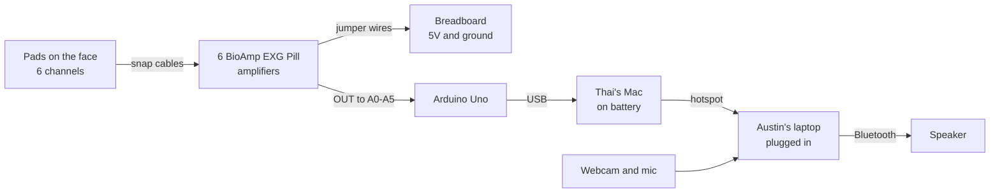
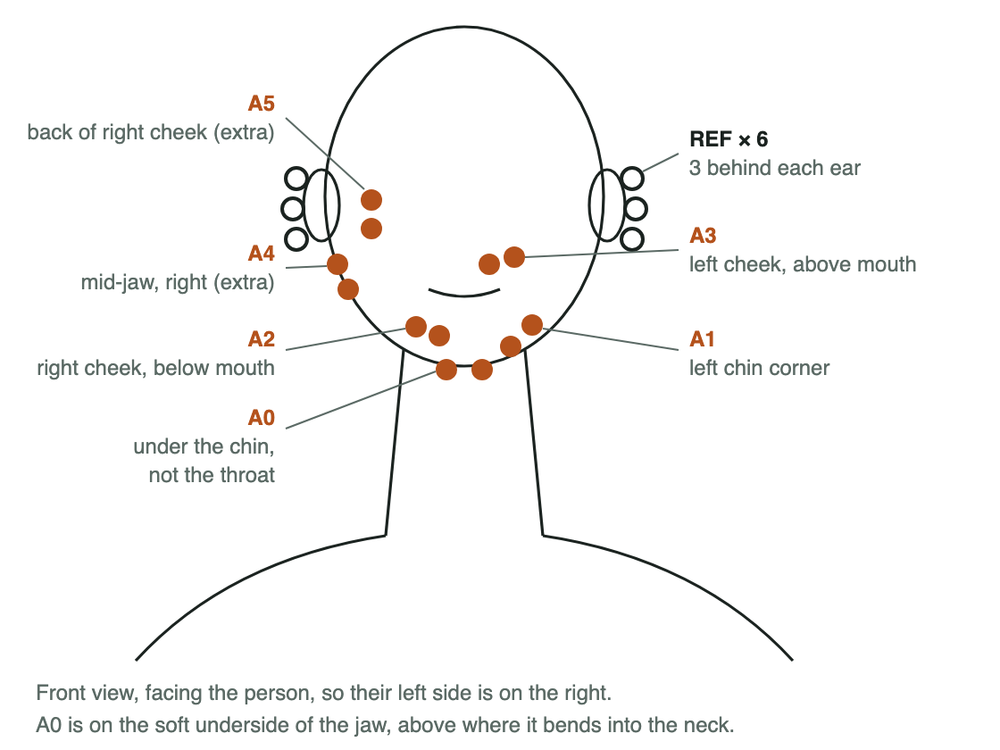
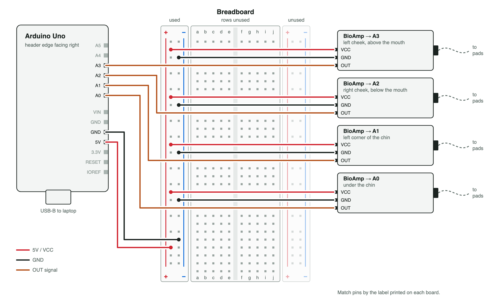

# Hardware

How the rig is connected, and what each part does.

## Signal chain

## Parts

| Part | What it does |
|---|---|
| Gel pads | Pick up tiny electrical pulses from the face muscles, 3 per channel: IN+, IN−, and REF |
| BioAmp EXG Pill, 6 boards | Boost each channel about 1,000x and cancel hum shared by all pads |
| Breadboard | Shares the Uno's 5V and ground with all 6 boards |
| Arduino Uno | Reads each board 1,000 times a second and sends raw bytes over USB at 230400 baud or higher |
| Thai's Mac | Reads the Uno, filters the signal, and runs the quick phrases classifier |
| Austin's laptop, RTX 5060 | Runs lip reading, Claude, Cartesia, and the dashboard |
| Webcam and mic | Film the lips, and hear the partner's question |
| Bluetooth speaker | Plays the voice loud enough for a noisy room |

## Pad sites

The 4 core sites are the best 4-electrode set from [Gaddy and Klein, 2020](https://aclanthology.org/2020.emnlp-main.445.pdf).
The 2 extras are added once the core 4 are clean, and they double as spares.

| Pin | Site in the paper | Where | Reads |
|---|---|---|---|
| A0 | 3 | Under the chin, 3 cm back from the tip | Tongue |
| A1 | 2 | Left corner of the chin | Lower lip and jaw |
| A2 | 6 | Right cheek, just below the mouth | Lower lip |
| A3 | 1 | Left cheek, just above the mouth | Upper lip |
| A4 | 5 | Right side of the jaw, midway | Jaw, extra |
| A5 | 8 | Back of the right cheek, 4 cm in front of the ear | Back of the cheek, extra |

- IN+ and IN− go about 2 cm apart on the same muscle.
- Each board has its own REF pad, on the bone behind the ears, 3 per side.
- No pad goes on the throat, since patients lose the voice box.
- Cables run back behind the ears, so the webcam can still see the lips.

## Wiring

The diagram shows the 4 core boards, and the 2 extras wire the same way, with OUT to A4 and A5.

| From | To |
|---|---|
| Uno 5V | Breadboard + column |
| Uno GND | Breadboard − column |
| Each board's VCC | Breadboard + column |
| Each board's GND | Breadboard − column |
| Each board's OUT | Its pin, A0 to A5 |
| Each board's JST connector | Its electrode cable |
| Uno USB | Thai's Mac |

Check VCC and GND before powering on, since swapping them destroys a board.

## Safety

- The pads connect Austin's face to Thai's Mac through the Uno, so that Mac stays off its charger whenever pads are on skin.
  The [BioAmp docs](https://docs.upsidedownlabs.tech/hardware/bioamp/bioamp-exg-pill/index.html) also warn that a charger adds noise.
- Austin's laptop never touches the rig, so it can charge.
- The two laptops talk over a phone hotspot, never a cable, since a cable would connect the charging laptop to the pads.
- Voices are only cloned with the person's permission.
