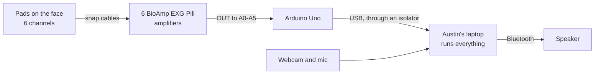

# Hardware

The rig is a short chain, and each part does one job before passing its output on.

## Parts

| Part | What it does |
|---|---|
| Gel pads | Pick up tiny electrical pulses from the face muscles, 3 per channel: IN+, IN−, and REF |
| BioAmp EXG Pill, 6 boards | Boost each channel about 1,000x and cancel the hum shared by all pads |
| Breadboard | Shares the Uno's 5V and ground with all 6 boards |
| Arduino Uno | Reads each board 1,000 times a second and sends the numbers over USB |
| USB isolator | Breaks the electrical path between the pads and the laptop's charger, see Safety |
| Austin's laptop, RTX 5060 | Reads the Uno, and runs the EMG model, lip reading, the decoder, Claude, Cartesia, and the dashboard |
| Webcam and mic | Film the lips, and hear the partner's question |
| Bluetooth speaker | Plays the voice loud enough for a noisy room |

The BioAmp is built for 5V boards like the Uno, so its output plugs straight in, and the Uno runs off the laptop's USB, through the isolator, with no separate battery.

## Pad sites

The 4 core sites are the best 4-electrode set from [Gaddy and Klein, 2020](https://aclanthology.org/2020.emnlp-main.445.pdf), so our signals look like the Berkeley data we pre-train on.
The 2 extras go on once the core 4 are clean, and they double as spares if a core board fails.

| Pin | Site in the paper | Where | Reads |
|---|---|---|---|
| A0 | 3 | Under the chin, 3 cm back from the tip | Tongue |
| A1 | 2 | Left corner of the chin | Lower lip and jaw |
| A2 | 6 | Right cheek, just below the mouth | Lower lip |
| A3 | 1 | Left cheek, just above the mouth | Upper lip |
| A4 | 5 | Right side of the jaw, midway | Jaw, and the jaw-clench cancel gesture |
| A5 | 8 | Back of the right cheek, 4 cm in front of the ear | The chewing muscle, and the jaw-clench cancel gesture |

The chin channel matters most.
The muscles that move the tongue sit just above the skin under the chin, so the pad reads the tongue, which no camera can see.
You can feel it with two fingers under your chin while saying "ta ta ta", then "ka ka ka".

- IN+ and IN− go about 2 cm apart on the same muscle, since the amplifier measures the difference between them.
- REF is the zero point, on bone with no muscle on top, so it picks up only the hum for the amplifier to subtract.
  Each board has its own REF pad, 3 behind each ear.
- No pad goes on the throat, since patients lose the voice box.
- Wipe each spot with alcohol, and mark it with a skin marker so pads go back in the same place every session.
- Run every cable back behind the ears, so the webcam can still see the lips.

## Wiring

The diagram shows the 4 core boards, and the 2 extras wire the same way, with OUT to A4 and A5.
Only the breadboard's left + and − columns are used, and each column is one connected strip, so any hole in it works.

| From | To | Wire |
|---|---|---|
| Uno 5V | Breadboard + column | Male-to-male jumper |
| Uno GND | Breadboard − column | Male-to-male jumper |
| Each board's VCC | Breadboard + column | Male-to-female jumper |
| Each board's GND | Breadboard − column | Male-to-female jumper |
| Each board's OUT | Its pin, A0 to A5 | Male-to-female jumper |
| Each board's JST connector | Its electrode cable | Cable from the kit |
| Uno USB | USB isolator, then Austin's laptop | USB-B cable to the isolator, isolator to the laptop |

Check VCC and GND before powering on, since swapping them destroys a board.
Keep the jumpers short, since longer wires pick up more hum.

## Sample rate

The Uno reads each of the 6 channels at 1,000 Hz, matching the Berkeley dataset.
That's 6,000 readings a second, too much for plain text at 115200 baud, so it sends raw bytes at 230400 baud or higher.

## Safety

Everything now runs on Austin's laptop, so the pads connect to the same laptop that charges and drives the GPU.
A charger ties the laptop to mains ground, and without care that path runs through the USB cable to the pads on Austin's face.

- **Default: a galvanically isolated USB link** between the Uno and the laptop (a USB 2.0 full-speed isolator, which the Uno's USB supports).
  With the isolator in line, the laptop can stay on its charger, so the GPU runs at full power.
- **Fallback if there is no isolator:** the laptop runs on battery whenever pads are on skin.
  Unplug the Uno before plugging in the charger.
  The GPU slows down on battery, so measure the latency in that state too.
- **Never** a charging laptop with the Uno connected directly, without an isolator.
- The [BioAmp docs](https://docs.upsidedownlabs.tech/hardware/bioamp/bioamp-exg-pill/index.html) also warn that a charger adds noise; the isolator helps with that too.
- Voices are only cloned with the person's permission.
- This is a prototype, not a medical device.

## Build order

1. **Solder each board:** pin headers, the JST connector, and the EMG solder bridge, following the [official docs](https://docs.upsidedownlabs.tech/hardware/bioamp/bioamp-exg-pill/index.html).
   The boards ship set up for brain and eye signals, and the bridge switches them to muscle.
2. **Forearm test** with 1 board on A0: clenching the fist should make clear bursts in the serial plotter.
3. **Chin check** with 1 board on site 3: press the tongue hard against the roof of the mouth, then swallow.
   No bursts means a soldering or wiring problem, not pad placement.
4. **Wire the 4 core boards**, and check that every channel bursts when mouthing a phrase.
5. **Add the 2 extras** on A4 and A5 once the core 4 are clean.
