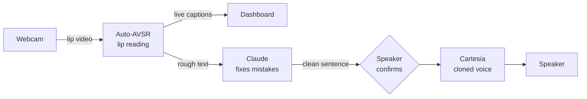
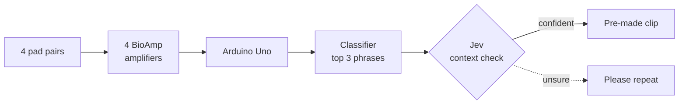

# Reclaim

Silent speech for people who lost their voice box.
You mouth the words, and Reclaim says them out loud in your own voice.

Built at Cal Hacks 13.0, October 23 to 25, 2026.

## Who it's for

A laryngectomy removes the voice box, usually after throat cancer.
People can still move their lips, tongue, and jaw, so the words are there without the sound.
Most rely on an electrolarynx, a handheld buzzer that sounds robotic and needs a free hand.

## Two modes

| | Free speech | Quick phrases |
|---|---|---|
| Priority | Main goal | Stretch goal |
| You do | Mouth any sentence | Mouth one of 10 set phrases |
| Sensor | Webcam | 4 face electrode channels, no camera |
| Reads it | Auto-AVSR lip reading, then Claude fixes mistakes | Our classifier, then Jev picks using the conversation |
| Voice | Cartesia, live in a cloned voice | 10 pre-made Cartesia clips |

### Free speech

Claude only swaps words that look alike on the lips or don't fit the conversation, and never adds new ideas.
If it isn't sure, the screen says "Please repeat" instead of guessing.

### Quick phrases

Picking 1 of 10 phrases is far easier than reading any sentence, and it works in the dark or with the face turned away.

## What we demo

Two minutes, live, at our table.

1. **Free speech.**
   The partner asks "What do you need?", and Austin mouths an answer at the webcam.
   Captions appear as he mouths, Claude fixes a look-alike word like "bills" to "pills", and the sentence plays in Austin's cloned voice.
2. **Quick phrases, camera off.**
   The partner asks "Want some water?", and Austin mouths "I'm thirsty".
   The muscle signals jump on screen, the classifier shows its top 3, Jev picks "I'm thirsty" from the question, and the clip plays.
3. **The raw and fixed text side by side**, to show exactly what Claude changed.

## Stack

| Part | Tool |
|---|---|
| Lip reading | [Auto-AVSR](https://github.com/mpc001/auto_avsr), on a laptop GPU |
| Fixing mistakes | Claude |
| Voice clone and speech | Cartesia Sonic, Instant Voice Clone |
| Partner's speech to text | Cartesia Ink |
| Phrase context | [Jev](https://typesafe.ai) |
| Muscle signals | BioAmp EXG Pill boards and an Arduino Uno, see [HARDWARE.md](HARDWARE.md) |
| Classifier | PyTorch, pre-trained on Berkeley's silent speech data |

## Known limitations

- This is a prototype, not a medical device.
- Lip reading gets about 1 in 5 words wrong even on normal speaking video, and silent mouthing is harder.
- Quick phrases is trained per person, from about 30 minutes of recordings.
- Auto-AVSR reads a whole sentence at a time, so the voice waits until the speaker finishes.
  Evan owns making it stream, so words come out while the speaker is still mouthing.

## Built on

- [Digital Voicing of Silent Speech](https://aclanthology.org/2020.emnlp-main.445.pdf), Gaddy and Klein, UC Berkeley, 2020, for the electrode sites and pre-training data.
- [Auto-AVSR](https://github.com/mpc001/auto_avsr), Ma et al., 2023, for lip reading.

## Team

Thai (hardware), Austin (ML, and the speaker in the demo), Frank (voice AI), and Evan (app, dashboard, and streaming the lip reading).
