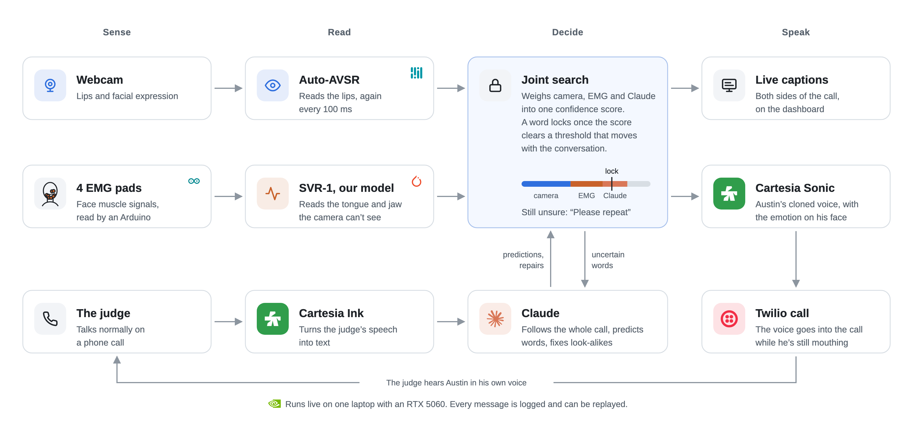

# Silent Voice

Silent Voice gives a voice back to people who lost their voice box.
You mouth the words without a sound, and Silent Voice speaks them in your own voice while you're still mouthing, even on a phone call.

We built it at Cal Hacks 13.0.

## Who it's for

A laryngectomy removes the voice box, usually after throat cancer.
People keep their lips, tongue, and jaw, so the words are still there, only the sound is gone.
Many of them speak through an electrolarynx, a handheld buzzer that sounds robotic and ties up a hand.
We think they deserve a voice that sounds like them, keeps up with a real conversation, and works on an ordinary phone call, and that's what we're building.

Our demo speaker is Austin, who's healthy, and no patients take part in the demo.

## How it works

Silent Voice has one mode, open mouth, no sound, in real time.
Three readers work together, because each one sees what the others can't.
Every 100 ms one joint search combines them and locks in each word as soon as they're confident enough.

<picture>
  <source media="(prefers-color-scheme: dark)" srcset="figures/overview-dark.png">
  
</picture>

- The camera reads the lips and does most of the work.
  It also reads the facial expression, which sets the voice's emotion.
- The EMG model reads the electrical signals of the face muscles, so it sees the tongue and jaw that no camera can.
  It settles words that look alike on the lips ("bat", "mat", "pat"), proposes its own guesses, and keeps going when the face is hard to see.
- Claude follows the whole conversation, both sides.
  It predicts likely words before you start mouthing and repairs look-alike mistakes ("bills" → "pills" after a question about medicine).
  It only swaps look-alike words and never adds ideas.
- Cartesia speaks each word in your cloned voice as soon as it locks, without waiting for the end of the sentence.
- When the system can't tell what you said, it shows "Please repeat" instead of guessing.

Read on for the details.

- [docs/REALTIME_PIPELINE.md](docs/REALTIME_PIPELINE.md) explains how the whole system works.
- [docs/SVR1_SPEC.md](docs/SVR1_SPEC.md) specifies the EMG model, SVR-1.
- [docs/TEAM_TASKS_AND_INTERFACES.md](docs/TEAM_TASKS_AND_INTERFACES.md) covers who builds what.
- [HARDWARE.md](HARDWARE.md) describes the rig, and [RECORDING.md](RECORDING.md) the recording sessions.

## What we demo

The demo is two minutes, live, at our table.

1. Austin calls the judge standing in front of us, through Twilio.
   The judge talks normally, and their words appear in the captions.
2. Austin mouths his side of the conversation.
   His words appear as he mouths and play into the call in his cloned voice while he's still going.
3. His facial expression sets the voice's emotion.
4. The dashboard shows the real latency, which reader settled each word, and what Claude changed.

## Stack

| Part | Tool |
|---|---|
| Lip reading | [Auto-AVSR](https://github.com/mpc001/auto_avsr), as is, re-read every 100 ms for real time |
| Face, mouth crop, expression | MediaPipe FaceLandmarker |
| Muscle signals | BioAmp EXG Pill boards and an Arduino Uno, see [HARDWARE.md](HARDWARE.md) |
| EMG model | SVR-1, ours: PyTorch, pre-trained on Berkeley's silent speech data, fine-tuned on Austin |
| Context and repairs | Claude, through the Claude API |
| Voice clone and speech | Cartesia Sonic 3.6, Instant Voice Clone |
| The other person's speech to text | Cartesia Ink |
| Phone call | Twilio |
| Compute | One laptop, RTX 5060 |

## Code and data

All code lives in this repo.
Datasets, checkpoints, results, and Python environments live in a working directory outside it, and the code finds them through the environment variable `RECLAIM_WORKDIR` (datasets in `silent_speech/` and `data/`, plus `checkpoints/`, `benchmark_results/`, `recordings/`, `third_party/`).
Without it, the code expects data next to itself, which is how the cluster copy works.
Data folders are in `.gitignore`.

| Folder | What it is |
| --- | --- |
| `svr/` | SVR-1, the EMG model: model, training, fine-tuning, preprocessing ([docs/SVR1_SPEC.md](docs/SVR1_SPEC.md)) |
| `fusion/` | The joint search over camera + EMG + Claude, and its language model: a conversational 4-gram with a cache of the call (`fusion/lm.py`, built by `fusion/build_lm.py`) |
| `bench/` | Benchmarks and their frozen test splits |
| `cluster/` | H100/H200 job scripts (PBS), smoke tests, runbook |
| `camera/` | Camera-only baselines (Auto-AVSR, BRAVEn, LipLearner) |
| `rig/` | EMG rig: Arduino firmware, serial reader, live hum filter, signal check, `emg.raw` publisher (`publish.py`) |
| `recorder/` | The recording app: camera + EMG + the session sentences ([recorder/README.md](recorder/README.md)) |
| `bus/` | The team bus: ZeroMQ wire format, the camera's topics (`__init__.py`) and every other endpoint and port (`team.py`) |
| `buslog/` | Logs every bus message to `$RECLAIM_WORKDIR/logs/` (`record.py`) and replays a session (`replay.py`) |
| `claude_service/` | The Claude service: predicts Austin's next words and repairs look-alikes (`brain.py`), on the bus (`service.py`) |
| `dashboard/` | The live dashboard judges watch, from Thai's Figma v5, fed by the bus ([dashboard/README.md](dashboard/README.md)) |
| `demo/dashboard/` | Captions dashboard prototype, sample data ([demo/dashboard/README.md](demo/dashboard/README.md)) |
| `call/` | The phone call: Twilio, Austin's cloned voice (Cartesia Sonic) and the judge's captions (Cartesia Ink) ([call/README.md](call/README.md)) |
| `figures/` | The SVR-1 architecture figure, the SVR-1 vs Gaddy & Klein results (`svr1_vs_gaddy_4ch*`), and the scripts that draw them |
| `tests/` | Smoke and unit tests |
| `docs/` | Plans and specs, Markdown with PDF copies |

## Known limitations

- This is a prototype, not a medical device.
- Lip reading gets about 1 in 5 words wrong even on normal speaking video, and silent mouthing is harder.
  The EMG model and Claude are there to close that gap.
- The EMG model is trained for one person (Austin), from three recording sessions, see [RECORDING.md](RECORDING.md).
- The voice runs a little behind the lips, because a word is spoken only once it's confident enough to lock.

## Built on

- [Digital Voicing of Silent Speech](https://aclanthology.org/2020.emnlp-main.445.pdf), Gaddy and Klein, UC Berkeley, 2020, for the electrode sites and pre-training data.
- [Auto-AVSR](https://github.com/mpc001/auto_avsr), Ma et al., 2023, for lip reading.
- [Lipflow](https://github.com/amywork777/lipflow), MIT license, for live mouth cropping with MediaPipe.

## Team

Thai (EMG hardware and the Claude service), Austin (EMG model and fusion, and the speaker in the demo), Frank (Cartesia voice, the Twilio call, and the captions dashboard), and Evan (real-time lip reading and facial emotion).
