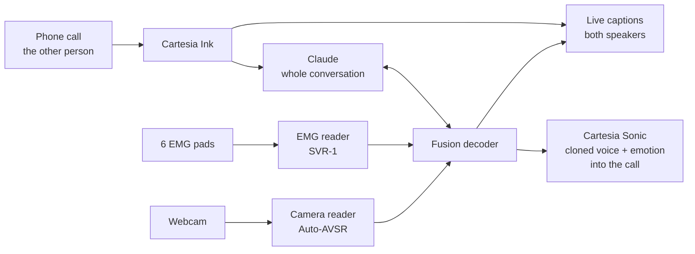

# Reclaim

Silent speech for people who lost their voice box.
You mouth the words, and Reclaim says them out loud in your own voice, while you are still mouthing, even on a phone call.

Built at Cal Hacks 13.0, October 23 to 25, 2026.

## Who it's for

A laryngectomy removes the voice box, usually after throat cancer.
People can still move their lips, tongue, and jaw, so the words are there without the sound.
Most rely on an electrolarynx, a handheld buzzer that sounds robotic and needs a free hand.

Our demo speaker is Austin, who is healthy; no patients take part in the demo.

## How it works

One mode: open mouth, no sound, real time.
Three readers work together, because each sees what the others can't, and every 100 ms a decoder combines them and locks in each word as soon as they're confident enough.

- The camera reads the lips and does most of the work. It also reads the facial expression, which sets the voice's emotion.
- The EMG model reads the face muscles, so it sees the tongue and jaw that no camera can. It settles words that look alike on the lips ("bat", "mat", "pat"), proposes its own guesses, and keeps going when the face is hard to see.
- Claude follows the whole conversation, both sides. It predicts likely words before you start mouthing, and it repairs look-alike mistakes ("bills" → "pills" after a question about medicine). It only swaps look-alike words and never adds ideas.
- Cartesia speaks each word in your cloned voice as soon as it locks, without waiting for the end of the sentence.
- If the system can't tell what you said, it shows "Please repeat" instead of guessing.

Details: [docs/ARCHITECTURE.md](docs/ARCHITECTURE.md). Plan and owners: [docs/PLAN.md](docs/PLAN.md). What changed and why: [docs/DECISIONS.md](docs/DECISIONS.md).

## What we demo

Two minutes, live, at our table.

1. Austin calls the judge, standing in front of us, through Twilio. The judge talks normally; their words appear in the captions.
2. Austin mouths his side of the conversation. His words appear as he mouths and play into the call in his cloned voice while he is still going.
3. His facial expression sets the voice's emotion.
4. The dashboard shows the real latency, which reader settled each word, and what Claude changed.

## Stack

| Part | Tool |
|---|---|
| Lip reading | [Auto-AVSR](https://github.com/mpc001/auto_avsr), as is, re-read every 100 ms for real time |
| Face, mouth crop, expression | MediaPipe FaceLandmarker |
| Muscle signals | BioAmp EXG Pill boards and an Arduino Uno, see [HARDWARE.md](HARDWARE.md) |
| EMG model | SVR-1, ours: PyTorch, pre-trained on Berkeley's silent speech data, fine-tuned on Austin |
| Context and repairs | Claude, through the Claude API |
| Voice clone and speech | Cartesia Sonic 3.6, Instant Voice Clone |
| The other person's speech to text | Cartesia Ink |
| Phone call | Twilio |
| Compute | One laptop, RTX 5060 |

## Known limitations

- This is a prototype, not a medical device.
- Lip reading gets about 1 in 5 words wrong even on normal speaking video, and silent mouthing is harder; the EMG model and Claude are there to close that gap.
- The EMG model is trained for one person (Austin), from three recording sessions.
- The voice runs a little behind the lips, because a word is spoken only once it is confident enough to lock.

## Built on

- [Digital Voicing of Silent Speech](https://aclanthology.org/2020.emnlp-main.445.pdf), Gaddy and Klein, UC Berkeley, 2020, for the electrode sites and pre-training data.
- [Auto-AVSR](https://github.com/mpc001/auto_avsr), Ma et al., 2023, for lip reading.
- [Lipflow](https://github.com/amywork777/lipflow), MIT license, for live mouth cropping with MediaPipe.

## Team

Thai (EMG hardware and the Claude service), Austin (EMG model and fusion, and the speaker in the demo), Frank (Cartesia voice, the Twilio call and the captions dashboard), and Evan (real-time lip reading and facial emotion).
