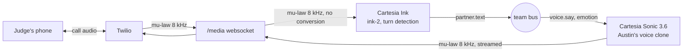

# Silent Voice call service

Silent Voice lets someone who lost their voice box talk on the phone again, in their own voice, without making a sound.
Austin mouths his words silently; the lip reader and EMG decoder turn them into text; this service speaks that text into a
real phone call in his cloned voice, while he is still mouthing, and transcribes the person on the other end.

## What Cartesia does here

| Cartesia feature | What it does in Silent Voice |
| --- | --- |
| **Instant Voice Clone** | Austin's own voice, made from his recordings with his consent. Without it he would sound like an electrolarynx. |
| **Sonic 3.6 over the WebSocket, continuations** | One context per sentence. Locked words are pushed as natural phrases (`continue: true`, one flush each, no server buffer): at Austin's pauses or every ~4 words, so speech starts while he is still mouthing and sounds like talking. Sonic pads each flush with ~0.5 s of silence; it is trimmed to a natural pause (`call/audio.py`). |
| **`generation_config` + inline tags** | When a sentence starts, his facial expression picks the `emotion` (neutral, happy, sad, surprised), his mouthing pace sets `speed` and his effort sets `volume`. Sonic keeps a context's settings, so a change mid-sentence goes inline as `<emotion value/>`, `<speed ratio/>` or `<volume ratio/>`. |
| **`pcm_s16le` 8 kHz output** (phrases; `pcm_mulaw` with `CARTESIA_PACED=0`) | Phone rate, so no resampling; linear so each phrase can be trimmed as it streams, then encoded to Twilio's mu-law here. |
| **Ink (ink-2) with turn detection** | Transcribes the judge from the call audio (also `pcm_mulaw` 8 kHz) into live captions and into Claude's context. |

## Setup

1. Environment (on the machine that runs it; venvs can't be copied between computers):
   `uv venv --python 3.11 venv-call && uv pip install --python venv-call/bin/python -r requirements-call.txt`
2. Keys: `cp call/.env.example call/keys.env`, then fill in `CARTESIA_API_KEY`, `CARTESIA_VOICE_ID` (Austin's clone),
   the Twilio account SID, auth token and number (a paid account: trial calls play an announcement first).
3. A public HTTPS tunnel to `PORT` (default 8787), e.g. `cloudflared tunnel --url http://127.0.0.1:8787` or ngrok;
   put its host in `PUBLIC_HOST`.
4. Run:
   - Austin calls the judge: `venv-call/bin/python -m call.server --dial +14155550142`
   - Or the judge calls our number: point the number's voice webhook at `https://PUBLIC_HOST/twiml` (POST), then
     `venv-call/bin/python -m call.server`
5. Tests (no network, fake Cartesia and Twilio): `venv-call/bin/python -m pytest tests/call -q -c tests/call/pytest.ini`

## Team bus

ZeroMQ over TCP on the laptop's loopback (docs/TEAM_TASKS_AND_INTERFACES.md; no `ipc://`, which Windows lacks). Each variable in
`call/keys.env` or the environment overrides its address.

| Address | Who binds it | What we use |
| --- | --- | --- |
| `tcp://127.0.0.1:5556` (`RECLAIM_CAM_PUB`) | camera reader (`lipread.run`) | `cam.tick`: only its `emotion` |
| `tcp://127.0.0.1:5557` (`RECLAIM_DEC_PUB`) | Austin's decoder | `voice.say`: `utt_id`, `words` (the new words), `final`, `pace`, `effort`, and `offset` (where `words[0]` sits in the sentence, so a resent word is never spoken twice and a real repeat like "no no" is); `dec.hyp`: only whether a word is being mouthed now (`mouthing`; an older decoder: `unlocked`), so a phrase ends on his pause |
| `tcp://127.0.0.1:5559` (`RECLAIM_CALL_PUB`) | this service | publishes `partner.text`, `timing.voice`, `call.state` |

Times on the bus are `time.perf_counter()` (the team clock).

## Responsible use

- A voice clone is someone's identity: we clone only Austin's own voice, from his recordings, with his consent.
- Keys stay on the laptop in `call/keys.env` (git-ignored); nothing calls Cartesia from a browser.
- Only Twilio can reach the call audio: the media websocket path holds a random token that appears only in TwiML,
  and `/twiml` answers only requests with a valid `X-Twilio-Signature`.
- The voice speaks only words the decoder locked; when it isn't sure, the screen says "Please repeat" instead of guessing.

## Known limitations

- One call at a time.
- If streaming fails even after a reconnect, those words are spoken with one whole-sentence request at the end of the
  sentence (the repo's fallback); that path adds ~1-2 s.
- Noisy rooms, three layers: (1) the demo phone is an iPhone held to the ear with Mic Mode set to Voice Isolation
  (Control Center during the call; on iOS 18 "Automatic" does it at the ear), never speakerphone; (2) a gate here
  passes only audio near the caller's own speaking level (on a test call at the expo: caller -12 to -20 dBFS, people
  nearby -40 to -60), so they are muted even while they talk; if the caller gets quieter, the gate follows within a
  few seconds (`NOISE_GATE=0` turns it off); (3) Ink is told our words (`keyterm`: Silent Voice, Austin, Cal Hacks, ...) and
  how sure to be that a turn started (`INK_TURN_START`, default 0.8).
- The judge's speech is transcribed but not barge-in aware: Austin's voice is not cut off when the judge talks over it.
- Phrases (default): measured on real Sonic (a sentence mouthed in 5.5 s with two pauses), first sound 0.6 s after he
  started, finished 1.0 s after him. With the old 120 ms server buffer, Sonic held 14 of 15 words until the sentence
  ended (4.9 s of silence); word by word with no buffer sounded like a list of one-word sentences on a test call.
  `CARTESIA_PACED=0` goes back to the old behaviour (`CARTESIA_MAX_BUFFER_MS`, `CARTESIA_PHRASE_WORDS`).
- Each phrase publishes `timing.voice` `{stage: 'voice_phrase', words, ms, emotion, speed, volume}`.
- Pace and effort are relative to Austin's normal (1.0 = normal, as svr/live.py computes effort): speed = pace, volume =
  effort, clamped to Sonic's 0.6-1.5 and 0.5-2.0.
- Emotion comes from the camera's face label; below 0.5 confidence the voice stays neutral.
