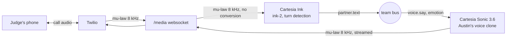

# Reclaim call service

Reclaim lets someone who lost their voice box talk on the phone again, in their own voice, without making a sound.
Austin mouths his words silently; the lip reader and EMG decoder turn them into text; this service speaks that text into a
real phone call in his cloned voice, while he is still mouthing, and transcribes the person on the other end.

## What Cartesia does here

| Cartesia feature | What it does in Reclaim |
| --- | --- |
| **Instant Voice Clone** | Austin's own voice, made from his recordings with his consent. Without it he would sound like an electrolarynx. |
| **Sonic 3.6 over the WebSocket, continuations** | One context per sentence. Words are pushed as the decoder settles them (`continue: true`), so speech starts while Austin is still mouthing. |
| **`generation_config`** | His facial expression picks the `emotion` (happy, sad, angry, surprised, neutral); his mouthing pace sets `speed`, his effort sets `volume`. |
| **`pcm_mulaw` 8 kHz output** | Sonic speaks phone audio directly: no resampling between Cartesia and Twilio. |
| **Ink (ink-2) with turn detection** | Transcribes the judge from the call audio (also `pcm_mulaw` 8 kHz) into live captions and into Claude's context. |

## Setup

1. Environment (on the machine that runs it; venvs can't be copied between computers):
   `bash scripts/setup_envs.sh call`
2. Keys: `cp call/.env.example call/keys.env`, then fill in `CARTESIA_API_KEY`, `CARTESIA_VOICE_ID` (Austin's clone),
   the Twilio account SID, auth token and number (a paid account: trial calls play an announcement first).
3. A public HTTPS tunnel to `PORT` (default 8787), e.g. `cloudflared tunnel --url http://127.0.0.1:8787` or ngrok;
   put its host in `PUBLIC_HOST`.
4. Run:
   - Austin calls the judge: `venv-call/bin/python -m call.server --dial +14155550142`
   - Or the judge calls our number: point the number's voice webhook at `https://PUBLIC_HOST/twiml` (POST), then
     `venv-call/bin/python -m call.server`
5. Tests (no network, fake Cartesia and Twilio): `venv-call/bin/python -m pytest tests/call -q -c tests/call/pytest.ini`

## Responsible use

- A voice clone is someone's identity: we clone only Austin's own voice, from his recordings, with his consent.
- Keys stay on the laptop in `call/keys.env` (git-ignored); nothing calls Cartesia from a browser.
- Only Twilio can reach the call audio: the media websocket path holds a random token that appears only in TwiML,
  and `/twiml` answers only requests with a valid `X-Twilio-Signature`.
- The voice speaks only words the decoder locked; when it isn't sure, the screen says "Please repeat" instead of guessing.

## Known limitations

- One call at a time.
- If streaming fails even after a reconnect, those words are spoken with one whole-sentence request at the end of the
  sentence (the repo's fallback); that path adds ~1-2 s.
- Noisy rooms: a loudness gate keeps only the person holding the phone to their ear (`NOISE_GATE=1`, default).
  On speakerphone or with a quiet caller it can clip words; turn it off with `NOISE_GATE=0`.
- The judge's speech is transcribed but not barge-in aware: Austin's voice is not cut off when the judge talks over it.
- Each word goes to Sonic as soon as it arrives (the repo plan), with a 120 ms server buffer. Austin mouths about as
  fast as speech plays, so streaming word by word can leave short silences mid-sentence; `CARTESIA_PHRASE_WORDS=3` with
  `CARTESIA_MAX_BUFFER_MS=0` groups words instead (an experiment, off by default).
- Pace and effort mapping assume pace 1.0 = normal and effort 0 to 1 (to confirm with the decoder).
- Emotion comes from the camera's face label; below 0.5 confidence the voice stays neutral.
