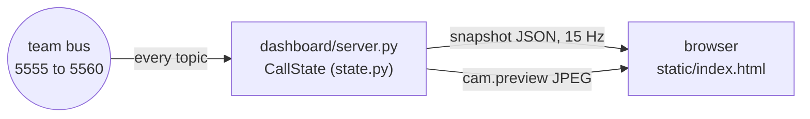

# Live dashboard

What the judges watch during the call, built from Thai's Figma "Reclaim — Demo Dashboard v2", section v5 (frames:
Reading, Claude repair, Please repeat, Face hidden, Muscle sensors off, End of call). The left side has the
conversation, Austin's words and who settled each one, and the latency. The right side has Austin's mirrored
camera with the four pads, the emotion and what the call heard.



## Run

```bash
venv-call/bin/python -m dashboard.server --number "(628) 888-6598"     # then open http://127.0.0.1:8790, F11
```

It only listens, so it can start or stop at any time without touching the call. To rehearse without Austin, run
the scripted call with every part stopped. On a shared laptop, use private ports so no one's logger records it:

```bash
export RECLAIM_EMG_PUB=tcp://127.0.0.1:6555 RECLAIM_CAM_PUB=tcp://127.0.0.1:6556 RECLAIM_DEC_PUB=tcp://127.0.0.1:6557 \
       RECLAIM_CLAUDE_PUB=tcp://127.0.0.1:6558 RECLAIM_CALL_PUB=tcp://127.0.0.1:6559 RECLAIM_SVR_PUB=tcp://127.0.0.1:6560
venv-call/bin/python -m dashboard.server &
venv-live/bin/python -m dashboard.demo_feed --video some_clip.mp4     # --video needs OpenCV (venv-live)
```

A logged call replays onto it with `python -m buslog.replay SESSION`.

## Where each number comes from

Everything on the screen is measured on the call, from the bus. The rules:

- **Nothing is made up.** A part that hasn't published shows `--` and never a sample number.
- **No error rate during a call.** There is no answer key during a call, so the end screen shows how often each
  reader alone **disagreed** with the final word, labelled that way.
- **The status line comes from what is actually arriving.** It checks how recently each part published, and whether
  the bus logger (`buslog.record`) is writing.

| On screen | From |
| --- | --- |
| lips to voice | first `dec.lock` word time to `timing.voice` `sonic_first_audio` (before the phone network) |
| fixed by Claude, asked to repeat | `claude.repair` edits, `dec.repeat` |
| Judge bubble | `partner.text` (partial while speaking, then final) |
| Austin's words and their colours | `dec.hyp` `locked` / `unlocked` / `source`, plus the struck word from `claude.repair` |
| Candidate bars and the lock threshold | `dec.hyp` `cands`, `threshold` (optional, below) |
| Camera | `cam.preview` (optional, below); without it, the face mesh from `cam.face` |
| Emotion chip, "Sounds warm" | `cam.tick` `emotion` (the expression model) |
| Pads | `emg.raw`: level (RMS against a running peak), contact (signal not flat, not on a rail) |
| Latency | `cam.tick` `timing_ms.total`, `timing.dec` (`lock`, `window`), `timing.claude`, `timing.voice` |

## Optional fields the screen uses when they arrive

These are in docs/TEAM_TASKS_AND_INTERFACES.md; the screen works without them and shows more with them.

- `cam.preview` (camera reader): `t`, `w`, `h`, `jpeg`, about 10 fps, 640 px wide. Mirrors the webcam, which only
  the lip reader can open.
- `dec.hyp` `cands` [{`w`, `cam`, `emg`, `claude`}] (top 3 for the newest word) and `threshold` (decoder).
- `dec.lock` words `cam_top`, `emg_top`: each reader's own pick for that word, for the end screen's disagreement
  bars (decoder).
- `timing.dec` `{stage: 'lock' | 'window', ms}` (decoder).

## End screen

When the call ends, the screen shows `CallState.summary()`: the story line, four stats, two charts, the latency strip and the call as a chat.

- **Words wrong** is word error per reader on a scored recording, read at start from `$RECLAIM_WORKDIR/results/wer_session3.json` (or `--benchmark PATH`).
  The file is `{"session": "session_03", "lips": 22.0, "lips_muscles": 14.0, "claude": 4.0}`, in percent.
  Without it the chart shows the design's sample values in brackets with a "placeholder" tag: the one exception to "nothing is made up", and it says so on screen.
- **How he sounded** counts Austin's sentences by the tone they were spoken with (`cam.tick` `emotion`).
- **The call** is the transcript as a chat; a long call keeps the newest messages that fit and counts the rest.
- **Logos:** Cartesia's are from [cartesia.ai/brand](https://www.cartesia.ai/brand), unaltered as their guidelines require; Claude's mark is from Simple Icons.

## Test

```bash
venv-call/bin/python -m pytest tests/dashboard -q -c tests/dashboard/pytest.ini
venv-call/bin/python -m dashboard.demo_feed --fixtures /tmp/fx    # one snapshot per state, no bus
```

`demo_feed.simulate()` feeds the scripted call into `CallState` on a simulated clock, so the tests check every
state in the design without sockets or timing. `?offline` opens the page without the websocket;
`window.reclaimRender(snapshot)` draws a given snapshot, which is how the screenshots are made.
