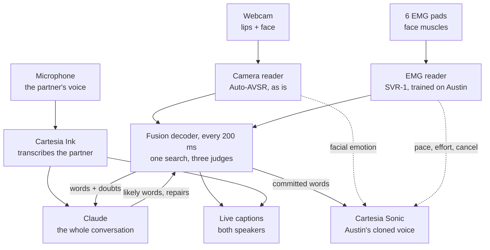
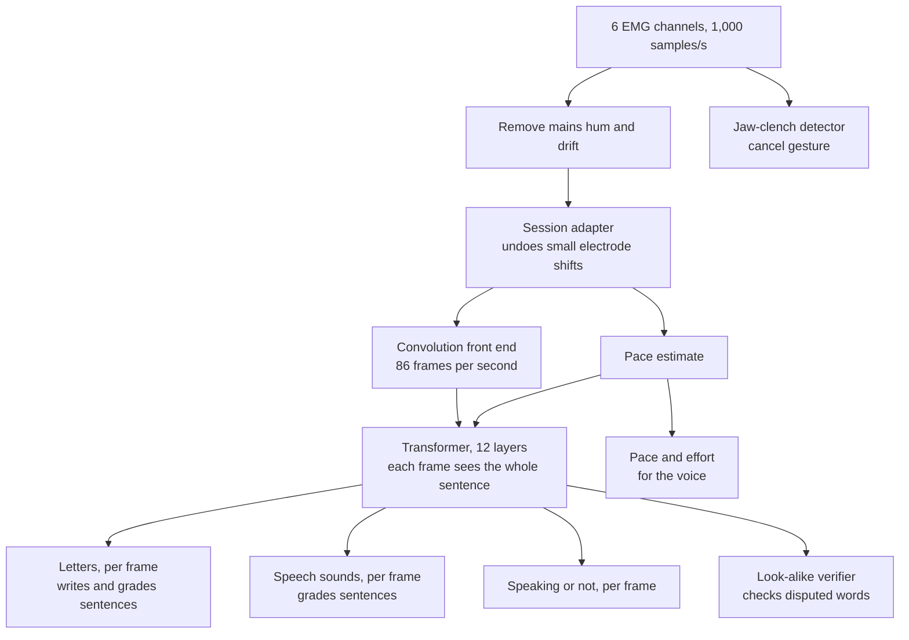
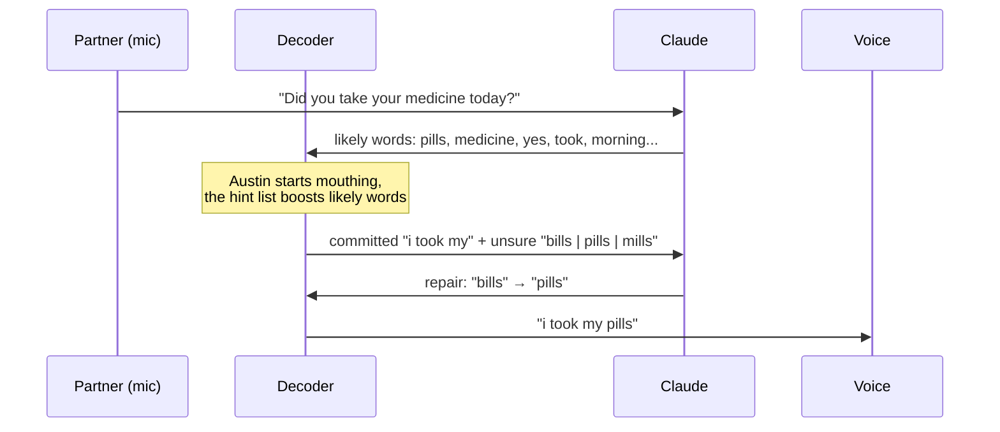

# How Reclaim works

Reclaim turns silently mouthed speech into live captions and a live voice. Austin mouths words with his mouth open and no sound; within about a second, the words appear on screen and play in his own cloned voice, with the emotion on his face. The people he talks to speak normally, and their words appear in the same captions. Everything runs on one laptop (RTX 5060, 115 W).

Three readers work together, because each one sees something the others cannot. The camera reads the lips. The EMG model reads the muscles under the skin. Claude reads the conversation. A decoder in the middle combines them several times a second, and Cartesia speaks the result.



## Why three readers

The camera does most of the work. A lip reader trained on thousands of hours of video (Auto-AVSR) already gets about four words in five right on normal video, it knows English well, and it sees word boundaries clearly. Its weakness is physics: many sounds look identical on the lips. "Bat", "mat" and "pat" all start with closed lips; "t", "d" and "n" all happen behind the teeth; "k" and "g" happen at the back of the mouth where no camera can see. It also struggles when the face turns, the light changes or the speaker talks fast.

The EMG model reads electrical activity of the muscles that move the jaw, the lips, the chin and the floor of the mouth, which drags the tongue. That is exactly the information the camera lacks: what the tongue and jaw are doing. On its own, EMG is a noisier reader than the camera, but it disagrees with the camera in the right places. On our Berkeley benchmark, an EMG model picks the true sentence out of ten lip look-alikes 84 to 89% of the time.

Claude knows what makes sense. If the partner just asked "did you take your medicine?", then "pills" is far more likely than "bills", even though they look the same. Claude sees the whole conversation, both sides, and uses it to predict what Austin is likely to say next and to repair words that the other two readers got wrong.

None of these alone gives fast, accurate free speech. Together they cover each other's blind spots: the camera supplies the bulk of the words, EMG settles the look-alikes and keeps going when the face is hard to see, and Claude settles what both sensors leave ambiguous.

## Real time: reading while you speak

Auto-AVSR was built to read a finished sentence: it looks at the whole clip, forwards and backwards, before deciding. That is why existing lip-reading apps make you finish a sentence, then wait one or two seconds. We keep the model and change how we use it.

Every 200 ms, while Austin is still mouthing, we hand the model everything since he started the current sentence and let it read the whole thing again. Each pass sees a little more, so earlier guesses get firmer. A word that comes out the same on two passes in a row is committed: it turns from grey to black on screen and is sent to the voice. Reading the same few seconds again costs a few tens of milliseconds on the laptop GPU, so this repetition is affordable.

Here is what that looks like for "I want water":

```text
time   lips seen so far   this pass reads    screen (black = committed, grey = tentative)
0.2 s  "I w..."           "i"                i
0.4 s  "I want"           "i want"           i want
0.6 s  "I want wa..."     "i want what"      i | want what
0.8 s  "I want water"     "i want water"     i want | water
1.0 s  (pause)            "i want water"     i want water |
```

"What" turned into "water" one pass later, before it was committed: waiting for two passes to agree is what keeps the voice from saying wrong words. A sentence ends when the lips are still and the muscles are quiet for about half a second. At that point a slower, more careful final pass runs on the whole sentence and quietly fixes the captions.

We considered a model that is streaming by design (PyTorch's real-time Emformer recipe). It waits 0.8 s by design, its accuracy comes mostly from audio, which silent speech does not have, and it would need thousands of hours of video to retrain. Re-reading gets words out sooner with the model we already have.

## The camera reader

The camera reader is Auto-AVSR's visual model, used as is: no recording, no fine-tuning. For every webcam frame, MediaPipe finds the face and 478 landmarks, and we cut a 96×96 grey patch around the mouth, aligned the same way as the model's training data. A small image network turns each patch into a feature vector once, as the frame arrives. Every 200 ms, the model's 12-layer Conformer reads all feature vectors of the current sentence and outputs, for each video frame (25 per second), how likely each word piece is. Those per-frame probabilities, not just the camera's best sentence, go to the decoder.

The same MediaPipe pass gives 52 facial expression scores (brows, eyes, cheeks, smile). Because the mouth is busy forming words, the expression comes mostly from the upper face: raised brows, squinting eyes, cheek raise, a frown. Smoothed over about a second, these become the emotion tag that Cartesia applies to the voice. The mouth landmarks also give a cheap signal of whether Austin is mouthing at all.

Evan's step-by-step plan for this part is in [EVAN_WORKFLOW.md](EVAN_WORKFLOW.md).

## The EMG reader: SVR-1, revised

SVR-1 is our EMG model. It reads the six electrode channels at sites 1, 2, 3, 5, 6 and 8 from Gaddy and Klein's layout: chin, under the chin, both cheeks, jaw, and the back of the right cheek. There is no throat pad.



The front end turns about a thousand voltage readings per second into 86 short "frames" per second, each a list of numbers describing what the face muscles are doing in that slice of time. The Transformer then lets every frame look at every other frame of the sentence, because whether a burst of muscle activity is an "m" or a "b" depends on what comes before and after it, just as in hearing. A small adapter at the start learns how today's electrode placement differs from yesterday's, so a minute of calibration on demo day refits only that.

The model's outputs, per frame:

- **Letters.** Like the camera, SVR-1 gives the probability of each letter at each frame. That lets it do two jobs: propose its own guesses at the sentence, and grade any sentence someone else proposes. Grading is the important job: for "grab the bat" versus "grab the mat", the EMG model says how well each version fits the muscles it measured.
- **Speech sounds** (phonemes). Muscles make sounds, not spellings, so grading by sound as well as by letter is sharper.
- **Speaking or not.** Muscles fire a few tens of milliseconds before the lips visibly move, so EMG notices the start of speech first, and it notices the end reliably even when the lips pause mid-word. That lets the system start a sentence sooner and end it without waiting long.
- **The look-alike verifier.** Given the few candidate sentences the decoder is unsure between, it looks only at the words they disagree on and scores those against the muscle signal. Words everyone agrees on cannot drown out the one word that matters.
- **Pace and effort.** How fast Austin is articulating, and how hard his muscles work, pass to Cartesia as the voice's speed and volume, so the voice follows the rhythm and emphasis of his mouthing. Nothing else in the system can sense effort.
- **Cancel.** A deliberate jaw clench lights up the jaw sites (5 and 8) far more strongly than speech does. Holding a clench for half a second stops the voice and marks the sentence for repeating. This gives the speaker control over what plays, instead of confirming every sentence before it is spoken.

Compared with Gaddy and Klein's model, which only writes letters for open-mouth speech recorded with 8 electrodes in a lab, SVR-1 is built for this job: it runs on our 6 sites, it is trained to grade the camera's look-alike guesses (it practises picking the true sentence out of lip look-alikes during training), it is trained on sped-up and slurred signals so it holds up at natural speed, and it gives the same answer whether it reads a whole sentence or a partial one.

The closed-mouth mode, the fixed-phrase classifier and the "none" class from the earlier plan are gone: the demo is open-mouth only.

### How SVR-1 learns

SVR-1 first learns silent speech in general from 19 hours of Berkeley recordings: one speaker, 8 electrodes, open mouth. During that pretraining it also predicts tongue, lip and jaw positions computed from the audio of the voiced recordings, which teaches it the physics of speech. It sees signals that are sped up, slurred, filtered like our amplifier and missing channels, so that our rig and Austin's pace are not a surprise. Halfway through, it starts practising the grading job: for each training sentence it scores the true sentence against lip look-alikes and is rewarded when the true one wins.

Because the live system reads partial sentences, SVR-1 also practises on beginnings of sentences, cut at random points with the matching beginning of the text. Then it is fine-tuned on Austin: about 75 minutes of him mouthing varied sentences with the camera recording at the same time.

There is no need for 50 repetitions of 10 fixed sentences any more; that was only for the closed-mouth phrases. Free speech needs many different sentences, not many repetitions of a few. The recording plan is in [PLAN.md](PLAN.md#recording-session).

## The fusion decoder: one search, three judges

The decoder writes the sentence from left to right and keeps the best few drafts, typically 8 to 16. Each time it considers extending a draft by a word piece, it asks three questions and adds up the answers:

1. The camera: how well does this draft match the lips seen so far?
2. The EMG model: how well does it match the muscles?
3. The language side: is this a likely thing to say here? A small word-level language model answers instantly, and Claude's list of likely words for this moment adds a boost.

The camera and the EMG model each grade every draft as it grows, not just at the end, so a word the camera ranked fifth can still win if the muscles clearly favour it. Two extra sources feed the drafts: SVR-1's own guesses, and look-alike expansion. Whenever a draft finishes a word, the decoder also tries the words that look identical on the lips ("bat" → "mat", "pat"), so that the right word is in the race even when the camera never thought of it.

How much each judge counts changes from moment to moment. A small gate looks at how confident the camera is, whether the face is clearly visible, how clean the EMG signal is and how fast Austin is going, and sets the weights. When he turns his head or covers his mouth, the camera's weight drops and EMG carries the captions; if an electrode peels off, EMG's weight drops and the camera and Claude carry on.

The decoder runs every 200 ms on the latest outputs of both readers and publishes the drafts, the committed words, and, for each recent word, how confident it is and what the alternatives were.

## Claude: the conversation brain

Claude follows the whole conversation: the partner's words, transcribed by Cartesia Ink, and Austin's words as the decoder commits them. Claude works next to the fast loop, never inside it, so a slow reply can delay a repair but never the captions.



Claude does two jobs:

- **Predict.** Whenever the partner finishes a sentence, and every couple of seconds while Austin talks, Claude returns the words and short phrases Austin is likely to use next. The decoder gives them a small boost. This costs no waiting: the list is ready before Austin starts mouthing.
- **Repair.** Each time words are committed, the decoder sends Claude the last few words with the alternatives it considered and how sure it was. Claude may swap a word only for one of those alternatives or a lip look-alike, never add or reword ideas, and answers "please repeat" when it cannot tell. The reply is a short structured list of edits.

To give repairs time to land, the voice speaks committed words about 0.6 s after they are committed. Most repairs arrive within that window and change the word before it is spoken. A repair that arrives later fixes the captions only, with the change highlighted, so the judges see exactly what Claude did. The window is a single setting: shorter means a faster voice, longer means Claude catches more mistakes before they are spoken.

Claude runs through the Claude API (`claude-opus-5-5` at low effort as the default; the team can switch to `claude-haiku-5-5` if measured latency calls for it). The rules and the conversation so far form a prefix that stays the same from call to call, so prompt caching keeps each call fast and cheap; only the newest words are new input.

## The voice

Frank's part. The voice is Cartesia Sonic 3.6 with an Instant Voice Clone of Austin, made from his own recordings with his consent. For each sentence the system opens one streaming context on Cartesia's WebSocket and sends words as they clear the repair window, marking each input as "more to come" so that the prosody flows across the pieces. Speed, volume and emotion go through `generation_config`: speed and volume from SVR-1's pace and effort, emotion from the camera's facial expression. Cartesia Ink transcribes the partner's microphone, and those words go to the captions and to Claude.

## Delays, end to end

These are design estimates for the RTX 5060; every one gets measured on the laptop.

| Step | Time |
| --- | --- |
| Face, landmarks and mouth crop, per frame | about 5 to 10 ms |
| Camera re-read of the current sentence, per 200 ms tick | about 15 to 40 ms |
| SVR-1 re-read, per tick | about 5 to 10 ms |
| Decoder, per tick | about 5 to 15 ms |
| Word on screen (grey) after it is mouthed | about 0.3 s |
| Word committed (black) | about 0.5 s |
| Repair window before speaking | 0.6 s (adjustable) |
| First audio from Cartesia | a few tenths of a second |
| Voice behind the mouth | about 1.0 to 1.4 s |

A sentence-at-a-time lip reader only starts speaking after the whole sentence is done, plus one or two seconds of decoding. Reclaim speaks while the sentence is still being mouthed, like a simultaneous interpreter.

## What we train, and what we don't

- **SVR-1:** pretrained on Berkeley's data on the H100/H200 cluster, then fine-tuned on Austin.
- **The decoder's weights and gate:** tuned in minutes on Austin's recordings, where camera, EMG and the true text are all known. This is how the three readers are trained to work together, without retraining the camera or Claude.
- **Auto-AVSR:** used as is.
- **Claude:** prompted, not trained.
- **Cartesia:** a voice clone from Austin's voice sample.

## When something fails

If the EMG rig fails, the gate drops EMG and the system runs on camera and Claude, which is the original free-speech plan. If Claude is slow, repairs reach the captions late but the voice keeps flowing. If streaming voice glitches, the voice falls back to speaking whole sentences at the end. If the face leaves the camera, EMG keeps captions alive for a while, and the screen says when it is guessing.
