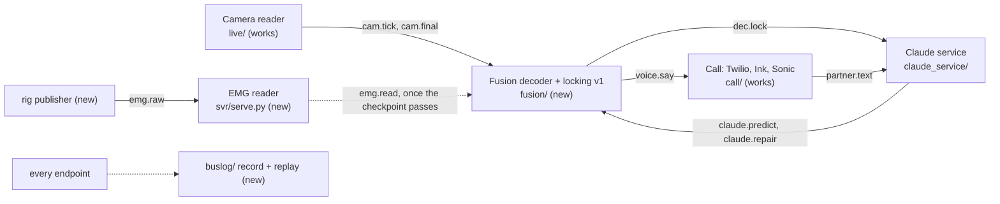

# Build plan: from today's code to the demo

Written 2026-10-24, about 30 hours before we present. The spec is [REALTIME_PIPELINE.md](REALTIME_PIPELINE.md); this
file says what is left, in what order, and what we drop if we run late. Every claim is tagged: **[ran]** checked by
running something, **[code]** read in the code, **[assumed]** not checked. "ASK" marks what only a person can answer.

## The plan on one page

The middle of the pipeline did not exist on Oct 24: nothing produced `dec.*` or `voice.say`, and nothing put
`emg.raw` on the bus [ran]. Both ends work on their own: the camera reader (`lipread/`, merged in #11) and the call
(`call/`: Twilio, Ink, Sonic, 23 tests) [ran]. So the first goal is one path through the middle, camera first, EMG
joining through its own reader process:

Critical path: **bus → decoder v1 → first end-to-end call → replay of sessions 1 and 2 → lock model fit → session
3 metrics → rehearsal.** EMG joins the decoder only if a 4-channel SVR-1 checkpoint helps on replay; the demo does
not wait for it.

| When | Milestone | Done when |
| --- | --- | --- |
| T-30h to T-24h | Shared bus (`bus/`), decoder + locking v1, logger + replay, `emg.raw` publisher, Claude service on the bus (done in code, this PR) | Unit tests pass with fake publishers; a logged fake session replays (done) |
| T-24h to T-18h | First live call on the laptop: camera → decoder → Claude → Sonic → Twilio | A teammate as the judge hears 5 mouthed sentences; latency in the log |
| T-18h to T-12h | Sleep in shifts. Replay sessions 1 and 2 through the decoder; fit lock weights and threshold | WER and mouth-to-lock on sessions 1 and 2 beat the hand-set weights |
| T-12h to T-8h | EMG joins, only if SVR-1 4-ch is ready and helps on replay; dashboard on real topics | WER with EMG ≤ without it on sessions 1 and 2 |
| T-8h | **Code freeze.** Record session 3 in demo conditions, on battery | Session 3 logged; never trained on |
| T-8h to T-4h | Metrics on session 3; failure drills; README setup steps | The numbers table below filled in |
| T-4h to T-0 | Rehearse the 2-minute call 3 times; charge with the Uno unplugged | 3 clean runs in a row |

**Cut line.** If behind at T-12h: drop EMG from the decoder (the fallback CLAUDE.md protects) and the dashboard's EMG
traces. At T-6h: drop the learned lock model (keep the hand-set weights) and pace/effort. At T-2h: drop live Claude
repairs (predictions only) and emotion. Never cut: camera → decoder → voice into the call, "Please repeat", logging.

**Owners.** Austin: decoder and locking sign-off, lock model fit, SVR-1, session 3. Evan: camera reader on the
laptop, `laptop_check.sh` on battery. Frank: call, voice clone, dashboard on real topics. Thai: rig publisher,
Claude service, prompt tuning on replayed logs. Agents write code against the contract below; one integrator
(Austin) merges.

## Where the code stands (Oct 24)

| Part | Status | Evidence |
| --- | --- | --- |
| Rig reader, `rig/filters.py` | works on the rig, untested here | `rig/reader.py`, `rig/filters.py:15` [code] |
| `emg.raw` on the bus | built: `rig/publish.py`; tested on fake chunks, not yet on the rig | `tests/test_rig_publish.py` [ran] |
| SVR-1 preprocessing | causal since #13 (`rig/filters.py` in order); `filtfilt` is left only in the `gaddy` baseline path | `svr/preprocess.py` [code] |
| SVR-1 on 4 channels | pretrained `SVR1_4ch` (Berkeley, epoch 107): WER 78.1 % greedy, homophene-10 72.3 %, phrase ID 96.0 %; not yet fine-tuned on Austin (recordings are on his laptop) | `checkpoints/NIGHT_REPORT.md` [ran] |
| Live EMG reader | built: `svr/serve.py` (`emg.read`, gap fill, reset on a pulled Uno, channel quality, calibration), `fusion/emg.py` (word support, look-alike settling, pace/effort); `SVR1_4ch` reads in 11 to 15 ms (2 to 8 s window) on the 5090, 160 ms on CPU, so it needs the GPU | `tests/test_svr_serve.py`, `tests/test_fusion_emg.py`, `svr.infer --bench` [ran] |
| `svr/infer.py` | built: replays recordings through the live reader into a buslog log for `fusion.evaluate --decode --emg` | `tests/test_infer.py` [ran] |
| Camera reader | merged (#11, `lipread/`); laptop numbers missing | `tests/lipread` [ran] |
| Final pass (beam + LM) | about 1.1 s for a 7.7 s clip on the 5090, even at beam 3 | `live/MEASURED.md` [ran] |
| Fusion decoder, locking v1 (camera only, EMG hook) | built: `fusion/`; 0.3 ms per pass on a 200-frame tick; end to end over real processes with a fake camera | `tests/test_fusion.py` [ran] |
| Claude service | built on the shared bus; tested with a fake client, not yet against the live API | `tests/smoke_claude_service.py` [ran] |
| Call: Twilio, Ink, Sonic | works with fakes; outside git | `tests/call` 23 passed [ran] |
| Dashboard | prototype on sample data; outside git | `demo/dashboard/README.md` [code] |
| Logger, replay, offline scorer | built: `buslog/`, `fusion/evaluate.py` | `tests/test_buslog.py`, `tests/test_evaluate.py` [ran] |
| Recorder | merged to main with the delivery styles (#10) | `git log origin/main` [ran] |

Code that must move into the repo (CLAUDE.md: all code lives in this repo): `call/`, `tests/call/`, `demo/dashboard/`,
`scripts/setup_envs.sh`. `call/config.py` still defaults to `ipc://`, which doesn't work on Windows: it must move to the
TCP ports in the Interfaces table.

**The EMG checkpoint, and when it joins.** Fine-tune `W_svr1` from `SVR1_4ch` (better than `SVR1_4ch_artic` at
look-alikes, which is EMG's job here) on sessions 1 and 2 on the 5090:
`python -m svr.finetune --name W_svr1 --init-from $RECLAIM_WORKDIR/checkpoints/SVR1_4ch/model.pt`. It joins the demo
only if session 3's judge top-1 is clearly above chance **and** `fusion.evaluate --decode --emg` (from
`svr.infer`) gives WER with EMG ≤ without, on sessions 1 to 3; otherwise run `fusion.run --no-emg`. This gate matters:
an end-to-end run with a random model showed bad EMG flipping look-alikes ("please" → "place"), because a lexicon
look-alike is always camera-tied, so EMG decides it [ran].

## The hard problems, decided

Each quotes the spec where it decides, and proposes where it is silent. Proposals need the owner's sign-off.

1. **Joint search over two models with different units.** The spec: camera and EMG grade every draft as it grows
   (REALTIME_PIPELINE.md, "The fusion decoder"). Proposal (Austin): v1 decodes camera greedy CTC into words and
   scores each word, not each piece. EMG joins at the word level: for each word span (camera frame times → EMG
   frames on the shared clock), SVR-1 scores the word and its look-alikes with its letter CTC over that span. This
   avoids aligning SentencePiece at 25 fps with letters at 86 fps inside one beam. Risk: a word the camera never
   proposed can only enter as a look-alike or a Claude prediction.
2. **Stable words across passes.** The spec is silent. v1: align each pass's words to the previous pass (difflib)
   and count unchanged passes; locked words are a pinned prefix that later passes cannot rewrite.
3. **Word finished, sentence ended.** The spec: the decoder moved on, the lips pause or the muscles go quiet; a
   sentence ends after about 0.5 s still. The camera reader already ends a segment after 0.5 s without mouthing and
   caps at 8 s with a 2 s overlap (`live/bus_schema.md`), so v1 uses segment end, and EMG quiet later.
4. **Lock model data.** The spec: every word on every pass is an example. Replaying a session through the decoder
   regenerates every pass's ingredients, so the logger only needs the inputs (`cam.*`, `emg.raw`, `partner.text`)
   and the prompt shown. The recorder stores each clip's video with per-frame `bus.now()` (`time.perf_counter()`) stamps
   (`recorder/README.md`), and the camera reader already replays a recorded clip on its own clock
   (`live/run.py --replay`, `live/source.py:resolve_recording`) [code]. So a session becomes training data by
   running the camera reader over each clip into the logger, then replaying that log through the decoder and
   scoring `dec.lock` against the manifest's prompt (`fusion/evaluate.py`).
5. **Claude timing.** The spec: 0.3 s repair window; later repairs fix captions only. Claude Opus at low effort may
   take longer than 0.3 s; measure p50/p95 on the first live call. If p95 > 0.3 s, repairs become captions-only fixes
   and the window stays 0.3 s (voice speed comes first).
6. **GPU and battery.** Every number in the "Delays" table is an estimate until measured on the RTX 5060 on battery.
   Evan runs `python -m lipread.bench.laptop_check` and `python -m lipread.bench.tick_bench` on battery first thing,
   and Austin `python -m svr.infer --ckpt ... --bench` alongside (SVR-1 shares the GPU).
7. **One clock.** Everything is `bus.now()` (`time.perf_counter()`, precise on Windows) on the laptop: camera
   `frame_t`, EMG `t0` per batch, and the logger's receive time. Drift check: the replay compares `t_pub` with receive time.
8. **Phone, emotion, limits.** Twilio and Sonic both use μ-law 8 kHz, so there is no conversion (`call/README.md`).
   Frank found that Sonic ignores `generation_config` changes inside a context but honours inline
   `<speed>/<volume>/<emotion>` tags; Cartesia's build rule asks for `generation_config`, so use it per sentence and
   the tags only per word. ASK Frank: does the face's label set match Cartesia's emotions? Claude spend over
   rehearsals: ASK Thai to check the rate limit tier.

## Interface contract (frozen for the agents)

- One bus package, `bus/`: ZeroMQ PUB/SUB on the loopback, msgpack, numpy as `{'nd': 1, dtype, shape, data}`, plus
  `v`, `seq`, `t_pub`. `bus` itself is the camera's (`bus/schema.md`); `bus.team` carries every other topic on the
  same wire format and checks `cam.*` with `bus.validate`.
- One TCP port per producer, each overridable by `RECLAIM_<NAME>_PUB`: `emg` 5555, `cam` 5556, `dec` 5557, `claude`
  5558, `call` 5559, `svr` 5560 (topics in the Interfaces table of
  [TEAM_TASKS_AND_INTERFACES.md](TEAM_TASKS_AND_INTERFACES.md)).
- `voice.say` `pace` and `effort` are relative to normal: 1.0 is Austin's usual rate and effort; from EMG when a fresh
  `emg.read` exists, 1.0 otherwise.
- Tests use `inproc://`, a free loopback port or a temporary folder, never the real endpoints.

## Numbers to show (Anthropic track)

| Metric | From |
| --- | --- |
| WER on session 3: camera, camera + EMG, camera + EMG + Claude | replay of session 3 with each reader on or off, vs the prompts |
| Mouth-to-lock, mouth-to-audio | `cam.tick` frame times → `dec.lock` → `voice.say` → `timing.call` |
| Please-repeat rate | `dec.repeat` per sentence |
| First-try understanding | rehearsal calls: did the judge answer without asking again (by hand) |

## Failure drills (before rehearsal)

Pull the Uno: captions go on from the camera. Cover the mouth: "Please repeat", no guess. Turn off Wi-Fi to Claude:
the voice keeps flowing, no repairs. Kill the Sonic stream: the call service reconnects or speaks whole sentences.

## Sponsor checks

- Anthropic: show raw and fixed text side by side; the 4 metrics above; quote a laryngectomee or speech therapist
  (ASK: who has talked to one?); mention Claude Code built it.
- Cartesia: Sonic 3.6, Instant Voice Clone with consent, Ink for the judge, `generation_config`, no Line SDK; README
  setup steps (missing); no keys committed.

## Pre-demo checklist

Battery full, charger unplugged with the Uno connected; signal check on all 4 channels; 1-minute calibration;
`ANTHROPIC_API_KEY`, Cartesia and Twilio keys in the environment; Twilio number and tunnel up; logger running.
