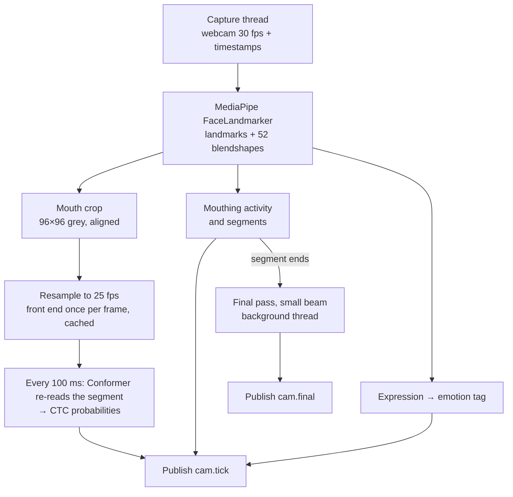

# Evan: real-time lip reading (the camera reader)

Your job: turn the webcam into a live stream of lip-reading probabilities, a "is he mouthing" signal and a facial-expression tag, every 100 ms, fast enough that words appear on screen within about 0.2 s of Austin mouthing them. You use Auto-AVSR as is: no recording, no training. Everything runs on Austin's laptop (RTX 5060, 8 GB). You can prototype on your MacBook (Lipflow was built for Macs and runs there), but timing and real tests happen only on Austin's laptop.

You do not decide the final words. You publish what the camera sees every 100 ms, and Austin's joint search combines it with EMG and Claude and decides when each word is confident enough to lock. Your part is a small separate program that publishes messages; Austin's joint search, Frank's dashboard and the logger subscribe to them.

How it fits: [REALTIME_PIPELINE.md](REALTIME_PIPELINE.md). Message formats shared with everyone: [TEAM_TASKS_AND_INTERFACES.md](TEAM_TASKS_AND_INTERFACES.md#interfaces).

## Start from code that already works

You don't start from zero. Two open-source projects in `calhacks2026/third_party/` already do most of the pieces:

- **[Lipflow](https://github.com/amywork777/lipflow)** (`third_party/lipflow`, MIT license). `lipflow/face.py` crops the mouth live with MediaPipe FaceLandmarker, reproducing Auto-AVSR's alignment. `lipflow/vsr.py` has `LipReader` with `encode(rois)` (the encoder), `greedy(enc)` (a ~1 ms CTC best path, which Lipflow already uses as a live preview while you are still talking), `beam_search(enc, nbest)`, `resample(timestamps, n)` to get a steady 25 fps, and `to_tensor` with the exact normalisation (crop 88 from 96, mean 0.421, std 0.165). Its app is macOS-only (`app.py` uses `objc`); reuse `face.py` and `vsr.py`, not the app.
- **[Chaplin](https://github.com/amanvirparhar/chaplin)** (`third_party/chaplin`). A real-time lip-reading demo on the same Auto-AVSR model, with MediaPipe. It shows the full model loading and config: `configs/LRS3_V_WER19.1.ini`.

Weights: the visual model `LRS3_V_WER19.1` and the subword language model `lm_en_subword` (both on Hugging Face; `camera/download_weights.sh` in our main folder and Chaplin's `setup.sh` fetch them), and MediaPipe's `face_landmarker.task` (Lipflow's `scripts/download-models.sh`).

## Milestones

Each milestone ends with something you can show. Do them in order; E2 is the one everything else depends on.

### E0. Offline baseline (about 1 hour)

1. Set up a Python 3.11 or 3.12 environment on the laptop with CUDA PyTorch, MediaPipe and OpenCV.
2. Record a 5-second clip of yourself mouthing a sentence. Run Lipflow's `face.py` crops and `LipReader.encode` + `greedy` + `beam_search` on it.
3. Time `encode` for clips of 2, 4 and 8 s on the GPU in fp16 (`torch.autocast("cuda", dtype=torch.float16)`), after a warm-up run.

Done when: you get a sensible transcript, and you have the three encode times written down. They decide how long a segment can get before re-reading is too slow.

### E1. Live capture and mouth crops (about 2 hours)

1. A capture thread reads the webcam (Logitech C920) at 1920×1080, 30 fps, MJPG, and stamps every frame with `bus.now()` (`time.perf_counter()`, the team clock). Never block it. Recordings keep the full 1080p. The live reader shrinks each frame to 1280×720 before MediaPipe, so the mouth crop and Frank's emotion crop both come from the same 720p frame.
   - **Why 720p is enough:** the lip-reading crop is cut from a reference face whose eyes are 54 px apart, and the emotion classifier takes a 224 px face. At laptop distance, 720p gives roughly 70 to 100 px between the eyes, so both crops are already shrunk from it. Below about 60 px they would have to be enlarged, which is why 640×480 is too small.
   - **Why not process the full 1080p:** it adds about 2 ms of decoding and 2 ms of MediaPipe per frame on the dev box, for no gain.
2. Run MediaPipe FaceLandmarker in VIDEO mode on each frame with `output_face_blendshapes=True`. Lipflow's `face.py` gives the four anchors (eyes, nose base, mouth centre) and the crop.
3. Smooth landmarks causally. Auto-AVSR's offline crop code (`auto_avsr/preparation/detectors/mediapipe/video_process.py`, `crop_patch`) averages landmarks over ±6 frames, which needs future frames. Use an average over past frames only (for example an exponential moving average over the last 4 to 6 frames) so a crop is ready as soon as its frame arrives.
4. Keep a buffer of (timestamp, 96×96 grey crop, blendshapes, mouth landmarks).

Done when: a debug window shows the crop, it looks like Lipflow's offline crops (the mouth centred, same scale), and face + crop costs under 10 ms per frame.

### E2. The re-read loop (2 to 3 hours)

This is the core. Every 100 ms:

1. Take all crops of the current segment (see E4 for where a segment starts and ends), resample them to 25 fps with `LipReader.resample`, and encode the whole segment.
2. Compute the CTC log-probabilities per frame (`model.ctc.log_softmax(enc)`; blank is token 0).
3. Publish a `cam.tick` message: for every 25 fps frame, the 32 most likely tokens with their log-probabilities, the blank log-probability, the frame's timestamp, plus the greedy text for debugging. Format in [TEAM_TASKS_AND_INTERFACES.md](TEAM_TASKS_AND_INTERFACES.md#interfaces).

Why every frame's probabilities and not just the best sentence: the joint search needs to ask "how well does *this* sentence match the lips?" for sentences the camera did not rank first. That is how EMG and Claude can overrule a look-alike mistake.

Done when: a terminal shows the greedy text updating while you mouth, each pass's compute time is logged, and a second program can subscribe to `cam.tick` and print it.

### E3. Make it fast (about 2 hours)

Measure first, then cut the biggest cost:

1. fp16 for the whole encoder, `torch.backends.cudnn.benchmark = True`, model loaded once, and a warm-up encode at start-up.
2. Run the front end once per frame. The encoder starts with a 3D-convolution + ResNet front end that only looks at a frame and its two neighbours on each side. Run it on new frames as they arrive (two frames late, because of the look-ahead), cache the features, and on each tick run only the Conformer on the cached features. Inspect the loaded model (`print(model)`) to find where the front end ends; it is the part before the 12 Conformer blocks.
3. Cap a segment at about 8 s. If someone talks longer without pausing, start a new segment that keeps the last 2 s as context, and tell the joint search through the segment fields in `cam.tick`.
4. Run MediaPipe and the GPU work in different threads, so face tracking never waits for the encoder.

Target: under 40 ms per pass at the 95th percentile with an 8 s segment. The whole pass (your camera re-read, SVR-1 and the joint search) has to fit well inside 100 ms, and the GPU is shared, so the camera gets about 40 ms. Put per-pass timings in `cam.tick` as `timing_ms`: number of frames, MediaPipe, front end, Conformer, total. The logger records everything you publish, so every slow pass can be found later.

### E4. Mouthing activity and segments (about 1 hour)

1. Mouth opening per frame: inner-lip gap (landmarks 13 and 14) divided by face size (distance between the eyes), as in Lipflow's `FaceObs.mouth_open`.
2. Activity: how much the opening and the lip corners move over the last 300 ms. Publish it per frame (0 to 1).
3. A segment starts when activity rises, including the 300 ms before (people start moving before it shows), and ends after about 0.5 s of stillness. Austin's joint search also uses EMG to confirm starts and ends, but your segments decide what you re-read.

Done when: segments line up with sentences you mouth, and they don't trigger on blinks, nodding or chewing.

### E5. Facial expression → emotion tag (1 to 2 hours)

1. Use the 52 blendshapes from E1. The mouth is busy forming words, so rely on the upper face: `browInnerUp`, `browOuterUpLeft/Right` (surprise, interest), `browDownLeft/Right` (anger, concentration), `eyeSquintLeft/Right` and `cheekSquintLeft/Right` (a real smile), `eyeWideLeft/Right` (surprise). Use `mouthSmileLeft/Right` only when it is strong and lasts longer than a mouthed syllable.
2. Take Austin's neutral face during the first few seconds as the baseline, and score changes from it.
3. Map to a small set of labels that Cartesia supports (check the exact names with Frank), for example: neutral, happy, sad, angry, surprised. Smooth over about 1 s and require a label to win for 0.5 s before switching, so the voice doesn't flicker between emotions.
4. Publish the current label, its confidence and the raw scores in every `cam.tick`.

Done when: smiling, raising eyebrows and frowning while mouthing each produce the right label, and a neutral face stays neutral.

Measured, and what changed (Frank, who owns the emotion tag): on real faces MediaPipe's `mouthFrown`, `noseSneer` and `browInnerUp` stay near 0, so the blendshape rules missed frowns and raised brows (Austin's session 1: 4 of 40 smile, frown and surprised sentences right). The tag now reads the face picture with HSEmotion, an open-source expression network (`lipread/expression.py`, Apache-2.0, about 7 to 11 ms per face on the CPU, on its own thread), plus a small head fitted on Austin's own delivery clips by `lipread/emotion_fit.py`. The baseline is the median of his face over the last 60 s, leaving out frames the network alone reads as a clear expression, since session 2 opened on raised brows. The head reads only HSEmotion's 8 scores, since the blendshapes did not carry across sessions. Each session scored by a head fitted on the other two: neutral 99%, happy 100%, sad 100%, surprised 95%, 2% of neutral sentences with a new wrong label. Steps 3 and 4 are unchanged: the label must win for its hold time, and `cam.tick` carries label, confidence and scores. Labels: neutral, happy (smile), sad (frown), surprised; Austin recorded no angry clips, so `angry` stays 0. The blendshape rules remain as the fallback when the model file is missing or the network fails.

### E6. Final pass at the end of a segment (about 1 hour)

When a segment ends, run Auto-AVSR's own beam search (beam 5, with the subword language model at Lipflow's weight) on the whole segment in a background thread, and publish the 5 best sentences with scores as `cam.final`. Austin's joint search uses it to polish the captions. It must never block the next tick.

### E7. Replay (about 1 hour)

Recording sessions use the separate recording tool (camera + EMG + prompts, built on Thai's `rig/` code), so you don't need a recording mode. Read its video format so replay accepts it.

1. `--replay FILE`: feed a recorded video through the same pipeline at real speed, as if it were the webcam. This lets the team test the full system on Austin's laptop without someone mouthing in front of it every time.

## Pitfalls

- **Use the model's exact preprocessing:** an aligned 96×96 grey crop, centre crop 88, `/255`, mean 0.421, std 0.165, at 25 fps. A wrong crop or frame rate costs more accuracy than anything else.
- **Mirroring:** run MediaPipe on the unmirrored frame. Flip only what you show on screen. Lipflow's eye indices assume an unmirrored frame.
- **Token text:** Auto-AVSR's word pieces mark word starts with "▁" and are uppercase. Send token IDs; Austin's joint search converts them.
- **Lighting:** light the face from the front; a window behind Austin will ruin the crops. Test in the demo room.
- **GPU sharing:** SVR-1 and the joint search share the GPU with you. Keep your own memory use reasonable (under about 2 GB) and log it.
- **Never block the capture thread.** A dropped or late frame becomes a gap in the lips the model sees.
- **First tick slowness:** CUDA kernels compile on first use; warm up with a dummy segment at start-up.

## What to send, and when

| When | What |
| --- | --- |
| End of E0 | The three encode times, and whether fp16 changes the transcript |
| End of E2 | A screen recording of live greedy text, plus the per-pass log |
| End of E3 | p50 and p95 pass times for 2, 4 and 8 s segments, on Austin's laptop |
| End of E5 | A short clip showing each emotion label switching |
| Any time | Anything in Lipflow or Auto-AVSR that does not match this plan |
