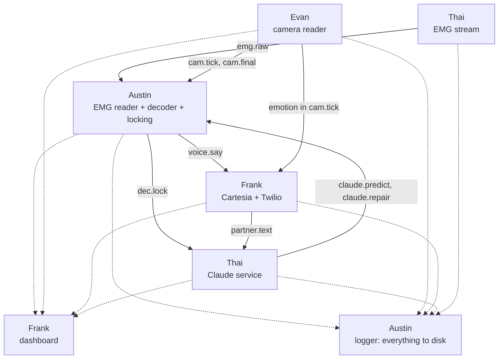

# Reclaim: the plan

One mode, open mouth, real time. Austin calls a judge through Twilio and mouths the whole conversation; the camera, the EMG model and Claude read it together every 100 ms; live captions show both sides; Cartesia speaks Austin's words into the call in his cloned voice, with his facial emotion, while he is still mouthing. Everything runs on Austin's laptop (RTX 5060, 115 W), with the lowest delay we can get at every step.

How it works: [ARCHITECTURE.md](ARCHITECTURE.md). What was decided: [DECISIONS.md](DECISIONS.md).

## The demo

The pitch is separate: Austin and Frank give it with their real voices. The product demo is a phone call.

1. Austin calls the judge, who is standing in front of us, through Twilio. The judge speaks normally into their phone; their words appear in the captions.
2. Austin answers only by mouthing: mouth open, no sound. His words appear on screen as he mouths, grey then black, and his cloned voice speaks them into the call while he is still going.
3. His facial expression changes the voice's emotion.
4. The dashboard shows the real latency, which reader settled each word, and what Claude changed.
5. If the system can't tell what he said, the screen says "Please repeat" rather than guessing.

Nothing is trained on the pitch or on a script: the judge can ask anything.

## Who does what

| Person | Owns |
| --- | --- |
| Evan | Camera reader: real-time Auto-AVSR every 100 ms, mouthing activity and segments, facial emotion ([EVAN_WORKFLOW.md](EVAN_WORKFLOW.md)) |
| Austin | SVR-1 training, live EMG reader, fusion decoder and confidence locking, logging and replay, integration |
| Frank | Cartesia (Austin's voice clone, Sonic streaming voice, Ink for the judge), the Twilio call, the captions dashboard |
| Thai | EMG rig (sites 1, 2, 3, 5, 6, 8) and its stream into the laptop, the Claude service (predict + repair) |

### Austin

1. Retarget SVR-1 to the rig's sites (input slots 0, 1, 2, 4, 5, 7). Drop the closed-mouth parts: the fixed-phrase head and closed-lips transfer.
2. Add the speaking-or-not output and partial-sentence training.
3. Train on the cluster: one full SVR-1 run plus a Gaddy-architecture baseline on the same 6 sites.
4. Live EMG reader: subscribe to `emg.raw`, filter, run SVR-1 every 100 ms, compute pace and effort.
5. Fusion decoder: the joint search over camera and EMG probabilities, with look-alike expansion, Claude's predicted words and the gate.
6. Confidence locking: compute the lock ingredients per word, train the lock model on sessions 1 and 2, and set the dynamic threshold from Claude's predictability.
7. "Please repeat" when the final pass still isn't confident, with the reasons in the debug log.
8. The logger, which subscribes to every topic and writes everything to disk, and a replay tool.
9. Fine-tune SVR-1 on sessions 1 and 2, and tune the decoder, gate and lock model; test everything on session 3.

### Evan

Follow [EVAN_WORKFLOW.md](EVAN_WORKFLOW.md). You can prototype on the MacBook (Lipflow was built for Macs), but timing and real tests run only on Austin's laptop.

### Frank

1. Instant Voice Clone of Austin, from his own recordings, with his consent.
2. Sonic 3.6 over the WebSocket: one context per sentence, words streamed in with "more to come" as they arrive on `voice.say`, `max_buffer_delay_ms` kept low. Speed, volume and emotion go through `generation_config`.
3. Twilio:
    - Austin's call to the judge, with a two-way audio stream to the laptop.
    - Cartesia's audio goes into the call; ask Cartesia for phone-format audio, or convert it.
    - The judge's incoming audio goes to Cartesia Ink, which publishes `partner.text`.
4. The captions dashboard:
    - captions for both speakers, with Austin's words grey until locked, then black;
    - Claude's edits highlighted, and a raw-vs-fixed panel;
    - a live latency meter;
    - "Please repeat" with the reason;
    - the EMG traces.

### Thai

1. Rig with sites 1, 2, 3, 5, 6, 8 and one REF per board, as in [HARDWARE.md](../HARDWARE.md).
2. Arduino firmware: 6 channels at 1 kHz, binary frames with a sync byte and a sample counter.
3. Laptop reader: parse the serial stream, stamp it with `time.monotonic()`, publish `emg.raw` every 10 ms.
4. Safety: a USB isolator between the Uno and the laptop, or the laptop on battery while pads are on skin.
5. The Claude service:
    - **Predict:** on every final `partner.text` and every ~2 s while Austin mouths, publish `claude.predict`: likely words and phrases, plus how predictable the next words are.
    - **Repair:** on each `dec.lock`, publish `claude.repair`.
    - **How it calls Claude:** `claude-opus-5-5` at low effort, structured outputs, prompt caching (rules and conversation kept as an append-only prefix).
    - **Prompt rules:** swap a word only for one of the alternatives given or a lip look-alike, never add ideas, answer "please repeat" when unsure.

## Interfaces

The parts run as separate small programs on the laptop and talk through ZeroMQ publish/subscribe over local sockets (`ipc://`), with messages encoded as msgpack (numpy arrays as raw bytes). A message takes well under a millisecond. All timestamps are `time.monotonic()` seconds on the same laptop.

| Topic | From → to | Rate | Main fields |
| --- | --- | --- | --- |
| `emg.raw` | Thai → Austin | every 10 ms | `t0`, `fs` = 1000, `samples` (n × 6, int16), `counter` |
| `cam.tick` | Evan → Austin, Frank | every 100 ms | `seg_id`, `seg_start`, `frame_t` (T), `topk_ids` (T × 32), `topk_logp` (T × 32), `blank_logp` (T), `greedy`, `activity` (T), `face_ok`, `emotion` {`label`, `confidence`, `scores`}, `timing_ms` |
| `cam.final` | Evan → Austin | at segment end | `seg_id`, `nbest` [{`text`, `score`}] |
| `dec.hyp` | Austin → dashboard | every 100 ms | `utt_id`, `locked` [words], `unlocked` [words], `confidence` per word, `source` per word (camera / EMG / Claude) |
| `dec.lock` | Austin → Claude, dashboard | on lock | `utt_id`, `words` [{`w`, `conf`, `alts`, `cam`, `emg`, `t`}] |
| `dec.repeat` | Austin → dashboard | at sentence end | `utt_id`, `reason` (which reader disagreed, confidences) |
| `claude.predict` | Claude → Austin | on judge line, ~2 s | `words` [{`w`, `weight`}], `phrases`, `predictability` (0 to 1), `ttl_s` |
| `claude.repair` | Claude → Austin, dashboard | on reply | `utt_id`, `edits` [{`index`, `from`, `to`}], `please_repeat` |
| `voice.say` | Austin → Frank | words leaving the repair window | `utt_id`, `words`, `final`, `pace`, `effort` |
| `partner.text` | Frank → Claude, dashboard | streaming | `text`, `is_final`, `t` |
| `timing.*` | everyone → logger | every event | the stage and its duration in ms |

Austin applies Claude's repairs before forwarding words on `voice.say`, so the voice never needs to know about Claude. The logger subscribes to every topic.

## Order of work

The system must work end to end early and get better, not work only at the very end.

| Block | Goal | Evan | Austin | Frank | Thai |
| --- | --- | --- | --- | --- | --- |
| 1 | Record + skeleton | E0, E1, E7 recording | Session 1; bus + logger; SVR-1 retarget; cluster runs start | Voice clone; Sonic speaks typed text | Rig for session 1; `emg.raw` live |
| 2 | Camera → voice, end to end | E2, E4 | Decoder on camera alone; locking v1 → `voice.say` | Streaming words in; Twilio call + Ink | Claude predict on real conversation |
| 3 | Session 2 + EMG joins | E3 | Session 2; fine-tune SVR-1; EMG into the decoder | Dashboard | Claude repair |
| 4 | Learn and tune | E5, E6 | Train the lock model and gate on sessions 1 and 2 | Emotion, pace, volume | Prompt tuning on logs |
| 5 | Test and rehearse | Replay tests | Session 3 in demo conditions; WER and latency on it | Full calls with a teammate as judge | Demo-room check of light and noise |

Fallback at every point: camera + Claude + voice works without EMG. If EMG isn't ready by the demo, that is what we show, and nothing else changes.

## Recording sessions

Prompts and procedure: `calhacks2026/recording_prompts/` (copies in [recording/](recording/)). All varied conversational sentences, mouth open, no sound, camera and EMG on one clock. The pads come off and go back on between sessions.

| Session | Sentences | Use |
| --- | --- | --- |
| 1 (now) | 250, the last 50 faster than natural | Training |
| 2 | 250, the last 50 faster than natural | Training |
| 3 (last, in demo conditions) | 100, at demo pace | Test only, never trained on |

Each session also includes about 2 minutes of rest clips (still face, swallow, nod, smile, and so on), which teach the model what is not speech. Sessions 1 and 2 take about 30 minutes each, session 3 about 12. A minute of calibration before the demo refits SVR-1's adapter.

## Training

1. **Pretraining (cluster):** SVR-1 on Berkeley's data, retargeted to the rig's 6 sites, with the Gaddy-architecture baseline on the same sites as the fallback and the comparison. Scripts and runbook are in `calhacks2026/cluster/`.
2. **Fine-tuning:** SVR-1 on sessions 1 and 2. It is small enough for the 5090 or the cluster.
3. **The decoder's weights, the gate and the lock model:** fitted on sessions 1 and 2.
4. **The test:** everything is measured on session 3.
5. **Auto-AVSR and Claude are not trained.**

## Numbers to show

These come from Anthropic's track brief:

- Word error rate on session 3 for camera alone, camera + EMG, and camera + EMG + Claude.
- Delay from mouthing a word to seeing it locked, and to hearing it (not counting the phone network).
- How often the system says "Please repeat".
- How often the judge understands on the first try.

## Still open

- **Which way to make the rig safe:** a USB isolator, or the laptop on battery while pads are on (decided: one of the two). Measure latency on battery if that is the choice.
- **Phone audio formats:** Frank confirms the exact format Twilio's audio stream needs from Cartesia, and what Ink accepts from it.
