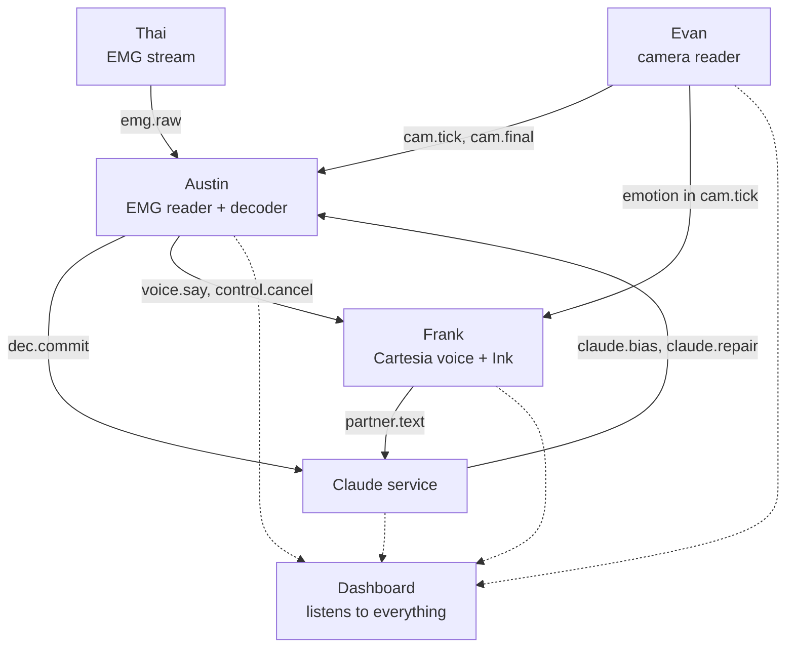

# Reclaim: the plan

One mode, open mouth, real time. Austin mouths; the camera, the EMG model and Claude read it together; live captions show both sides of the conversation; Cartesia speaks Austin's words in his cloned voice, with his facial emotion, while he is still mouthing. Everything runs on Austin's laptop (RTX 5060, 115 W). How it works: [ARCHITECTURE.md](ARCHITECTURE.md). Why it changed: [DECISIONS.md](DECISIONS.md).

## The demo

Two minutes at our table. Austin is the speaker; a teammate and a judge talk to him normally.

1. The judge asks Austin a question out loud. Their words appear in the captions (Cartesia Ink).
2. Austin answers by mouthing, mouth open, no sound. His words appear on screen as he mouths, grey then black, and his cloned voice speaks them about a second behind his lips.
3. He smiles or looks surprised: the voice changes emotion.
4. A look-alike gets fixed live, for example "bills" → "pills" after a question about medicine; the screen highlights what Claude changed and what EMG settled.
5. He clenches his jaw: the voice stops mid-sentence, showing that the speaker stays in control.
6. Close on the numbers: word error rate camera-only vs camera + EMG + Claude, and delay from mouth to voice.

## Who does what

| Person | Owns | First thing to deliver |
| --- | --- | --- |
| Evan | Camera reader: real-time Auto-AVSR, mouthing activity, facial emotion | Live greedy text from the webcam, publishing `cam.tick` ([EVAN_WORKFLOW.md](EVAN_WORKFLOW.md)) |
| Austin | SVR-1 training, live EMG reader, fusion decoder, integration | Fusion decoder running on camera alone, then with EMG |
| Frank | Cartesia: Austin's voice clone, Sonic streaming voice, Ink for the partner's mic, emotion/speed/volume; proposed: the Claude predict/repair service | Sonic speaking typed words word by word from `voice.say` messages |
| Thai | EMG rig (sites 1, 2, 3, 5, 6, 8), Arduino firmware, EMG stream into the laptop, electrical safety; proposed: the captions dashboard | `emg.raw` published at 1 kHz from the rig, with timestamps |

The two "proposed" items were not assigned in the team discussion; confirm them.

### Austin

1. Retarget SVR-1 to the rig's sites (input slots 0, 1, 2, 4, 5, 7) and drop the closed-mouth parts (fixed-phrase head, closed-lips transfer).
2. Add the speaking-or-not output and partial-sentence training.
3. Train on the cluster: one full SVR-1 run plus a Gaddy-architecture baseline on the same 6 sites. The ablation sweep is optional now.
4. Live EMG reader: subscribe to `emg.raw`, filter, run SVR-1 every 200 ms, and run the jaw-clench detector.
5. Fusion decoder: the joint search over camera and EMG probabilities, with look-alike expansion, Claude's hint list and the gate, plus the commit rule. Test it on replayed recordings first.
6. Recording session, fine-tuning on Austin, and tuning the decoder weights on the synchronised recordings.

### Frank

1. Instant Voice Clone of Austin, from his own recordings, with his consent.
2. Sonic 3.6 over the WebSocket: one context per sentence, words streamed in with "more to come", `max_buffer_delay_ms` kept low. Speed, volume and emotion go through `generation_config` (Cartesia's rule for this hackathon), and the exact emotion names go to Evan.
3. Cancel: stop the context instantly on `control.cancel`.
4. Ink streaming transcription of the partner's microphone, published as `partner.text`.
5. Proposed: the Claude service. On `partner.text` and every ~2 s it predicts likely words and publishes `claude.bias`; on each `dec.commit` it repairs and publishes `claude.repair`. It uses structured outputs and prompt caching (conversation prefix cached, append-only). Rules for the prompt: swap a word only for one of the alternatives given, never add ideas, answer "please repeat" when unsure.

### Thai

1. Rig with sites 1, 2, 3, 5, 6, 8 and one REF per board, as in [HARDWARE.md](../HARDWARE.md).
2. Arduino firmware: 6 channels at 1 kHz, binary frames with a sync byte and a sample counter.
3. Laptop reader: parse the serial stream, stamp it with `time.monotonic()`, publish `emg.raw` every 20 ms, and save to disk during recordings.
4. Electrical safety with everything on one laptop: see [HARDWARE.md](../HARDWARE.md#safety). This must be solved before pads go on skin.
5. Proposed: the dashboard. It shows captions for both speakers (grey/black), Claude's edits highlighted, a raw-vs-fixed panel, a live latency meter and the EMG traces.

## Interfaces

Every part runs as its own process on the laptop and talks through ZeroMQ publish/subscribe on `127.0.0.1`, with messages encoded as msgpack (numpy arrays as raw bytes). Each person can then build and test alone, and the dashboard can listen to everything. All timestamps are `time.monotonic()` seconds on the same laptop.

| Topic | From → to | Rate | Main fields |
| --- | --- | --- | --- |
| `emg.raw` | Thai → Austin | every 20 ms | `t0`, `fs` = 1000, `samples` (n × 6, int16), `counter` |
| `cam.tick` | Evan → Austin, Frank, dashboard | every 200 ms | `seg_id`, `seg_start`, `frame_t` (T), `topk_ids` (T × 32), `topk_logp` (T × 32), `blank_logp` (T), `greedy`, `activity` (T), `face_ok`, `emotion` {`label`, `confidence`, `scores`} |
| `cam.final` | Evan → Austin | at segment end | `seg_id`, `nbest` [{`text`, `score`}] |
| `dec.hyp` | Austin → dashboard | every 200 ms | `utt_id`, `committed` [words], `tentative` [words], `confidence` per word |
| `dec.commit` | Austin → Claude, dashboard | on commit | `utt_id`, `words` [{`w`, `conf`, `alts`, `t`}] |
| `claude.bias` | Claude → Austin | on partner line, ~2 s | `words` [{`w`, `weight`}], `phrases`, `ttl_s` |
| `claude.repair` | Claude → Austin, dashboard | on reply | `utt_id`, `edits` [{`index`, `from`, `to`}], `please_repeat` |
| `voice.say` | Austin → Frank | words leaving the repair window | `utt_id`, `words`, `final`, `pace`, `effort` |
| `control.cancel` | Austin → Frank, dashboard | on jaw clench | `utt_id` |
| `partner.text` | Frank → Claude, dashboard | streaming | `text`, `is_final`, `t` |

Austin applies Claude's repairs before forwarding words to `voice.say`, so the voice never needs to know about Claude.

## Order of work

The system must work end to end early and get better, not work only at the very end.

| Block | Goal | Evan | Austin | Frank | Thai |
| --- | --- | --- | --- | --- | --- |
| 1 | Skeleton | E0, E1 | Bus + message stubs; SVR-1 retarget; cluster runs start | Voice clone; Sonic speaks typed text | Rig + firmware; safety plan |
| 2 | Camera → voice, end to end | E2, E4 | Decoder on camera alone → `voice.say` | Streaming words in; Ink for the partner | `emg.raw` live; recorder |
| 3 | Recording session | E7 recording | Run the session | Claude predict/repair on real text | Run the rig in the session |
| 4 | EMG joins | E3, E5 | Fine-tune SVR-1 on Austin; EMG into the decoder; tune weights | Emotion + pace + volume; cancel | Dashboard |
| 5 | Rehearse | E6 | Measure WER and latency; fix | Polish voice timing | Demo-room test of light and noise |

Fallback at every point: camera + Claude + voice works without EMG. If EMG is not ready by the demo, that is what we show, and nothing else has to change.

## Recording session

Austin mouths with his mouth open and no sound, the camera and the EMG rig recording together on one clock. There are no closed-mouth recordings and no 50-repetition phrases.

| Set | What | Amount | Used for |
| --- | --- | --- | --- |
| C | Varied conversational sentences, at natural and fast pace | ~500 sentences, ~45 min | Fine-tuning SVR-1; tuning the decoder |
| D | Likely demo answers (introductions, answers to likely judge questions) | ~25 lines × 4, ~10 min | Demo robustness; Claude's hint list |
| E | Held-out sentences, never trained on | ~100, ~10 min | The honest numbers: WER camera-only vs fused, before and after Claude |
| B | Rest, swallowing, nodding, jaw clenches | ~5 min | The speaking-or-not output; the cancel gesture |

That is about 70 to 75 minutes of mouthing, split into two sessions with the electrodes taken off and put back in between, so that we know the model survives re-applying them. A minute of calibration before the demo refits SVR-1's adapter.

## Training

1. **Pretraining (cluster):** SVR-1 on Berkeley's data, retargeted to the rig's 6 sites, with the Gaddy-architecture baseline on the same sites as the fallback and the comparison. The cluster scripts and the runbook are in `calhacks2026/cluster/` (main folder, outside this repo).
2. **Fine-tuning:** on sets C and D, checked on E. It is small enough for the 5090 or the cluster.
3. **Decoder weights and gate:** fitted on sets C and D, where camera output, EMG output and the true text are all known; checked on E.
4. **Auto-AVSR and Claude are not trained.**

## Numbers to show

These come from Anthropic's track brief:

- Word error rate on set E for camera alone, camera + EMG, and camera + EMG + Claude.
- Delay from mouthing a word to hearing it, and from mouthing a word to seeing it.
- How often the system says "please repeat".
- How often the partner understands on the first try.

## Open questions

- **Electrical safety with one laptop** (USB isolator or battery-only): Thai decides, before pads go on skin.
- **Claude model:** `claude-opus-5-5` at low effort is the default; switch to `claude-haiku-5-5` if measured repair latency is too high. Decide after measuring.
- **Owners:** confirm who owns the Claude service and the dashboard.
- **Cartesia emotions:** which emotion names Cartesia accepts in `generation_config`, and whether emotion can change in the middle of a context (Frank).
