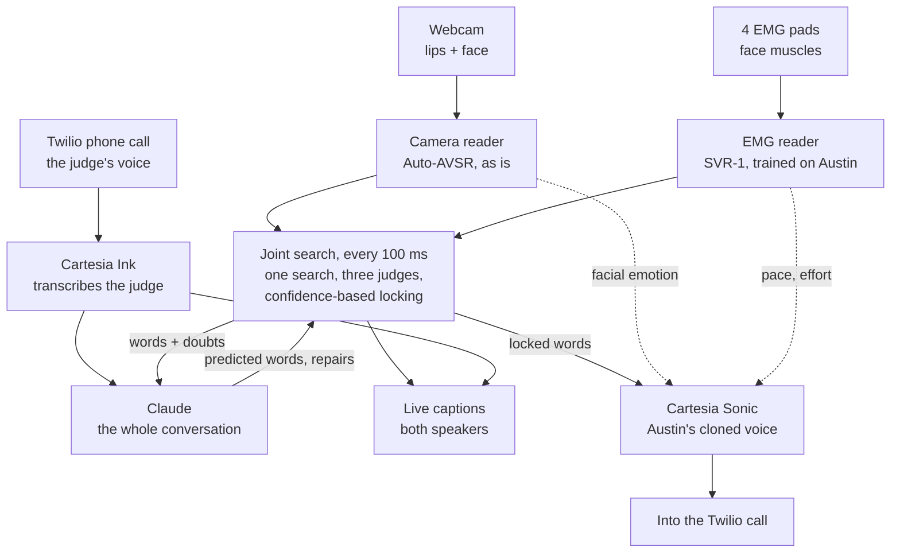
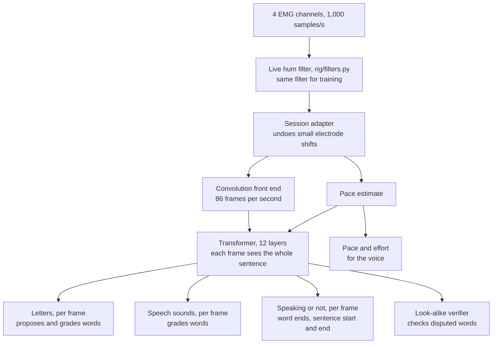
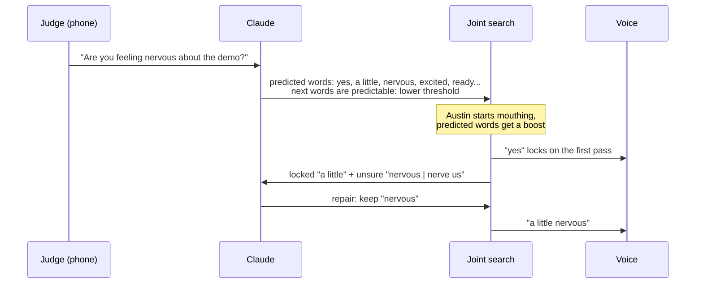

# Silent Voice's real-time pipeline

Silent Voice turns silently mouthed speech into live captions and a live voice. In the demo, Austin calls a judge on the phone (through Twilio). The judge talks normally; Austin only mouths, mouth open, no sound. His words appear on screen as he mouths them and play into the call in his own cloned voice, with the emotion on his face, while he is still mouthing. The judge's words, transcribed from the call, appear in the same captions. Everything runs on one laptop (RTX 5060, 115 W), and the goal at every step is the lowest possible delay.

Three readers work together, because each one sees something the others cannot. The camera reads the lips. The EMG model reads the muscles under the skin. Claude reads the conversation. Every 100 ms, one joint search in the middle combines them, and each word is locked in as soon as the three together are confident enough.



## Why three readers

The camera does most of the work. A lip reader trained on thousands of hours of video (Auto-AVSR) already gets about four words in five right on normal video, it knows English well, and it sees word boundaries clearly. Its weakness is physics: many sounds look identical on the lips. "Bat", "mat" and "pat" all start with closed lips; "t", "d" and "n" all happen behind the teeth; "k" and "g" happen at the back of the mouth, where no camera can see. It also struggles when the face turns, the light changes or the speaker talks fast.

The EMG model reads electrical activity of the muscles under the chin, which drag the tongue, and the muscles around the lips and chin. The pad under the chin matters most: it reads the tongue, exactly the information the camera lacks. On its own, EMG is a noisier reader than the camera, but it disagrees with the camera in the right places. On our Berkeley benchmark, an EMG model with 8 electrodes picks the true sentence out of ten lip look-alikes 88% of the time; with our 4 it will be lower, which is why it works as one of three readers rather than alone.

Claude knows what makes sense. If the judge just asked "how are you feeling today?", then "fine" is far more likely than "vine", even though the two look the same. Claude follows the whole conversation, both sides, and uses it to predict what Austin is likely to say before he starts mouthing, and to repair words the other two readers got wrong.

None of these alone gives fast, accurate free speech. The camera supplies the bulk of the words, EMG settles the look-alikes and keeps going when the face is hard to see, and Claude settles what both sensors leave ambiguous.

## Real time: re-reading every 100 ms

Auto-AVSR was built to read a finished sentence: it looks at the whole clip, forwards and backwards, before deciding. That is why existing lip-reading apps make you finish a sentence, then wait one or two seconds. We keep the model and change how we use it.

Every 100 ms, while Austin is still mouthing, we hand the camera model and the EMG model everything since he started the current sentence and let them read the whole thing again. Each pass sees a little more, so earlier guesses get firmer. Reading a few seconds again costs tens of milliseconds on the laptop GPU, so this repetition is affordable. The interval is a setting: if the laptop has room, it can go lower.

After each pass, every word that is not yet locked gets a confidence score, and a word locks as soon as its score crosses a threshold. Once locked, it turns from grey to black on screen and goes to the voice. A word can lock on its very first pass if the camera, EMG and Claude all agree strongly, or it can take several passes if they don't.

Here is what that can look like for "I want water", with a pass every 100 ms:

```text
time    lips seen so far    this pass reads    screen (black = locked, grey = not yet)
0.1 s   "I"                 "i"                i
0.2 s   "I w..."            "i"                i
0.3 s   "I wa..."           "i what"           i what
0.4 s   "I want"            "i want"           i | want
0.5 s   "I want w..."       "i want"           i want |
0.6 s   "I want wa..."      "i want what"      i want | what
0.8 s   "I want water"      "i want water"     i want | water
1.0 s   (pause)             "i want water"     i want water |
```

"I" locked at 0.4 s: the next word had started, so it was finished, and camera and EMG both supported it. "What" never locked, because it was still being mouthed: an unfinished word scores low by design, so the voice never says a word that is about to turn into another one.

## Locking: one confidence score per word

The decision to lock a word comes from one score, computed fresh on every pass. It combines:

- how strongly the camera's reading supports the word;
- how strongly the EMG reading supports it, and whether camera and EMG agree;
- how strongly Claude predicted it from the conversation (the camera and EMG must carry most of the weight, so Claude alone can never lock a word);
- whether the word looks finished: the joint search has moved on to the next word, the lips pause, or the muscles go quiet;
- how many passes the word has survived unchanged;
- signal quality: is the face clearly visible, are the electrodes clean.

These ingredients are not weighed by hand. A small model learns the weights from Austin's recordings, where the true sentence is known: every word on every pass becomes an example of "was this word right and final?". Sessions 1 and 2 give thousands of examples; session 3 checks the result on recordings it never saw.

The threshold moves with the conversation. When Claude finds the next words highly predictable (the judge asked a yes-or-no question, say), the threshold drops and words lock sooner; when anything could come next, it rises. Claude affects the threshold, and its predicted words feed the joint search's scores, but Claude's own share of the confidence is capped so its guess is never counted twice.

A sentence ends when the lips are still and the muscles quiet for about half a second. A slower final pass then reads the whole sentence once more, with Auto-AVSR's own careful search, look-alike checks and a Claude repair, and settles any word that never locked. If a word is still below the threshold after that, the screen says "Please repeat" instead of guessing, and the debug panel shows why: which reader disagreed and how confident each one was.

## The camera reader

The camera reader is Auto-AVSR's visual model, used as is: no recording, no fine-tuning. For every webcam frame, MediaPipe finds the face and 478 landmarks, and we cut a 96×96 grey patch around the mouth, aligned the same way as the model's training data. A small image network turns each patch into a feature vector once, as the frame arrives. Every 100 ms, the model's 12-layer Conformer reads all feature vectors of the current sentence and outputs, for each video frame (25 per second), how likely each word piece is. Those per-frame probabilities, not just the camera's best sentence, go to the joint search.

The same MediaPipe pass finds the face for the emotion tag. An open-source expression network (HSEmotion) reads the face picture, and a small head fitted on Austin's recorded smile, frown and surprised sentences turns its scores into neutral, happy, sad or surprised, measured against his own neutral face: the median of his face over the last minute, leaving out frames the network alone reads as a clear expression, so a smile at the start of the call doesn't become "neutral". Smoothed and held for about half a second (0.5 to 0.8 s, set by the fit) so it doesn't flicker, this becomes the emotion tag that Cartesia applies to the voice. The mouth landmarks also tell the system whether Austin is mouthing at all.

Evan's step-by-step plan for this part is in [EVAN_REALTIME_LIP_READING.md](EVAN_REALTIME_LIP_READING.md).

## The EMG reader: SVR-1, revised

SVR-1 is our EMG model; its exact design (layers, losses, training, the change list) is in [SVR1_SPEC.md](SVR1_SPEC.md), with the architecture figure. It reads four electrode channels at sites 3, 2, 6 and 1 from Gaddy and Klein's layout, their best four-electrode set: under the chin (the tongue), the left corner of the chin (lower lip and jaw), the right cheek below the mouth (lower lip) and the left cheek above the mouth (upper lip). There is no throat pad. We tried for six, but six pads don't sit cleanly on one face, and a noisy channel hurts the model more than a missing one, so four clean channels it is.



First, Thai's live filter removes the 60 Hz mains hum, its echoes and slow drift, sample by sample as they arrive. Every recording SVR-1 learns from, including Berkeley's, goes through the same filter in the same order, so the model sees exactly the signal it will see live. The front end then turns about a thousand voltage readings per second into 86 short "frames" per second, each a list of numbers describing what the face muscles are doing in that slice of time. The Transformer then lets every frame look at every other frame of the sentence, because whether a burst of muscle activity is an "m" or a "b" depends on what comes before and after it, just as in hearing. A small adapter at the start learns how today's electrode placement differs from the recordings', so a minute of calibration on demo day refits only that.

What SVR-1 contributes:

- **It proposes its own words and settles look-alikes, inside the same search as the camera.** SVR-1 gives the probability of each letter and each speech sound at every frame, so it can grade any sentence the joint search considers while the sentence is being built, not just afterwards. Its own best guesses join the drafts as well.
- **It finds the start and end of speech first.** Muscles fire a few tens of milliseconds before the lips visibly move, so EMG notices the start of a sentence first, notices when a word ends (which lets words lock sooner), and notices the end of a sentence reliably even when the lips pause mid-word.
- **It keeps captions going when the face is hard to see.** When Austin turns his head or something covers his mouth, the camera's confidence drops and EMG carries the decoding until the face is back.
- **It drives the voice's pace and loudness.** How fast Austin is articulating and how hard his muscles work pass to Cartesia as the voice's speed and volume, so the voice follows the rhythm and emphasis of his mouthing. Nothing else in the system can sense effort.
- **It tells Claude where the doubt is.** For each recent word, the joint search sends Claude how strongly camera and EMG supported it and which look-alikes competed, so Claude only touches the words that are actually uncertain.
- **The look-alike verifier.** Given the few candidates the joint search is unsure between, it looks only at the words they disagree on and scores those against the muscle signal, so words everyone agrees on cannot drown out the one word that matters.

Compared with Gaddy and Klein's model, which only writes letters for open-mouth speech recorded with 8 electrodes in a lab, SVR-1 is built for this job: it runs on our 4 sites, it is trained to grade the camera's look-alike guesses, it is trained on sped-up and slurred signals so it holds up at natural speed, and it gives the same answer whether it reads a whole sentence or a partial one.

The closed-mouth mode, the fixed-phrase classifier and the jaw-clench gesture from earlier plans are gone.

### How SVR-1 learns

SVR-1 first learns silent speech in general from 19 hours of Berkeley recordings: one speaker, 8 electrodes, open mouth. During that pretraining it also predicts tongue, lip and jaw positions computed from the audio of the voiced recordings, which teaches it the physics of speech. It learns on Berkeley's channels at our 4 sites, filtered by our rig's own filter, and it sees signals that are sped up and slowed down, slurred, softer and stronger, under a held smile, and filtered like our amplifier, so that our rig, Austin's pace and his expressions are not a surprise. Partway through, it starts practising the grading job: for each training sentence it scores the true sentence against lip look-alikes and is rewarded when the true one wins.

Because the live system reads partial sentences every 100 ms, SVR-1 also practises on beginnings of sentences, cut at random points with the matching beginning of the text.

Then it is fine-tuned on Austin, from three recording sessions of varied conversational sentences, with the camera recording at the same time. Nothing is trained on the pitch: the judge can ask anything. Sessions 1 and 2 (500 sentences) are for training; session 3 (100 sentences, never trained on), recorded last and in demo conditions, is the honest test. The pads come off and go back on between sessions, so the model learns to handle small shifts in placement.

## The joint search: one search, three judges

The joint search writes the sentence from left to right and keeps the best few drafts, typically 8 to 16. Each time it considers extending a draft by a word piece, it asks three questions and adds up the answers:

1. The camera: how well does this draft match the lips seen so far?
2. The EMG model: how well does it match the muscles?
3. The language side: is this a likely thing to say here? Our language model answers instantly, and Claude's list of predicted words for this moment adds a boost.

The camera and the EMG model each grade every draft as it grows, so a word the camera ranked fifth can still win if the muscles clearly favour it. Two extra sources feed the drafts: SVR-1's own guesses, and look-alike expansion. Whenever a draft finishes a word, the joint search also tries the words that look identical on the lips ("bat" → "mat", "pat"), so the right word is in the race even when the camera never thought of it.

How much each judge counts changes from moment to moment. A small gate looks at how confident the camera is, whether the face is clearly visible, how clean the EMG signal is and how fast Austin is going, and sets the weights. When he turns his head or covers his mouth, the camera's weight drops and EMG carries the captions; if an electrode peels off, EMG's weight drops and the camera and Claude carry on.

**The language model** is ours too, and it is built for a phone call, not a book. Gaddy and Klein's language model learned from audiobook text. Ours learned from 72 million words of everyday dialogue (film and TV subtitles and three chat datasets), with every sentence we recorded kept out. It finds our conversational sentences three times more predictable (perplexity 62 against 181) at a ninth of the size. On top of it sits a cache of the call itself: the judge's words from Cartesia Ink and Austin's locked words. A name or topic the judge just mentioned becomes likely at once, within the same 100 ms pass, while Claude, smarter but slower, adds its predictions every couple of seconds. It is the joint search's only language model: SVR-1 has none of its own, and the camera's own language model only runs in its end-of-sentence pass.

The joint search's output on every pass: the drafts, the confidence ingredients of every unlocked word, which words lock, and for each recent word the alternatives it considered.

## Claude: the conversation brain

Claude follows the whole conversation: the judge's words, transcribed from the call by Cartesia Ink, and Austin's words as they lock. Claude works next to the fast loop, never inside it, so a slow reply can delay a repair but never the captions.



Claude does two jobs:

- **Predict, before Austin mouths.** While the judge is still speaking, from Cartesia Ink's live transcript of their unfinished line, once more when the line is final (its last words can change the answer: "...nervous or excited?"), and again every couple of seconds while Austin talks, Claude returns the words and short phrases Austin is likely to use next, and how predictable the next words are. The predicted words get a boost in the joint search, and the predictability sets the locking threshold. This costs no waiting: the prediction is ready before Austin starts.
- **Repair.** As words lock, the joint search sends Claude the last few words with the alternatives it considered and how sure it was. Claude may swap a word only for one of those alternatives or a lip look-alike, never add or reword ideas, and answers "please repeat" when it cannot tell. The reply is a short structured list of edits.

A locked word waits a short repair window before it is spoken, 0.3 s by default, so that a quick repair can still change it. A repair that arrives later fixes the captions only, with the change highlighted. The window is a single setting: 0 gives the fastest voice, a longer window lets Claude catch more before words are spoken.

Claude runs through the Claude API, as `claude-haiku-5-5` with thinking off and low effort, chosen for speed: a call takes about 2 to 3 s (measured: predictions 2.1 to 3.5 s, repairs 2.0 to 2.3 s), where `claude-opus-5-5`, which always thinks first, took about 6 s. A repair that slow can't land inside the 0.3 s repair window, so repairs mostly correct the captions. The rules and the conversation so far form a prefix that stays the same from call to call, so prompt caching keeps each call fast and cheap; only the newest words are new input.

## The voice and the call

The voice is Frank's part. It is Cartesia Sonic 3.6 with an Instant Voice Clone of Austin, made from his own recordings with his consent. For each sentence the system opens one streaming context on Cartesia's WebSocket and sends the words that lock and clear the repair window as natural phrases, marking each as "more to come" so that the prosody flows across the pieces: a phrase goes when Austin pauses (his decoder shows no word being mouthed) or after about four words. A word sent alone would be said like a one-word sentence; phrases sound like a person talking, at his pauses, about a second behind his lips, which on a phone call sounds like ordinary speech. Speed, volume and emotion are set per sentence through `generation_config` and changed within a sentence through inline `<speed>`, `<volume>` and `<emotion>` tags: speed and volume from SVR-1's pace and effort, which arrive with every word as numbers relative to Austin's normal (1.0), and emotion from the camera's facial expression.

The audio goes straight into the Twilio call, so the judge hears Austin's voice on the phone. The call's incoming audio, the judge's voice, goes to Cartesia Ink, whose transcript feeds the captions and Claude. The phone network adds its usual delay in both directions, like any phone call; the dashboard shows the captions with the delay the system actually achieves.

## The error log

Everything is recorded, all the time, so any mistake can be traced afterwards. Every part already sends its output as messages on the laptop (ZeroMQ, well under a millisecond per message), so a logger simply listens to all of them and writes them to disk in the background, without slowing anything down. For every session it keeps:

- raw EMG and video;
- every pass's camera and EMG outputs;
- the joint search's drafts, scores and confidence ingredients;
- every lock decision;
- every Claude request, reply and delay;
- Cartesia and Twilio timings;
- the judge's transcript;
- the time each step took.

A replay tool plays any logged session back through the system exactly as it happened, so a bug can be reproduced without anyone mouthing in front of the laptop.

## Delays, end to end

These are design estimates for the RTX 5060; every one gets measured on the laptop, and the phone network adds its own delay on top.

| Step | Time |
| --- | --- |
| Face, landmarks and mouth crop, per frame | about 5 to 10 ms |
| Camera re-read of the current sentence, per 100 ms pass | about 15 to 40 ms |
| SVR-1 re-read, per pass | about 5 to 10 ms |
| Joint search and locking, per pass | about 5 to 15 ms |
| Word on screen (grey) after it is mouthed | about 0.15 to 0.2 s |
| Word locked (black) | as soon as the next word starts and confidence is reached, often within one or two passes |
| Repair window before speaking | 0.3 s (adjustable, 0 for fastest) |
| First audio from Cartesia | a few tenths of a second |
| Claude, per call (beside the loop, never in it) | about 2 to 3 s: predictions arrive after the judge's line, repairs after the word was spoken |

A sentence-at-a-time lip reader only starts speaking after the whole sentence is done, plus one or two seconds of decoding. Silent Voice speaks while the sentence is still being mouthed, like a simultaneous interpreter.

## What we train, and what we don't

- **SVR-1:** pretrained on Berkeley's data on the H100/H200 cluster, then fine-tuned on Austin's sessions 1 and 2.
- **The joint search's weights, the gate and the locking model:** fitted in minutes on sessions 1 and 2, where camera, EMG and the true text are all known; checked on session 3. This is how the three readers are trained to work together, without retraining the camera or Claude.
- **Auto-AVSR:** used as is.
- **Claude:** prompted, not trained.
- **Cartesia:** a voice clone from Austin's voice sample.

## When something fails

If the EMG rig fails, the gate drops EMG and the system runs on camera and Claude. If Claude is slow, repairs reach the captions late but the voice keeps flowing. If streaming voice glitches, the voice falls back to speaking whole sentences at the end. If the face leaves the camera, EMG keeps captions alive for a while, and the screen says when it is guessing. Whatever happens, the error log shows exactly what each part saw and decided.
