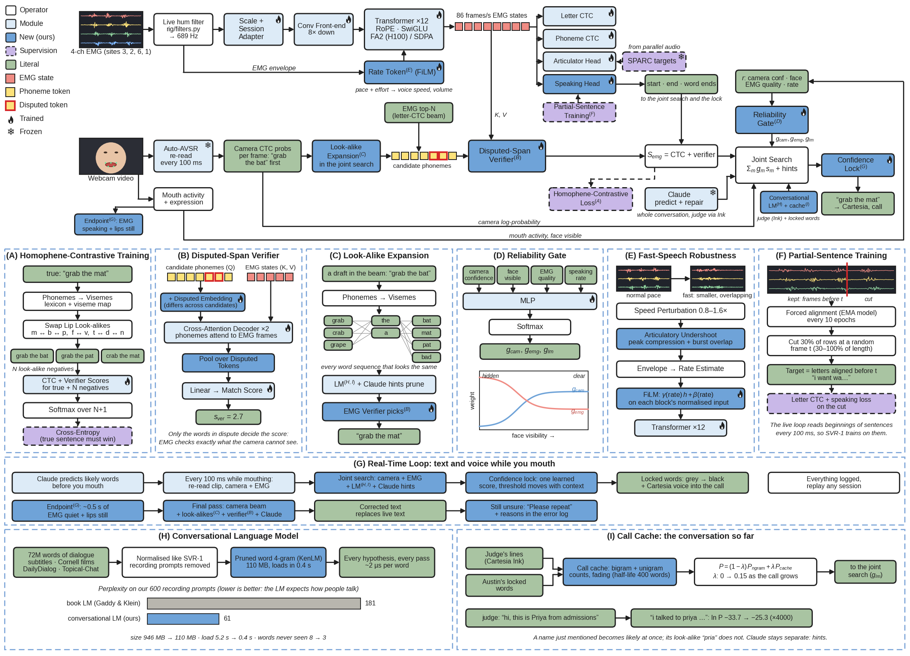
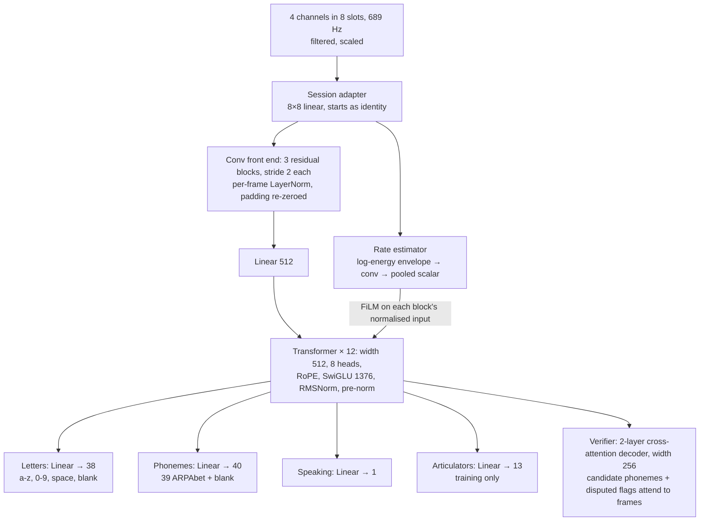

# SVR-1: engineering spec

SVR-1 is our EMG model: it reads 4 channels of face-muscle signals and, every 100 ms, gives the joint search per-frame letter and sound probabilities, a speaking-or-not signal, the speaking pace and effort, and a verifier that settles disputed look-alike words. This page specifies it precisely enough to implement: inputs, layers, outputs, losses, training, live use, and the models that sit on top of it (the joint search, its language model and the lock model). How it fits the whole system: [REALTIME_PIPELINE.md](REALTIME_PIPELINE.md).

The code is in `svr/` (model, training, fine-tuning, live wrapper), `bench/` (benchmarks), `cluster/` (H100/H200 jobs, [runbook](../cluster/RUNBOOK.md)) and `tests/`. It implements this design; the last section maps each part to its file. The joint search and the lock model (section 6) are not written yet; their language model is (`fusion/lm.py`).

**Terms used here.** The *joint search* is the pipeline's search, every 100 ms, over camera + EMG + language model + Claude's hints (`fusion/`). The *language model* (LM) is the conversational n-gram plus the call cache inside it (`fusion/lm.py`). The *fusion process* is the program that runs the joint search, the gate and the lock model. "Decoder" alone is kept for decoders inside neural networks: Auto-AVSR's attention decoder and the verifier's cross-attention layers.



The figure is drawn by `figures/make_architecture.py` (also as `figures/svr1_architecture.pdf`).

## 1. Input

**Electrodes.** 4 BioAmp EXG Pill channels at Gaddy and Klein's sites 3, 2, 6, 1 (their best 4-electrode set), read by the Uno at 1,000 Hz, 10-bit (0 to 1023). Rig columns arrive in pin order A0, A1, A2, A3.

**Channel slots.** The model has 8 input slots in Berkeley's channel order (slot = Gaddy site − 1), so Berkeley pretraining and our rig share one model. Our 4 channels go to slots 2, 1, 5, 0; the other 4 slots are zero and masked.

| Rig pin | Gaddy site | Where | Model slot |
| --- | --- | --- | --- |
| A0 | 3 | Under the chin | 2 |
| A1 | 2 | Left corner of the chin | 1 |
| A2 | 6 | Right cheek, below the mouth | 5 |
| A3 | 1 | Left cheek, above the mouth | 0 |

In code: `RIG_TO_SLOT = [2, 1, 5, 0]`, `KEEP = [0, 1, 2, 5]` (the existing `4ch` channel set in `bench/common.py`).

**Filtering: one filter everywhere.** Every EMG signal the model sees, live, in our recordings, and in Berkeley's pretraining data, goes through Thai's causal filter `rig/filters.py`: a 4th-order Butterworth high-pass at 20 Hz plus notches at 60, 120 and 180 Hz (Q = 10), applied with `scipy.signal.sosfilt` in time order, its state initialised from the first sample and carried across chunks. Never `filtfilt`. Berkeley's raw 1 kHz recordings are re-filtered this way and re-cached (`data/preprocessed_causal/`); Gaddy's original zero-phase notch and 2 Hz high-pass remain only for reproducing his released model.

Live, the filter has been running for minutes before anyone speaks. A recording starts cold, so the filter first runs over the recording's first second played backwards (it joins the recording with no jump), then over the recording itself. The 20 Hz high-pass and the notches settle in about 0.1 s. Filtering a clip in 10-sample chunks gives exactly the same output as filtering it whole.

**Resampling and frames.** As in Gaddy and Klein: linear resampling from 1,000 Hz to 689.06 Hz, then frames of 8 samples, so 86.13 frames per second (11.6 ms per frame).

**Scaling.** Our ADC counts and Berkeley's units differ, so each channel is scaled to Berkeley's level before the usual soft clip:

1. Per channel, the robust spread of the filtered signal (resampled to 689 Hz) over a session is `1.4826 × median(|x − median(x)|)`, computed over all of that session's clips (live: over the calibration minute).
2. Multiply channel *c* by `s_c = target_c / spread_c`, where `target_c` is the same statistic over all of Berkeley's filtered data for that site. Berkeley's own sessions are scaled the same way, each to the pooled target, so every session, Berkeley's or Austin's, reaches the model at the same level. The targets are in `data/svr1_targets/scale.json` and travel inside every checkpoint (`scale_target`), so fine-tuning and the live loop don't need the Berkeley data.
3. Then Gaddy's soft clip: `x / 20`, then `50 · tanh(x / 50)`.

The cache holds the filtered, resampled signal before scaling; the gain and soft clip are applied when it is loaded.

The session adapter (below) learns whatever difference remains.

## 2. Network



- **Session adapter:** an 8×8 linear map applied per sample, initialised to identity, with no weight decay; channel mask applied before and after it.
- **Conv front end:** 3 residual blocks, each a stride-2 1D convolution (kernel 3) + per-frame LayerNorm + GELU + a second convolution, with a 1×1 strided shortcut. 689 Hz in, 86 Hz out (8× down). Padding is re-zeroed after every block, so a clip gives the same output alone or in a batch, and a growing clip in the live loop gives stable outputs for the frames it already had.
- **Rate estimator:** per-frame log energy of each slot → two 1D convolutions → mean over valid frames → one number: the predicted speaking rate (normalised log letters per second).
- **Transformer:** 12 pre-norm blocks, width 512, 8 heads, rotary position embeddings, SwiGLU feed-forward (hidden 1376), RMSNorm, dropout 0.1, residual stream in fp32, matmuls in bf16. Attention never crosses utterances (key-padding mask). FlashAttention-2 with variable-length packing on H100/H200; PyTorch SDPA on the RTX 5090 and the laptop.
- **Rate FiLM:** in every block, a zero-initialised linear map turns the rate estimate into a scale and shift applied to the normalised inputs of the attention and feed-forward branches (adaLN style), never to the residual stream.
- **Size:** about 45M parameters. The reference speed for this size is the Gaddy-architecture model at 3.9 ms per 3 s clip on an H200; SVR-1 is a similar size and gets measured on the RTX 5060 (target: under 10 ms per pass for a 5 s window, fp16).

## 3. Outputs

| Output | Shape | Used for |
| --- | --- | --- |
| Letter log-probabilities | frames × 38 | Proposing words (CTC prefix search) and grading any candidate (CTC log-likelihood) inside the joint search; the space symbol marks word ends |
| Phoneme log-probabilities | frames × 40 | Grading candidates by sound (CTC log-likelihood), used only when every candidate has a pronunciation |
| Speaking probability | frames | Sentence start and end, word boundaries, gating the camera's activity signal |
| Rate | 1 per utterance | The voice's speed (`pace` on `voice.say`), and the gate |
| Effort | frames | Not learned: RMS of the filtered, scaled signal over 100 ms, normalised by the session's speaking median; the voice's volume (`effort` on `voice.say`) |
| Verifier score | 1 per candidate | Settling the few disputed words between close candidates |
| Articulator positions | frames × 13 | Training only: 12 tongue/lip/jaw trajectories + loudness from SPARC |

**Pace and effort for the voice.** `voice.say` carries both as relative numbers, 1.0 = Austin's normal, so the voice side never needs to know about EMG:

- `pace = exp(0.37 · z) / pace_ref`: z is the rate head's output (the z-score of log letters per second, so `exp(0.37 · z)` is the speaking rate relative to Berkeley's average), and `pace_ref` is its median over Austin's plain natural-pace clips (saved by fine-tuning, refreshed by the calibration minute).
- `effort = RMS over the last 100 ms / effort_ref`: `effort_ref` is the median of that RMS over the session's speaking frames (from fine-tuning, refreshed by calibration).

Effort is sent with every message, not once per sentence, so the voice can stress single words. Frank maps pace to Cartesia speed 0.6 to 1.5 and effort to volume 0.5 to 2.0. Sonic ignores `generation_config` changes inside a context but honours inline `<speed>`, `<volume>` and `<emotion>` tags, which is how a change reaches the middle of a sentence.

**Candidate score.** For candidate sentence *y*, SVR-1's score is

```latex
S_{emg}(y) = w_L \log P_{CTC}(y_{\text{letters}} \mid x) + w_P \log P_{CTC}(y_{\text{phonemes}} \mid x) + w_V\, v(y)
```

with (w_L, w_P, w_V) = softmax of three learned numbers (they always sum to 1). The phoneme term is dropped for the whole candidate set if any candidate lacks a pronunciation. A candidate too long for the frames (no CTC path) scores −10,000. Pronunciations come from CMUdict, indexed with apostrophes removed, plus a g2p_en supplement for names (`data/lexicon/g2p_supplement.dict`, 99.4% of Berkeley sentences covered).

## 4. Training

### Losses

| Loss | Weight | Target |
| --- | --- | --- |
| Letter CTC | 1.0 | The sentence's characters (lowercase, digits, single spaces) |
| Phoneme CTC | 0.5 | ARPAbet phonemes; rows without a full pronunciation are skipped |
| Articulator MSE | 0.5 | SPARC's 13 trajectories from the voiced Berkeley audio, resampled to frames; silent recordings get their voiced twin's targets aligned by DTW on EMG energy |
| Rate MSE | 0.1 | (log letters per second − 2.34) / 0.37 after augmentation |
| Speaking BCE | 0.2 | 1 from the first to the last non-blank letter of the forced alignment, widened by 50 ms on each side; 0 elsewhere; rest clips all 0 |
| Judge cross-entropy | 0.5, from step 3,000, ramped over 3,000 steps | The true sentence must out-score K = 8 negatives under S_emg |

**The judge loss** (homophene-contrastive training) runs on 8 utterances per micro-batch. Negatives are the sentence with words swapped for lip look-alikes (same viseme sequence, from CMUdict + a viseme map, vocabulary from the training sentences only). On Austin's data, the camera's own wrong guesses are added as negatives: Auto-AVSR's 8-best on the recorded video of each clip.

**Partial-sentence training.** The live loop reads the beginning of a sentence every 100 ms, so SVR-1 learns from beginnings:

1. From epoch 20, every 10 epochs, compute a forced alignment of every training utterance with the current EMA model (Viterbi over the letter CTC), and cache it.
2. For 30% of rows in each batch, cut at a random frame t between 30% and 100% of the length.
3. The target is the characters aligned before t, a partial last word included.
4. Letter CTC and the speaking loss train on the cut; phoneme, articulator and judge losses skip those rows.

The same alignments give the speaking targets.

**Augmentation**, on the fly, reproducible from (seed, epoch, batch):
- **Speed** 0.8 to 1.6× with probability 0.7, applied only if the target still fits.
- **Articulatory undershoot** with probability 0.6 when sped up: compress burst peaks by up to 35% and overlap neighbouring bursts by up to 35%, with a 10 to 40 ms shift.
- **Hardware simulation** with probability 0.8: small channel mixing, gain ±15%, a random first-order high-pass between 2 and 70 Hz half the time, 10-bit quantisation, noise.
- **Time masking:** up to 3 spans of up to 8 frames.
- **Channel dropout**, only in 8-slot pretraining: p = 0.25, at least 3 channels kept.
- **Delivery styles**, the ones Austin records ([RECORDING.md](../RECORDING.md)), applied to muscle amplitude (the soft clip undone, then redone):
    - **Slow speech:** 15% of the speed-augmented rows are slowed to 0.5 to 0.8× instead. A row is never slowed past the point where its micro-batch's padded size grows by more than 1.25× (the size all rows at 0.8× would give), so peak memory is unchanged.
    - **Effort:** half the rows have every channel multiplied by 0.5 to 2×, like soft or emphatic articulation.
    - **Held expression:** a quarter of the rows get tonic muscle noise ramped in over 0.1 to 0.5 s, strongest on slot 0 (site 1, the cheek above the mouth, near the smile muscles), then slot 5, then the chin slots, like a smile, frown or surprise held while mouthing.

**Optimisation:**
- AdamW, betas 0.9 / 0.98, learning rate 4e-4, weight decay 0.01 (none on norms, biases and the adapter).
- 1,000 warm-up steps, cosine decay to 5%, gradient clipping at 1.0.
- EMA of weights 0.999, with a warm-up of `min(0.999, (1 + step) / (10 + step))`.
- bf16.
- Batches: one utterance per row, sorted within chunks of 1,024 and filled to 112,000 padded samples (about 97% real signal, about 405 steps per epoch).
- 150 epochs, about 61,000 steps (Gaddy and Klein: 200 epochs of larger steps, about 50,000). After every epoch the EMA model is scored on Berkeley's dev set (greedy WER): `model.pt` keeps the best epoch, `model_last.pt` the latest. Early stopping ends the run after 20 epochs without a better dev WER, never before epoch 60.

### Stages

| Stage | Data | Trains | Notes |
| --- | --- | --- | --- |
| 0. Targets | Berkeley (19 h, 1 speaker) | nothing | Re-filter and re-cache with `rig/filters.py`; SPARC articulators; phonemes; scale statistics |
| 1. Pretrain | Berkeley, slots 0, 1, 2, 5 | everything | Main run `SVR1_4ch`; optional 8-slot run with channel dropout, then 50 epochs on the 4 slots (`--init-from`). Cluster: H100/H200 |
| 2. Fine-tune | Austin, sessions 1 and 2 | everything, lr 1e-4, 40 epochs, EMA 0.998 | Rest clips as negatives for speaking (and all-blank letter targets); camera N-best negatives for the judge; 10% of session 2 held out for early stopping; clips with a recorder warning (flat or pinned channel, short EMG) skipped; session 3's scale factors come from its first ~60 s of clips only, like the demo-day calibration minute; no hardware simulation (it is the real rig); the deliveries are real data here, and results are broken down by pace, expression and effort |
| 3. Calibrate | ~1 min before the demo | adapter only, 50 steps | Also recomputes the scale factors s_c |

The comparison baseline is Gaddy and Klein's architecture retrained on the same 4 slots with their recipe (`G4`), on the Berkeley benchmarks and on Austin's session 3.

## 5. Live use, every 100 ms

`svr/live.py` (`LiveSVR1`) does this inside the fusion process: `feed()` each `emg.raw` message, `read()` every 100 ms, `verify()` for disputed candidates, `calibrate()` on the demo-day minute.

1. The EMG reader keeps the filtered signal (60 s) in a ring buffer. The filter is causal, so it runs once per sample as samples arrive; nothing is re-filtered.
2. Every 100 ms, SVR-1 re-reads the whole current segment (up to 8 s; longer segments keep the last 2 s as context), or the last 2 s while nobody is speaking, and returns per-frame letter and phoneme log-probabilities with frame times, the speaking probability, the rate, `pace` and `effort`.
3. The joint search calls the verifier only for the disputed candidates of words about to lock.
4. A segment starts when the speaking probability (or the camera's mouth activity) rises, including 300 ms before, and ends after 0.5 s below threshold on both.

## 6. The models on top of SVR-1

These are not part of the network but are trained on the same data, so they are specified here.

### The joint search

A beam search (beam 16) over the camera's word pieces (Auto-AVSR's SentencePiece vocabulary, top 32 tokens per frame). Every partial hypothesis *h* carries four running scores, updated incrementally as it grows:

```latex
S(h) = g_{cam} \log P^{cam}_{CTC}(h) + g_{emg} \log P^{emg}_{CTC}(\text{chars}(h)) + g_{lm} \log P_{LM}(h) + \beta \cdot \text{hints}(h) + \gamma \, |h|
```

- **Camera and EMG terms:** CTC prefix probabilities, the camera's over word pieces at 25 fps and SVR-1's over characters at 86 fps. A hypothesis is converted to characters by lowercasing it and turning "▁" into a space.
- **LM term:** the conversational language model with the call cache (below), scored each time a hypothesis completes a word.
- **Hints:** a bonus for each word in Claude's current prediction list, weighted by its prediction weight.
- **Length term:** γ|h| is a length bonus.
- **Weights:** g_cam, g_emg, g_lm come from the gate.

Extra hypotheses enter the beam from two places: SVR-1's own best letter strings, and look-alike expansion, where each finished word is also tried as its viseme-identical alternatives.

**The gate** is a softmax over (camera, EMG, LM) from a small linear layer. Its inputs are:
- camera confidence (mean top probability, over the last 0.5 s);
- the share of recent frames with a clearly visible face;
- mouth activity and EMG speaking probability;
- EMG quality (clipping and hum from the signal check's measures);
- rate.

It is fitted on sessions 1 and 2 by making the true sentence win among the beam's 16-best: the same objective as the judge loss, with a few dozen parameters.

### The language model: conversational n-gram (H) with a call cache (I)

The LM is the joint search's sense of which words follow which. It is one term with one learned weight (g_lm), applied to the combined camera + EMG hypotheses, so word plausibility is counted once. SVR-1 has no language model of its own and needs no change or retraining for it. Auto-AVSR's own neural LM stays where it is, in the camera's end-of-segment beam search.

**(H) Conversational n-gram.** A word 4-gram over everyday dialogue instead of audiobook text. Gaddy and Klein's LM was built from book text, which matches Berkeley's novel sentences but not a phone call.
- Text: about 72M words. OpenSubtitles 2018 (film and TV dialogue, every 3rd line of the first 36M), Cornell Movie-Dialogs, DailyDialog and Topical-Chat.
- Normalised exactly like SVR-1's targets (`svr.text.clean_text`), so the joint search's words and the LM's words match.
- Every recording prompt (sessions 1 to 3) removed: session 3 is the test set, and the joint search's weights are fitted on sessions 1 and 2.
- KenLM, singleton 3- and 4-grams pruned, 8-bit quantised trie (`python -m fusion.build_lm`). A word's score takes under a microsecond, so every hypothesis is scored on every pass.

**(I) Call cache.** A small model of this call's own words, mixed into the n-gram:

```latex
P(w \mid h) = (1 - \lambda)\, P_{ngram}(w \mid h) + \lambda\, P_{cache}(w \mid w_{-1})
```

- P_cache: bigram counts of the call so far (the judge's final lines from Cartesia Ink, Austin's locked words), backed off to its unigram counts. Counts fade with a half-life of 400 words, so the current topic counts most.
- λ grows with the cache, from 0 (empty: the n-gram alone) to 0.15.
- Names and topics just mentioned become likely at once, including words the n-gram never saw: a name the judge says gets a usable probability on its next mention instead of the unknown-word floor.
- Claude stays separate: smarter, but answering every couple of seconds; its predicted words are the hints bonus. The cache reacts within the same 100 ms pass.

Which LM to use (none, the book LM, or this one) is decided on session 3, decoded each way.

### The lock model

After each pass, every unlocked word gets one probability that it is right and final:

```latex
p_{lock}(w) = \sigma(\theta \cdot f(w))
```

The features f(w) are:
- the joint search's posterior for the word at its position, across the beam;
- the camera-only and EMG-only posteriors, after rescoring the beam with one reader alone;
- their minimum (agreement);
- Claude's prior for the word, capped at 0.3;
- the boundary probability: the next word started, the space posterior, the speaking probability dropping, or the mouth pausing;
- how many passes the word has survived unchanged;
- face visibility and EMG quality.

θ is a logistic regression trained on sessions 1 and 2. Every word on every pass is an example, labelled correct if it matches the true word at that position and never changed later.

A word locks when p_lock ≥ τ, where τ = clip(τ₀ − κ · predictability, τ_min, τ_max). Claude reports the predictability (0 to 1) with its prediction. τ₀ and κ are chosen on held-out data so that at most 2% of locked words are wrong, with the shortest delay. Claude can never lock a word alone: its feature is capped, and a hard rule requires camera–EMG agreement above a floor.

At the end of a sentence, the final pass rescores with the camera's attention beam (Auto-AVSR, beam 5), look-alike checks, the verifier and a Claude repair. A word still below τ then makes the screen show "Please repeat", with the features logged.

## 7. Evaluation

| Benchmark | Data | Metric |
| --- | --- | --- |
| Open vocabulary | Berkeley test set, 4 slots | WER, CER (greedy and beam + LM) vs `G4` |
| Homophene judge, 10 and 50 candidates | Berkeley test set | Top-1: can EMG pick the true sentence among lip look-alikes? |
| Fast-speech judge | Berkeley test set compressed 1.25× and 1.5× | Top-1 |
| Austin, session 3 | 100 held-out sentences, demo conditions | WER for camera alone, camera + EMG, camera + EMG + Claude; lock delay; wrong-lock rate; "Please repeat" rate |
| Speed | RTX 5060, on battery | Per-pass time for SVR-1, camera and the joint search |

Reference points: Gaddy and Klein report 76.8% of words wrong for their best 4 sites against 68.0% for all 8, on their audio-output metric. Our Gaddy-architecture retrain on 6 sites reached 33.2% WER (beam + LM) and 84.0% homophene-10. The 4-site numbers come from the `G4` and `SVR1_4ch` runs.

## 8. Code map

| Part | File | Status |
| --- | --- | --- |
| Causal filtering, resampling, scaling, rig slots `[2, 1, 5, 0]` | `svr/preprocess.py` (filter from `rig/filters.py`) | Done |
| Berkeley splits, causal cache, scale statistics | `svr/data.py`, `python -m svr.precompute_svr1 cache` | Done |
| Network with the speaking head (`speak_logit`); `n_fixed = 0` | `svr/svr1.py` | Done; checkpoints from before the speaking head still load |
| Forced alignment, speaking targets, partial-sentence targets | `svr/align.py` | Done |
| Pretraining: 4 slots by default, speaking loss, alignments every 10 epochs from epoch 20, partial sentences, delivery augmentation | `svr/train_svr1.py` | Done; `--device cpu` for tiny correctness runs |
| Articulator targets on the causal cache | `svr/precompute_svr1.py` (`sparc`, `align`) | Done |
| `G4` baseline on the causal inputs | `svr/train.py --preprocess causal` (default) | Done |
| Fine-tuning on the recorder's format; calibration mode; `G4` fine-tune | `svr/finetune.py` | Done; the fixed-sentence head, "none" and closed-lips transfer are gone |
| Live wrapper | `svr/live.py` | Done; library, no bus code (the fusion process owns the bus) |
| Benchmarks at 4 slots with the checkpoint's own preprocessing | `bench/run_model.py` | Done |
| Cluster runs `SVR1_4ch` and `G4`, smoke tests, runbook | `cluster/` | Done |
| Unit checks: 4 slots, speaking head, causal filter, alignment, cuts, delivery augmentation, live wrapper | `tests/smoke_svr1_units.py` | Done |
| Language model: conversational n-gram (H) + call cache (I) | `fusion/lm.py`, `fusion/build_lm.py` | Done; the model file is `data/lm/conversational.binary` |
| Joint search, gate, lock model | `fusion/search.py`, `fusion/lock.py` | Not started |
| The figure on this page | `figures/make_architecture.py` | Done |
