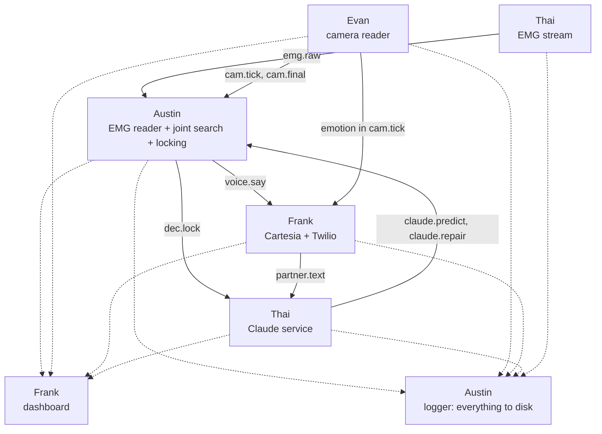

# Team tasks and interfaces

One mode, open mouth, real time. Austin calls a judge through Twilio and mouths the whole conversation; the camera, the EMG model and Claude read it together every 100 ms; live captions show both sides; Cartesia speaks Austin's words into the call in his cloned voice, with his facial emotion, while he is still mouthing. Everything runs on Austin's laptop (RTX 5060, 115 W), with the lowest delay we can get at every step.

How the whole system works: [REALTIME_PIPELINE.md](REALTIME_PIPELINE.md). The EMG model in detail: [SVR1_SPEC.md](SVR1_SPEC.md).

## The demo

The pitch is separate: Austin and Frank give it with their real voices. The product demo is a phone call.

1. Austin calls the judge, who is standing in front of us, through Twilio. The judge speaks normally into their phone; their words appear in the captions.
2. Austin answers only by mouthing: mouth open, no sound. His words appear on screen as he mouths, grey then black, and his cloned voice speaks them into the call while he is still going.
3. His facial expression changes the voice's emotion.
4. The dashboard shows the real latency, which reader settled each word, and what Claude changed.
5. If the system can't tell what he said, the screen says "Please repeat" rather than guessing.

Nothing is trained on the pitch or on a script: the judge can ask anything.

## Who does what

| Person | Owns |
| --- | --- |
| Evan | Camera reader: real-time Auto-AVSR every 100 ms, mouthing activity and segments, facial emotion ([EVAN_REALTIME_LIP_READING.md](EVAN_REALTIME_LIP_READING.md)) |
| Austin | SVR-1 training, live EMG reader, the joint search with its language model, confidence locking, logging and replay, integration |
| Frank | Cartesia (Austin's voice clone, Sonic streaming voice, Ink for the judge), the Twilio call, the captions dashboard |
| Thai | EMG rig (4 channels, sites 3, 2, 6, 1) and its live filter, the Claude service (predict + repair) |

### Austin

1. Retarget SVR-1 to the rig's 4 sites (input slots 0, 1, 2, 5, the existing `4ch` channel set). Drop the closed-mouth parts: the fixed-phrase head and closed-lips transfer. Code done.
2. Switch all EMG preprocessing to Thai's causal filter (`rig/filters.py`), Berkeley pre-training data included: re-cache Berkeley through it, in order, instead of Gaddy's `filtfilt`. Code done.
3. Add the speaking-or-not output, partial-sentence training, and augmentation for the recorded deliveries (slow, effort, held expression). Code done.
4. Train on the cluster: `SVR1_4ch` plus the Gaddy-architecture baseline `G4` on the same 4 sites ([cluster/RUNBOOK.md](../cluster/RUNBOOK.md)).
5. The recording tool: done, `recorder/record.py` (camera + EMG + the session prompts, in `svr/recordings.py`'s format).
6. Live EMG reader: subscribe to `emg.raw`, filter, run SVR-1 every 100 ms, compute pace and effort. The SVR-1 side is `svr/live.py`; the bus side comes with the joint search.
7. The joint search over camera and EMG probabilities, with look-alike expansion, Claude's predicted words, the gate and the language model: our conversational 4-gram plus a cache of the call (`fusion/lm.py`, built by `fusion/build_lm.py`; done).
8. Confidence locking: compute the lock ingredients per word, train the lock model on sessions 1 and 2, and set the dynamic threshold from Claude's predictability.
9. "Please repeat" when the final pass still isn't confident, with the reasons in the debug log.
10. The logger, which subscribes to every topic and writes everything to disk, and a replay tool.
11. Fine-tune SVR-1 on sessions 1 and 2, and tune the joint search, gate and lock model; test everything on session 3.

### Evan

Follow [EVAN_REALTIME_LIP_READING.md](EVAN_REALTIME_LIP_READING.md). You can prototype on the MacBook (Lipflow was built for Macs), but timing and real tests run only on Austin's laptop.

### Frank

1. Instant Voice Clone of Austin, from about 60 s of his real voice read aloud, recorded separately with his consent ([RECORDING.md](../RECORDING.md#voice-sample-for-the-clone)); the silent sessions have no audio.
2. Sonic 3.6 over the WebSocket: one context per sentence, locked words from `voice.say` streamed in with "more to come" as natural phrases: a phrase goes when Austin pauses (`dec.hyp` shows nothing being mouthed) or after about 4 words, each its own flush with no server buffer, Sonic's padding trimmed. A word sent alone sounds like a one-word sentence; phrases sound like talking, about 1 s behind his lips. Speed, volume and emotion are set per sentence with `generation_config` and changed within a sentence with inline `<speed>`, `<volume>` and `<emotion>` tags, since Sonic ignores `generation_config` changes inside a context. `pace` maps to speed 0.6 to 1.5, `effort` to volume 0.5 to 2.0.
3. Twilio:
    - Austin's call to the judge, with a two-way audio stream to the laptop.
    - Cartesia's audio goes into the call; ask Cartesia for phone-format audio, or convert it.
    - The judge's incoming audio goes to Cartesia Ink, which publishes `partner.text`.
4. The captions dashboard:
    - captions for both speakers, with Austin's words grey until locked, then black;
    - Claude's edits highlighted, and a raw-vs-fixed panel;
    - a live latency meter;
    - "Please repeat" with the reason;
    - the EMG traces.

### Thai

1. Rig with 4 boards on A0 to A3 (sites 3, 2, 6, 1) and one REF per board, as in [HARDWARE.md](../HARDWARE.md).
2. Firmware, reader and live filter (`rig/`): 1 kHz, raw frames with a counter, causal hum filter. They move from 6 to 4 channels with the recording tool.
3. Live: the reader stamps samples with `bus.now()` (`time.perf_counter()`) and publishes `emg.raw` every 10 ms.
4. Safety: the laptop runs on battery whenever the pads are on skin; never charge with the Uno connected.
5. The Claude service:
    - **Predict:** on every final `partner.text` and every ~2 s while Austin mouths, publish `claude.predict`: likely words and phrases, plus how predictable the next words are.
    - **Repair:** on each `dec.lock`, publish `claude.repair`.
    - **How it calls Claude:** `claude-opus-5-5` at low effort, structured outputs, prompt caching (rules and conversation kept as an append-only prefix).
    - **Prompt rules:** swap a word only for one of the alternatives given or a lip look-alike, never add ideas, answer "please repeat" when unsure.

## Interfaces

The parts run as separate small programs on the laptop and talk through ZeroMQ publish/subscribe over TCP on the loopback (`tcp://127.0.0.1:<port>`, one port per publisher; the camera reader is 5556), with messages encoded as msgpack (numpy arrays as raw bytes).
`ipc://` sockets don't work on Windows, which is why it is TCP.
Ports, each bound by its publisher (the map is `bus/team.py`): EMG rig 5555 (`RECLAIM_EMG_PUB`), camera reader 5556 (`RECLAIM_CAM_PUB`), Austin's joint search 5557 (`RECLAIM_DEC_PUB`), Claude service 5558 (`RECLAIM_CLAUDE_PUB`), call service 5559 (`RECLAIM_CALL_PUB`), live EMG reader 5560 (`RECLAIM_SVR_PUB`).
A message takes well under a millisecond.
All timestamps are `bus.now()` seconds on the same laptop, which is `time.perf_counter()`: on Windows before Python 3.13, `time.monotonic()` only ticks every 15.6 ms.
Every message also carries `v` (schema version), `seq` (counts up per topic, so a gap is a drop) and `t_pub` (send time).
The wire details, the queue limits and a ready-made subscriber are in [bus/schema.md](../bus/schema.md) and the `bus` package.

| Topic | From → to | Rate | Main fields |
| --- | --- | --- | --- |
| `emg.raw` | Thai → Austin | every 10 ms | `t0`, `fs` = 1000, `samples` (n × 4, raw 0 to 1023), `counter` |
| `cam.tick` | Evan → Austin, Frank | every 100 ms | `seg_id`, `seg_start`, `frame_t` (T), `topk_ids` (T × 32), `topk_logp` (T × 32), `blank_logp` (T), `greedy`, `activity` (T), `face_ok`, `emotion` {`label`, `confidence`, `scores`}, `timing_ms` |
| `cam.final` | Evan → Austin | at segment end | `seg_id`, `nbest` [{`text`, `score`}] |
| `cam.face` | Evan → dashboard | ~12.5 Hz | `t`, `w`, `h`, `face_ok`, `pts` (478 × 2, normalised), `blend` (52), `pose` (yaw, pitch, roll) |
| `cam.preview` | Evan → dashboard | every processed frame, at most 30 Hz | `t`, `w`, `h`, `jpeg` (the processed frame, 640 px wide): the dashboard's mirror of the webcam, which only the lip reader can open; `pts` (that frame's 478 × 3 face points: x / w, y / h and MediaPipe's z; nil without a face), so the pads drawn on it sit on his face. Sent from its own thread without blocking (`lipread/preview.py`), so it never slows the lip reader |
| `dec.hyp` | Austin → dashboard | every 100 ms | `utt_id`, `locked` [words], `unlocked` [words], `confidence` per word, `source` per word (camera / EMG / Claude); optional for the dashboard: `cands` [{`w`, `cam`, `emg`, `claude`}] (top 3 for the newest word) and `threshold` |
| `dec.lock` | Austin → Claude, dashboard | on lock | `utt_id`, `words` [{`w`, `conf`, `alts`, `cam`, `emg`, `t`}]; optional for the dashboard: per word `cam_top`, `emg_top` (each reader's own pick, for the end screen's disagreement bars) |
| `dec.repeat` | Austin → dashboard | at sentence end | `utt_id`, `reason` (which reader disagreed, confidences); the dashboard reads `reason` as {`reader` (camera / EMG / Claude), `words` [{`index`, `w`, `alts`}]} |
| `claude.predict` | Claude → Austin | on judge line, ~2 s | `words` [{`w`, `weight`}], `phrases`, `predictability` (0 to 1), `ttl_s` |
| `claude.repair` | Claude → Austin, dashboard | on reply | `utt_id`, `edits` [{`index`, `from`, `to`}], `please_repeat` |
| `voice.say` | Austin → Frank | words leaving the repair window | `utt_id`, `words` (only the new ones), `offset` (index of `words[0]` in the sentence, optional), `final`, `pace`, `effort` (both relative, 1.0 = Austin's normal; below) |
| `partner.text` | Frank → Claude, dashboard | streaming | `text`, `is_final`, `t` |
| `call.state` | Frank → dashboard | on change | `state` (`connected` / `ended`), `t`, plus `call_sid` and `ink` on connect |
| `timing.*` | everyone → logger | every event | the stage and its duration in ms (the camera's ride in `cam.tick.timing_ms`); the dashboard's latency strip reads `timing.dec` {`stage`: `lock` (lock decision) or `window` (repair window), `ms`}, `timing.voice` {`stage`: `sonic_first_audio` or `played_to_judge`, `utt_id`, `ms`} and `timing.claude` {`ms`, `error`} |

Austin applies Claude's repairs before forwarding words on `voice.say`, so the voice never needs to know about Claude. The logger subscribes to every topic.

`voice.say` units, from SVR-1 ([SVR1_SPEC.md](SVR1_SPEC.md#3-outputs)):
- `pace`: speaking rate relative to Austin's normal, `exp(0.37 × the rate head's z-score)` divided by its median over the calibration minute. 1.0 is normal, 0.5 half speed.
- `effort`: muscle effort relative to Austin's normal, the RMS of the EMG over the last 100 ms divided by the session's median while speaking. 1.0 is normal; soft mouthing is below, emphatic above.
- Both come with every message, so a single stressed word can get its own volume.

`voice.say` sentences:
- `offset` lets the voice skip a resent word and still speak a real repeat ("no no"); without it, every word in `words` is spoken.
- Every sentence ends with a `final` message.
- If a `final` is lost, the voice closes that sentence once it has been silent for 3 s and the next sentence is waiting, and ignores its late messages.

## Order of work

The system must work end to end early and get better, not work only at the very end.

| Block | Goal | Evan | Austin | Frank | Thai |
| --- | --- | --- | --- | --- | --- |
| 1 | Record + skeleton | E0, E1, E7 recording | Session 1; bus + logger; SVR-1 retarget; cluster runs start | Voice clone; Sonic speaks typed text | Rig for session 1; `emg.raw` live |
| 2 | Camera → voice, end to end | E2, E4 | Joint search on camera alone; locking v1 → `voice.say` | Streaming words in; Twilio call + Ink | Claude predict on real conversation |
| 3 | Session 2 + EMG joins | E3 | Session 2; fine-tune SVR-1; EMG into the joint search | Dashboard | Claude repair |
| 4 | Learn and tune | E5, E6 | Train the lock model and gate on sessions 1 and 2 | Emotion, pace, volume | Prompt tuning on logs |
| 5 | Test and rehearse | Replay tests | Session 3 in demo conditions; WER and latency on it | Full calls with a teammate as judge | Demo-room check of light and noise |

Fallback at every point: camera + Claude + voice works without EMG. If EMG isn't ready by the demo, that is what we show, and nothing else changes.

## Recording sessions

Procedure: [RECORDING.md](../RECORDING.md); sentences: [recording/](recording/). Sessions are recorded with the recording tool (`recorder/`), which records the camera and Thai's EMG stream on one clock and steps through the prompts. All varied conversational sentences, mouth open, no sound. The pads come off and go back on between sessions.

| Session | Sentences | Use |
| --- | --- | --- |
| 1 (now) | 250, the last 50 faster than natural | Training |
| 2 | 250, the last 50 faster than natural | Training |
| 3 (last, in demo conditions) | 100, at demo pace | Test only, never trained on |

Each session also records 10 rest clips of about 3 s (still face, swallow, nod, smile, and so on), which teach the model what is not speech. Sessions 1 and 2 take about 30 minutes each, session 3 about 12. A minute of calibration before the demo refits SVR-1's adapter and its scale factors.

Some sentences carry a delivery to hold, shown by the recorder (Frank's request, [RECORDING.md](../RECORDING.md)): in each training session 20 slow and 10 each of smile, frown, surprised, soft and emphatic; in session 3, 10 smile and 10 frown. They let SVR-1 see a smile's EMG and the range of pace and effort the voice follows, and session 3 tests "same words, two expressions". SVR-1's pretraining also simulates these deliveries on Berkeley's data.

Two more recordings, outside the sessions:
- About 60 s of Austin's real voice, read aloud, with his consent, for Frank's voice clone.
- For the emotion tagger, nothing extra: it needs no training, only about 3 s of neutral face at the start of the call; the rest clips and the delivery clips are enough to tune it on Austin.

## Training

1. **Pretraining (cluster):** SVR-1 on Berkeley's data, re-filtered with `rig/filters.py` and retargeted to the rig's 4 sites, with the Gaddy-architecture baseline on the same 4 sites as the fallback and the comparison. Scripts and runbook are in `calhacks2026/cluster/`.
2. **Fine-tuning:** SVR-1 on sessions 1 and 2. It is small enough for the 5090 or the cluster.
3. **The joint search's weights, the gate and the lock model:** fitted on sessions 1 and 2.
4. **The test:** everything is measured on session 3.
5. **Auto-AVSR and Claude are not trained.**

## Numbers to show

These come from Anthropic's track brief:

- Word error rate on session 3 for camera alone, camera + EMG, and camera + EMG + Claude.
- Delay from mouthing a word to seeing it locked, and to hearing it (not counting the phone network).
- How often the system says "Please repeat".
- How often the judge understands on the first try.

## Still open

- **Battery life:** the whole system runs on battery during recordings and the demo. Measure how long a full run lasts, and charge between sessions with the Uno unplugged.
- **Phone audio:** Frank owns the Twilio ↔ Cartesia audio formats.
