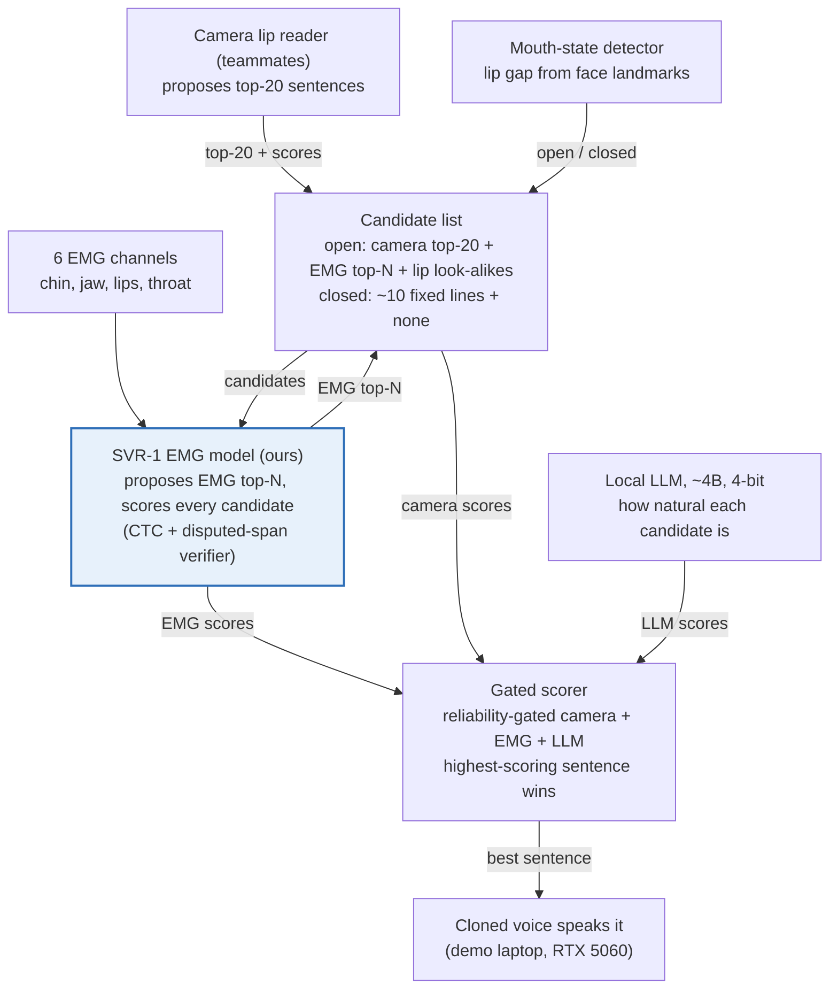

# Silent Voice Rig: Fused EMG Model Plan

Oct 23, 2026 · @Austin Wang

Mouthed speech becomes on-screen text and a cloned voice in real time. Mouth open: camera and EMG both propose sentences, and EMG, camera and a local LLM judge them together. Mouth closed: EMG alone picks one of \~10 pitch lines. The novelty is speed.

## Status

Baselines are trained; SVR-1 is written and reviewed but not trained yet, because the H100 jobs ran before its code landed. Nothing is lost: local code and the bucket are identical.

| Part | State | Next step |
| --- | --- | --- |
| Gaddy baselines (H100/H200) | Done. 6-channel retrain G6: 33.2% WER. 8-channel retrain: 29.4% vs Gaddy's published 27.1% | G6 is the bar SVR-1 must beat |
| SVR-1 code | Done; reviewed twice; 3 crash bugs and 2 big speed losses fixed; all CPU unit checks pass | Cluster: articulator targets, smoke test, then the 11-run sweep |
| SVR-1 training | Not started | `smoke_svr1.sh SVR1_full`, then `svr1_sweep.sh` |
| Camera baselines (Auto-AVSR, +LLM, BRAVEn, LipLearner) | Code done; cluster smoke fixes merged | Run on the wearer's recordings |
| Wearer fine-tuning + benchmarks | `svr/finetune.py` done, tested on synthetic data | Needs the day-2 recordings |
| Fusion gate + real-time loop | Designed (figure panel G) | Build on day 3 |
| Code sync | Local = bucket, with the cluster's fixes merged | Pull before every cluster session |

## How it works

Both streams propose candidate sentences and both are judged; closing the mouth shrinks the candidates to the pitch lines and hands the decision to EMG.

|  | Mouth open | Mouth closed |
| --- | --- | --- |
| Inputs | Camera + 6 EMG channels | 6 EMG channels |
| Who proposes | Camera top-20, EMG top-N (its own letter decoder), lip look-alike expansion | The \~10 pitch lines + "none" |
| Who judges | EMG score + camera score + local LLM, weighted by the reliability gate | EMG alone |
| Target | Low WER at 150–180+ words per minute | Near-perfect pick; pre-rendered voice starts at once |

- No mode switch: the gate slides trust from camera to EMG as the mouth closes.
- Electrodes: Gaddy sites 1–6 (two chin sites, two cheeks, jaw, throat), reference below the left ear. Sites 7–8 dropped: they rank last and sit on the upper cheek.
- Ownership: we train the EMG model and build the fusion; teammates own hardware, recorder, camera and the cloned voice (Cartesia).

## SVR-1, the EMG model

SVR-1 (45M parameters) turns 6-channel EMG into 86 frames per second, writes its own guesses with a letter decoder, and scores any candidate sentence. A separate doc, [SVR-1 explained](svr1-explained.md), walks through every box of the figure and the real-time levers.

Dark blue = our modules; flame = trained, snowflake = frozen; panels A–F = contributions; panel G = the real-time loop.

## Contributions

Each one is a switch in the code, so the sweep measures what it adds.

| # | Contribution | What it does |
| --- | --- | --- |
| A | Homophene-contrastive training | Teaches EMG to pick the true sentence over lip look-alikes (bat / mat / pat) |
| B | Disputed-span verifier | Checks only the words the candidates disagree on against the muscle signal |
| C | Viseme-lattice expansion | Reaches sentences outside the camera's top-20 that look the same on the lips |
| D | Reliability gate | Per-sentence trust in camera, EMG and LLM from mouth opening, confidence, signal quality and pace |
| E | Fast-speech robustness | Speed and articulatory-undershoot augmentation, plus a speaking-rate token |
| F | Closed-lips transfer | Open-mouth repetitions supervise closed-mouth EMG through time alignment (DTW) |
| G | Real-time loop | Live text every 250 ms; a word commits once two passes agree |

Built on and credited: articulator targets from audio (SPARC, Lee et al. 2025), 8-to-6-channel pretraining (Hwang et al. 2026), letter + phoneme CTC (Gaddy & Klein 2021).

## Real-time pipeline

Target: each word on screen \~0.3–0.5 s after it is mouthed, the cloned voice streaming right behind it. Auto-AVSR is an offline model (it reads the whole clip), but we stream it by re-reading the growing clip every 250 ms. That needs no retraining, and it beats the 0.8 s delay of PyTorch's streaming model.

```mermaid
flowchart TD
    subgraph live["Live loop, every 250 ms (laptop, RTX 5060)"]
        cam["Webcam, 30 fps<br/>crops the mouth (MediaPipe)"] --> avsr["Auto-AVSR encoder<br/>ResNet on new frames only<br/>Conformer re-reads the clip"]
        emg["6 EMG channels, 1 kHz<br/>filter, resample to 689 Hz"] --> svr["SVR-1 encoder (ours)<br/>re-reads the clip, ~5 ms<br/>works with lips sealed"]
        avsr --> camtop["Camera top-N<br/>CTC prefix search, few ms"]
        svr --> emgtop["EMG top-N (ours)<br/>letter-CTC prefix search"]
        svr --> pitch["Pitch lines + none<br/>used when the mouth closes"]
        camtop --> pool["Candidate pool<br/>partial sentences from all proposers"]
        emgtop --> pool
        pitch --> pool
        pool --> camscore["Camera score<br/>do the lips match?"]
        pool --> semg["S_emg (ours)<br/>CTC + disputed-span verifier"]
        pool --> lm["Fast language model<br/>n-gram or 0.5-1.5B LLM"]
        camscore --> gate["Reliability gate -> weighted sum<br/>camera conf, mouth opening, EMG quality, pace"]
        semg --> gate
        lm --> gate
        gate --> agree["Local agreement<br/>commit a word once 2 passes agree"]
        agree --> screen["Screen<br/>live text, grey -> black"]
        agree --> voice["Cartesia voice (teammate)<br/>streams committed words"]
    end
    subgraph once["Once per sentence"]
        endp["Endpoint<br/>250 ms EMG quiet + still lips"] --> final["Final pass<br/>Auto-AVSR small beam, look-alike lattice<br/>verifier, 4B LLM rescoring"]
        final --> corr["Corrected sentence<br/>replaces the live text"]
        closed["Mouth closed (ours)<br/>fixed-line head, confidence > 0.9"] --> pre["Pre-rendered cloned voice<br/>plays at once"]
    end
    classDef ours fill:#e7f1fb,stroke:#2f6fb8,stroke-width:2px
    class svr,emgtop,pitch,semg,closed ours
```

SVR-1 is the highlighted part; everything else is the camera, fusion, language model and voice around it.

1. Every 250 ms: run the camera front end on the new frames only, then re-encode the clip so far (camera + EMG).
2. Both streams propose top-N partial sentences with a fast CTC prefix search; no slow attention beam search while mouthing.
3. Score the candidates with EMG + camera + a fast language model, through the gate.
4. Commit a word once two consecutive passes agree; it turns from grey to black and streams to Cartesia.
5. Sentence end (250 ms of EMG quiet + still lips): the final pass adds look-alike expansion, the verifier and the 4B LLM, and corrects the text. Mouth closed: a pitch line commits at confidence > 0.9 and its pre-rendered voice plays at once.

| Step | Budget (estimate, measured on the laptop day 3) |
| --- | --- |
| Camera front end, new frames | \~1–2 ms per frame |
| Camera encoder re-read, 3–5 s clip | \~10–30 ms |
| SVR-1 re-read | \~5 ms |
| CTC prefix search, both streams | \~2–5 ms |
| Live language scoring (n-gram, or a 0.5–1.5B LLM) | <1 ms / \~20–40 ms |
| Whole tick | well under the 250 ms tick |
| Final pass at sentence end (4B LLM, verifier) | \~150–250 ms |

The voice (Cartesia, teammate) is the largest remaining delay; our side only has to deliver stable words early.

## Results so far

On our 6 sites, Gaddy's architecture retrained (G6) reaches 33.2% WER, but its look-alike accuracy falls from 84% to 49% at 1.5× speed: that drop is what SVR-1 targets. Berkeley test set, 99 sentences.

| Model | Channels | WER, beam + LM (%) | Homophene-10 top-1 (%) | Same at 1.5× speed (%) |
| --- | --- | --- | --- | --- |
| Gaddy's released model | 8 | 27.1 | 88.3 | – |
| Our retrain, Gaddy recipe | 8 | 29.4 | 89.4 | 68.1 |
| Gaddy's model, 2 channels zeroed | 6 | 64.4 | 55.3 | 38.3 |
| **G6: retrained on 6 channels (bar to beat)** | 6 | **33.2** | **84.0** | **48.9** |
| SVR-1 | 6 | pending | pending | pending |

- Forward pass: 3.9 ms per 3 s clip on an H200.
- The first seed of the 8-channel retrain collapsed (CTC stuck on blanks for 43 epochs); seed 1 trained normally. Watch dev WER early in every run.

## Benchmarks

Berkeley benchmarks pick the best model now; the wearer's held-out recordings decide the demo. Headline chart: WER vs words per minute, camera alone vs fused.

| Benchmark | Question it answers | Metric |
| --- | --- | --- |
| Homophene judge (10 / 50 candidates) | Can EMG pick the true sentence among lip look-alikes? | Top-1 |
| Fast-speech judge (1.25× / 1.5×) | Same, at speed | Top-1 |
| Open vocabulary | How good is the encoder alone? | WER, CER |
| Wearer set E, three paces | Ours vs Auto-AVSR, Auto-AVSR + LLM, BRAVEn | WER vs WPM |
| Wearer fixed lines | Mouth closed: SVR-1 vs LipLearner (5-shot) | Top-1, false triggers on rest |
| Camera n-best + EMG | First fused number, before the gate exists | WER |
| Laptop latency | Real time? | Mouthed → shown, mouthed → heard |

## Data to record on the wearer

About 2.5 hours over two sessions on day 2, with camera and EMG on one clock. Format: `svr/recordings.py`.

| Set | What | Amount | Use |
| --- | --- | --- | --- |
| A | The \~10 mouth-closed pitch lines | 50 closed + 10 open each | Fixed-line path; closed-lips transfer |
| B | Rest, swallowing, random movement, talking | \~100 clips | The "none" class |
| C | Varied sentences at \~100, \~150, 180+ WPM | \~400 | Fine-tuning; camera mistakes as training negatives |
| D | Open-mouth pitch lines | 10 each | Demo robustness |
| E | Never-trained sentences, three paces | \~100 | The honest test numbers |
| F | Read aloud with a microphone | \~100 | Wearer's own articulator targets |

- Mouth closed = lips sealed, tongue and jaw still actively articulating. A still face decodes at chance.
- Electrodes come off between sessions, so next-session accuracy is real; mark the skin.

## Next steps

Day 2: train SVR-1 while the recordings happen. Day 3: build the fusion and real-time loop on the laptop.

Day 2

- [ ] Cluster: SPARC articulator targets, then `bash cluster/smoke_svr1.sh SVR1_full` until it prints SMOKE PASS
- [ ] Launch `SVR1_full`, then the rest of `cluster/svr1_sweep.sh` (8-to-6, six ablations, two sizes)
- [ ] Record sets A–F; run `svr.make_g2p` on the new prompts
- [ ] Run the camera baselines on the recordings (writes the n-best SVR-1 trains against)
- [ ] Fine-tune the sweep winner and G6 on the wearer: `svr.finetune`

Day 3

- [ ] Streaming camera: per-frame front end, re-read every 250 ms, CTC prefix search
- [ ] Fusion gate + look-alike expansion, trained on set C
- [ ] Local agreement, endpointing, Cartesia hand-off; measure latency on the RTX 5060
- [ ] WER-vs-WPM chart; rehearsal; fixed-line-only fallback

## Risks

| Risk | Mitigation |
| --- | --- |
| Closed-mouth EMG is weak if the wearer keeps a still face | Rehearse active tongue and jaw behind sealed lips; 50 reps per line; closed-lips transfer |
| Electrodes shift before the demo | Refit the session adapter from \~1 min of calibration; mark the skin |
| A training run collapses (seen once with the Gaddy recipe) | Watch dev WER in the first epochs; rerun with another seed |
| Camera's last word or two are unreliable on partial clips | Commit only words that two passes agree on; the final pass corrects |
| EMG adds little at speed | The gate falls back to camera + LLM; show the measured chart either way |
| Laptop runs out of its 8 GB | Smaller LLM for the live pass; 4B only at sentence end |

Open: confirm sites 1–6 with hardware; recording time; the camera's n-best output format.
