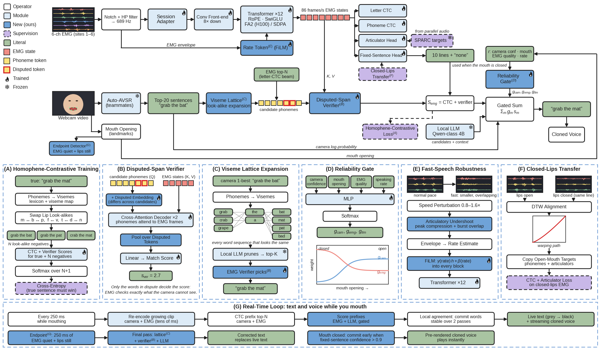

# SVR-1 explained

Oct 23, 2026 · @Austin Wang

SVR-1 is our EMG model: it reads 6 muscle signals from the face and throat, writes its own guess at the sentence, and scores any candidate sentence against those signals. This doc walks through the architecture figure box by box, then shows which parts make the system real time.

## The figure and how to read it

Read it in three bands: the top row is the EMG model turning muscle signals into scores, the middle row is the camera and the fusion that picks the final sentence, and the bottom bands zoom into each new idea.

| Band of the figure | What it shows | Read it as |
| --- | --- | --- |
| Top row, left to right | 6-channel EMG → filter → adapter → conv front end → Transformer → red EMG states → four heads | "Turn muscle signals into a summary of what was said, 86 times a second" |
| Middle row | Webcam → Auto-AVSR → top-20 sentences → look-alike expansion → verifier → gated sum → "grab the mat" → cloned voice | "Collect guesses from everyone, check them against the muscles, pick the winner" |
| Panels A–F | Our six new ideas, each drawn in detail | "Why this works better than existing systems" |
| Panel G | The real-time loop | "How text appears while you are still mouthing" |

| Mark in the figure | Meaning |
| --- | --- |
| White box | A fixed operation (a filter, a formula); nothing learned |
| Light blue box | A standard learned module (exists in prior work) |
| Dark blue box | New: our contribution |
| Green box | A concrete value, such as a sentence or the 10 pitch lines |
| Dashed purple box | Training signal only; not used when the demo runs |
| Red squares | EMG states: one 512-number summary per 11.6 ms frame |
| Yellow squares | Phoneme tokens of a candidate sentence; red-bordered ones are disputed |
| Flame / snowflake | Trained by us / frozen (used as is) |

## One sentence's journey

The wearer silently mouths "grab the mat". The camera sees lips that look the same for "bat", "mat" and "pat" (all three close the lips), so it guesses "grab the bat". EMG also senses the tongue and jaw, which the camera cannot see; on our look-alike benchmark an EMG model already picks the true sentence 84–89% of the time.

| Step | Box in the figure | In → out | Everyday analogy |
| --- | --- | --- | --- |
| 1 | 6-ch EMG | Face muscles → 6 voltage traces, 1,000 samples per second | Six microphones taped to muscles instead of air |
| 2 | Notch + HP filter | Raw traces → clean traces at 689 Hz | Removing mains hum and slow drift from a recording |
| 3 | Session adapter | Clean traces → traces as if the electrodes sat exactly where they did in training | Adjusting a mirror before driving |
| 4 | Conv front end | 689 samples/s → 86 frames/s, 512 numbers each | Turning sound into syllable-sized chunks |
| 5 | Rate token | Envelope → "how fast is this person talking?" | A listener noticing someone speaks quickly and paying closer attention |
| 6 | Transformer ×12 | Each frame looks at every other frame → red EMG states | Reading a whole sentence before deciding what a smudged word was |
| 7 | Letter / phoneme CTC | EMG states → EMG's own best guesses (EMG top-N) | A second witness writing down what they think was said |
| 8 | Auto-AVSR, top-20 | Webcam → the camera's 20 best sentences, "grab the bat" first | The first witness, who watched the lips |
| 9 | Viseme lattice | "grab the bat" → also "grab the mat", "grab the pat", "crab the mat" | Listing every word that looks the same on the lips |
| 10 | Disputed-span verifier | Each candidate + EMG states → a match score, decided by bat/mat/pat only | Checking only the words the witnesses disagree on |
| 11 | S\_emg = CTC + verifier | Per candidate: how well do the muscles agree? | The EMG witness's confidence in each version |
| 12 | Reliability gate + gated sum | Camera, EMG and LLM scores, weighted by trust → "grab the mat" | A judge who trusts the lip witness less when the mouth is barely open |
| 13 | Cloned voice | Text → speech in the wearer's voice | — |

## The encoder (top row)

The encoder turns about 1,000 voltage readings per second into 86 "EMG states" per second, each a list of 512 numbers that summarises what the face is doing at that moment, in the context of the whole sentence.

| Part | What it does | Why it is there |
| --- | --- | --- |
| Notch + high-pass filter | Removes 60 Hz mains hum and its harmonics, and drift below 2 Hz | Hum is far larger than muscle signal; same filtering as Gaddy so the Berkeley data transfers |
| Session adapter | A learned 8×8 mix of the channels, starting as "change nothing" | Electrodes never land in exactly the same spot; on demo day \~1 minute of calibration refits only this |
| Conv front end | 3 convolution blocks, each halving the time resolution: 689 → 86 per second | Muscle bursts last \~10–100 ms; 86 frames per second is fine enough for letters and cheap for attention |
| Rate token (E) | Estimates speaking rate from the signal's loudness envelope; nudges every Transformer block | Fast speech squeezes and blurs muscle bursts; knowing the pace helps undo that |
| Transformer ×12 | Every frame looks at every other frame of the sentence (attention), 12 times over | Whether a burst is "m" or "b" depends on its neighbours, as in speech |
| RoPE, SwiGLU, RMSNorm | The modern Transformer recipe (as in Llama-class models) | Trains stably and fast; RoPE encodes distance between frames, not absolute position |
| FlashAttention-2 / SDPA | Two interchangeable attention kernels, same maths | FA2 on H100 for training speed; SDPA on the 5090 and the laptop |

SVR-1 next to the model it must beat:

|  | Gaddy's model (G6 baseline) | SVR-1 | Why the change matters |
| --- | --- | --- | --- |
| Channels | 8 (6 when retrained as G6) | 6, pretrained with 8 + channel dropout | Our rig has 6 electrodes |
| Size | 6 layers × 768, 54M parameters | 12 layers × 512, 45M parameters | Deeper and narrower, a bit smaller |
| What attention sees | Fixed 200-frame windows, sometimes spanning two recordings | Exactly one sentence, never across recordings | No leakage between unrelated sentences |
| Normalisation in the front end | BatchNorm (statistics of the batch) | Per-frame LayerNorm | Same output alone or in a batch: needed for streaming and a new rig |
| Outputs | Letters only | Letters, phonemes, articulators, the fixed lines + "none" | More ways to learn; a direct answer when the mouth is closed |
| Judging a candidate | Letter likelihood only | Letters + phonemes + verifier, trained against lip look-alikes | Trained for exactly the camera's blind spot |
| Fast speech | Nothing special | Rate token + speed and undershoot augmentation | G6 drops from 84% to 49% look-alike accuracy at 1.5× speed |
| Speed | 3.9 ms per 3 s clip (H200) | Not measured yet; similar size, so similar | Both are tiny next to the camera model |

## The heads (right column)

Four small layers read the same EMG states. Two of them use CTC, which lets one head both write a guess and grade someone else's guess.

What CTC is: at every frame the head gives a probability for each letter plus a "blank" (nothing new here). A sentence lasts many more frames than it has letters, so CTC lets each letter span several frames and drops the blanks: frames reading `g g _ r a a _ b` collapse to "grab".

| Use of CTC | How | Speed | Role in the system |
| --- | --- | --- | --- |
| Write a guess | Take the most likely symbol per frame and collapse | \~1 ms | EMG proposes (EMG top-N) |
| Grade a guess | Add up the probability of every way that exact sentence could fit the frames | \~1 ms per candidate | EMG judges (part of S\_emg) |

| Head | Output per frame | Used in the demo? | Why |
| --- | --- | --- | --- |
| Letter CTC | 37 characters + blank | Yes: proposes and grades | Can write any sentence, including names |
| Phoneme CTC | 39 speech sounds + blank | Yes: grades | Muscles make sounds, not spellings ("though" vs "tho") |
| Articulator head | 12 tongue, lip and jaw positions + loudness | No: training only | Teaches the encoder the physics of speech; targets come from SPARC run on the voiced recordings' audio |
| Fixed-sentence head | One score per pitch line + "none", for the whole clip | Yes, when the mouth is closed | One pass picks the line; "none" stops swallows and pauses from triggering a line |

## Proposing vs judging

Yes, EMG does both: it proposes its own sentences (the "EMG top-N" box) and it judges everyone's. Proposing means putting a sentence on the shortlist; judging means scoring each shortlisted sentence. A sentence that nobody proposes can never win, so we want several different proposers.

| Proposer | What it adds to the shortlist | Strong at | Blind to |
| --- | --- | --- | --- |
| Camera (Auto-AVSR top-20) | 20 whole sentences | Common words, word boundaries, lip-visible sounds (f, w, o) | b/m/p, t/d/n, k/g: they look identical |
| EMG (letter-CTC top-N) | Its own guesses, letter by letter | Tongue and jaw movement, which the camera cannot see | Spelling of rare words; noisier overall |
| Viseme lattice (C) | Every sentence that looks the same as the camera's best | Fixing the camera's look-alike errors | Needs the camera's best to be roughly right |
| Fixed lines | The \~10 pitch lines + "none" | Mouth closed: near-perfect, instant | Anything off-script |

| Judge | Measures | Weighted up when |
| --- | --- | --- |
| Camera score | How well the lips match | The mouth is wide open and the camera is confident |
| S\_emg = letter CTC + phoneme CTC + verifier | How well the muscles match | Signal quality is good, fast speech, mouth nearly closed |
| Local LLM | How natural the sentence is in context | Candidates are close and one is clearly better English |

The disputed-span verifier (B) is the part that makes EMG a sharp judge. It is told which words the candidates disagree on (red-bordered yellow squares), looks at the EMG frames around them, and scores only those. Agreed words ("grab", "the") cannot drown out the one word that matters.

Worked example for "grab the mat" (qualitative):

| Candidate | Proposed by | Camera | EMG (S\_emg) | LLM | Result |
| --- | --- | --- | --- | --- | --- |
| grab the bat | Camera #1 | Best | Low | Fine | Loses |
| grab the mat | Lattice, EMG | Tied with bat | Best: the verifier scores only bat / mat / pat | Fine | **Wins** |
| grab the pat | Lattice | Tied with bat | Low | Fine | Loses |
| crab the mat | Lattice | Close | Lower | Odd | Loses |

The reliability gate (D) sets the weights per sentence from four signals: camera confidence, mouth opening, EMG signal quality and speaking rate. As the mouth closes, the camera's weight slides towards zero and EMG's rises, so there is no mode switch to glitch.

## Panels A–F: what each new idea fixes

Each panel answers one way the obvious design fails. Each is a switch in the code, so the sweep trains SVR-1 once with each switched off and shows what it adds.

| Panel | Failure it fixes | How, following the panel top to bottom | Proved by |
| --- | --- | --- | --- |
| A. Homophene-contrastive training | A normal EMG model is trained to write text, not to beat the camera's specific confusions | Take the true sentence, swap words for lip look-alikes (m↔b↔p, f↔v, t↔d↔n), score all of them, and train so the true one wins | Homophene-10/50 top-1, with vs without (`--no-judge`) |
| B. Disputed-span verifier | Agreed words dominate a whole-sentence score | Candidate phonemes, with disputed ones flagged, attend to the EMG frames; the score pools only the disputed tokens | `--no-verifier` |
| C. Viseme-lattice expansion | The right sentence is often not in the camera's top-20 | Camera's best → sounds → lip shapes → every word sequence with the same lip shapes → LLM keeps the plausible ones → verifier picks | Wearer WER with vs without |
| D. Reliability gate | Fixed weights trust the camera even when the mouth is closed | A small network reads camera confidence, mouth opening, EMG quality and pace and outputs three weights | Switching test: first sentence after the mouth closes |
| E. Fast-speech robustness | At speed, muscle bursts shrink and overlap; G6 falls from 84% to 49% | Train on sped-up and "undershot" signals; the rate token tells every layer the pace | Fast-speech judge (1.25×, 1.5×); `--no-rate`, `--no-fastaug` |
| F. Closed-lips transfer | Mouth-closed recordings have little to learn from | Align each closed-mouth repetition to an open-mouth one of the same line in time (DTW); the open-mouth model's outputs teach the closed-mouth input | Fixed-line accuracy with the mouth closed |

## Training: what learns from what

SVR-1 learns general silent speech from 19 hours of Berkeley recordings (one speaker, 8 electrodes), then specialises on our wearer.

| Stage | Data | What changes | Learns from |
| --- | --- | --- | --- |
| 0. Targets | Berkeley's voiced recordings (with audio) | Nothing; precomputed | SPARC turns audio into tongue/lip/jaw tracks; a pronunciation dictionary gives phonemes |
| 1. Pretrain (H100) | Berkeley, our 6 channels | Everything | Letters + phonemes + articulators; after step 3,000 the judge loss ramps in |
| 2. Fine-tune | Wearer, sets A–F | Everything | Same, plus the fixed-line classifier, the camera's real mistakes as negatives, closed-lips transfer |
| 3. Calibrate (demo day) | \~1 minute of the wearer | Session adapter only | Letter CTC on a few repetitions |

- The judge loss starts late because ranking sentences with a model that cannot read yet is noise.
- Augmentation on the fly: speed 0.8–1.6×, articulatory undershoot, simulated amplifier differences, short masked gaps, dropped channels.
- About 61,000 optimiser steps over 150 epochs; batches are \~97% real signal, \~3% padding.

## Making it real time

There are two kinds of delay. Waiting delay is time spent waiting for input that has not happened yet: a faster GPU cannot shrink it, only the design can. Compute delay is time spent calculating: faster hardware and cheaper algorithms shrink it. Today's camera systems are slow mainly because of waiting, so our biggest wins are design changes, not the GPU.

| Where the delay comes from | Kind | Typical camera system today | Our lever (panel G) | What it buys |
| --- | --- | --- | --- | --- |
| Decoding starts only after the sentence ends | Waiting | Lipflow: text 1–2 s after the key is released, for a 9 s clip | Re-read the growing clip every 250 ms | Words appear while still mouthing |
| Attention beam search (beam 40) + language model | Compute | The bulk of those 1–2 s | CTC prefix search while mouthing (milliseconds); a small beam only at sentence end | Removes the biggest compute item |
| Camera front end re-run on old frames | Compute | Whole clip each time | Run the per-frame ResNet only on new frames and keep the results | Per-tick cost stays flat as the clip grows |
| The newest word is unreliable without what follows | Waiting | — | Local agreement: show a word once two passes agree | \~0.25–0.5 s per word, few corrections |
| LLM writes a cleaned sentence token by token | Compute | Lipflow-style cleanup | Score candidates in one pass instead of generating; n-gram or 0.5–1.5B model live, 4B only at sentence end | Tens of ms instead of hundreds |
| Detecting the end of a sentence | Waiting | Release a key | 250 ms of EMG quiet + still lips | Hands-free, a quarter second |
| Voice waits for the whole sentence | Waiting | Speak after the end | Stream each committed word to Cartesia | Voice trails the text by about one TTS start-up |
| Mouth closed | Both | — | Pitch lines pre-rendered in the cloned voice; commit at confidence > 0.9, often before the line ends | Playback starts immediately |
| Laptop GPU work | Compute | — | fp16, all models resident on the GPU, one process, no copies back to CPU between steps | Keeps each 250 ms tick well under budget |

Is Auto-AVSR "sentence by sentence"? Its default use is, but the model is not. It has three parts, and only the slow third part needs the whole sentence:

| Auto-AVSR part | Needs the whole sentence? | Cost on a 3–5 s clip (estimate, laptop) | Live use |
| --- | --- | --- | --- |
| ResNet front end, per video frame | No: each frame needs only its neighbours | \~1–2 ms per new frame | Yes, incrementally |
| Conformer encoder, 12 layers | Prefers it: it looks both ways, so the newest \~0.5 s is shaky | \~10–30 ms per re-read | Yes, every 250 ms |
| CTC head | No | \~1 ms | Yes: live partial text |
| Attention decoder + beam 40 + LM | Yes, in practice | Most of Lipflow's 1–2 s | Only once, at sentence end, with a small beam |

Three ways to get live camera text:

|  | Auto-AVSR, default (Lipflow) | Auto-AVSR re-read every 250 ms (our plan) | PyTorch real-time AV-ASR (Emformer RNN-T) |
| --- | --- | --- | --- |
| Inputs | Video | Video | Audio + video |
| Built-in wait | The whole sentence | \~0.25–0.5 s (tick + agreement) | 0.8 s by design (1.28 s chunks) |
| Reported speed | 1–2 s after a 9 s clip | Not measured yet; estimates above | Real-time factor 0.33–0.35 on an RTX 3070 Ti |
| Accuracy with no sound | 19.1% WER on LRS3 (visual only) | Same model; partial text a bit worse until committed | Not reported: its 1.6% WER is driven by audio, which silent speech does not have |
| Released for silent speech | Yes | Yes (same weights) | Recipe only; no visual-only weights published |
| Cost to adopt | None | 1–2 days of code | Training on \~3,000 h of video across many GPUs: not doable in 3 days |

Better hardware still helps: on the laptop's RTX 5060 the compute items above are small, so the remaining delay is mostly the 250 ms tick and the voice start-up. Every number marked as an estimate gets measured on the laptop on day 3.

## Glossary

| Term | Plain meaning |
| --- | --- |
| EMG | Electromyography: voltages from contracting muscles, picked up by skin electrodes |
| Frame | One time step of the model, 11.6 ms long (86 per second) |
| Viseme | A lip shape; several sounds share one (b, m, p) |
| Homophene | Words that look identical on the lips (bat, mat, pat) |
| CTC | A way to read per-frame letter probabilities as a sentence, or to grade a given sentence |
| WER | Word error rate: share of words wrong; lower is better |
| Top-N | The N best guesses, best first |
| Attention | Each frame weighing every other frame to decide what it means |
| FiLM | Scaling and shifting a layer's inputs according to a side signal (here, the pace) |
| DTW | Dynamic time warping: lining up two recordings of the same sentence spoken at different speeds |
| SPARC | A model that turns speech audio into tongue, lip and jaw positions |
| Local agreement | Showing a word only once two successive decodes agree on it |
| Real-time factor | Compute time ÷ audio length; below 1 keeps up with live input |

Sources: [PyTorch real-time AV-ASR post](https://pytorch.org/blog/real-time-speech-rec/) and its [recipe](https://github.com/pytorch/audio/tree/main/examples/avsr); [Auto-AVSR paper](https://arxiv.org/abs/2303.14307); Lipflow timings from its repository; our numbers from `benchmark_results/LEADERBOARD.md`.
