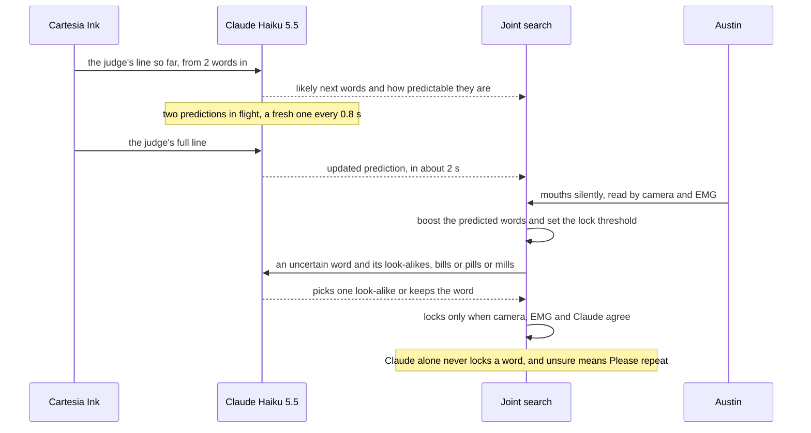
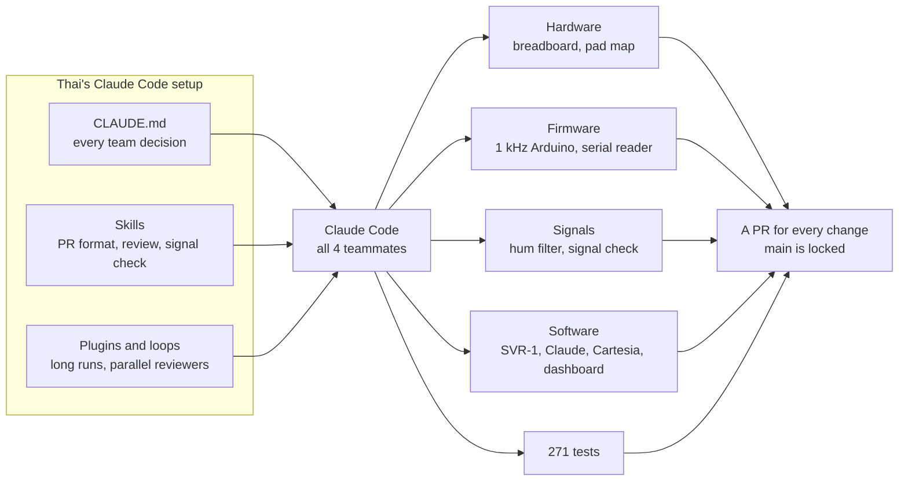

# Anthropic: Claude for Public Benefit

Source: track brief the organizers posted, October 2026.
Challenge: pick a narrow community, find a real problem they face, and build something with Claude that helps.

Prizes:
- $5,000 in Claude credits
- A year of Claude Max 20x for the winning team
- Office hours with Anthropic's Applied AI team
- An invite to visit Anthropic HQ in San Francisco

Lip reading gets about 1 in 5 words wrong, and most of those misses are words that look the same on the lips.
Claude is the one part of Silent Voice that knows what the conversation is about, so it's the one that can tell "bills" from "pills" when the judge just asked about medicine.

## How Claude works inside Silent Voice

- Claude hears both sides of the call, the judge through Cartesia Ink and Austin through the words that already locked.
- It predicts what Austin will say before he mouths it, starting while the judge is still talking, once 2 words of their line are in.
  Two predictions stay in flight, so a fresh one lands about every 0.8 s, and one more fires when the judge's line ends.
- The predicted words get a boost in the joint search, and how predictable the next words are sets how easily a word locks.
- It repairs look-alikes, but only by picking from the alternatives the lip and muscle readers already proposed, and only one swap per word.
- It's held back on purpose, so it never adds ideas, it can never lock a word by itself, and when nobody's sure the screen says "Please repeat".
- Under the hood it's the Claude API with JSON schema outputs, prompt caching, and a backoff that carries the judge's lines into the next request, so a short outage or a 429 loses nothing.

One turn of the conversation, from Claude's side.

We started on Opus 5.5 and it was too slow for a phone call, so we timed every option on live calls and moved to Haiku 5.5 with thinking off.
Opus took 5.7 to 6.9 s a call, and Haiku answers in about 2 to 3 s, so a prediction is ready before Austin starts mouthing.

The code is in `claude_service/`, and [docs/REALTIME_PIPELINE.md](../docs/REALTIME_PIPELINE.md) shows where Claude sits in the whole loop.

## Built with Claude Code, hardware included

Four people shipped 99 commits, 31 merged PRs, and 271 tests between October 23 and 25, and every one of us did it with Claude Code.
Most of Austin's, Frank's, and Evan's commits carry the Claude Code trailer, and Thai's don't only because his git rules leave it off.

Thai is an Anthropic Claude Builder Campus Ambassador and runs the Claude Builder Club at McGill, so he showed up with tricks.
- A project `CLAUDE.md` holds every decision the team already made, so no agent wastes an hour re-arguing them.
- Skills turn our habits into commands, like a fixed commit and PR format, a code review pass, and a "do less" mode that keeps the code small.
- A repo skill, [signal-check](../.claude/skills/signal-check/SKILL.md), lets Claude run the pad check itself, speaking each cue out loud while Austin wears the pads.
- Loops keep an eye on long runs, and parallel subagents review a PR from several angles at once.
- Main is locked, so every change is a PR, and Claude writes each one in the same four sections.

Claude didn't stop at software either.
It laid out the breadboard, wrote the 1 kHz Arduino firmware and the serial reader, mapped the pads to the face, designed the hum filter, and wrote the scripts that check the signal and the tests that keep it all honest.

The hum filter is causal, so it runs live one sample at a time, and training runs the exact same filter, which means the model never sees cleaner data than it gets on stage.

## How they judge

| They want | Our answer | Gap to close |
|---|---|---|
| A named, narrow community | Adults who lost their voice box to a laryngectomy, usually after throat cancer | Say it this narrowly every time, never just "people who can't speak" |
| A real problem, lived or heard firsthand | Electrolarynx users sound robotic and need a free hand | Talk to at least one laryngectomee or speech therapist before judging, and quote them |
| A working, high-impact product | Free speech works end to end, live, on a real phone call | It has to work no matter what |
| A plan to measure impact | On Austin's recorded sessions, 23.6% of words wrong, "Please repeat" on 1.5% of sentences, and a word locks a median 0.76 s after he finishes mouthing it | Word errors with and without Claude on the same clips |
| Thoughtful use of Claude | Claude uses the conversation to fix look-alikes and predicts words before they're mouthed, and it can never lock a word alone | Show raw and fixed text side by side on the dashboard |

## Impact metrics to show

- Word errors before and after Claude, on the same clips.
- Delay from mouthing a word to seeing it in the captions and to hearing it.
- How often the judge understands on the first try, next to an electrolarynx.
- How often Silent Voice says "Please repeat".

## Pitch line

"Silent Voice lets someone who lost their voice box talk again, in their own voice, without holding a buzzer to their throat."
