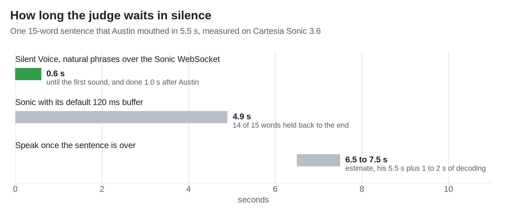
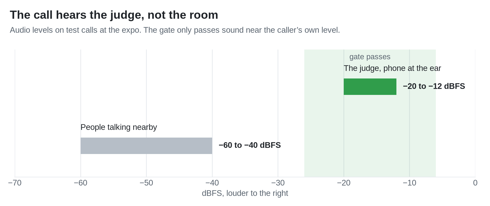

# Cartesia

Source: https://docs.cartesia.ai/calhacks, read October 23, 2026.
Prize: Meta glasses for the winning team, up to 4 people.

Cartesia isn't a feature in Silent Voice, it's Austin's voice.
He mouths without a sound, and the only thing the judge ever hears on the phone is Cartesia speaking as him.

## How we use Cartesia

| Cartesia piece | What it does for us |
|---|---|
| Instant Voice Clone | Austin sounds like Austin, not like an electrolarynx, from his own recordings and with his consent. |
| Sonic 3.6 over the WebSocket, with continuations | One context per sentence, and locked words go in as natural phrases at his pauses or every ~4 words, so he's heard while he's still mouthing. |
| `generation_config` and inline tags | His face picks the emotion, his mouthing pace sets the speed, and his effort sets the volume, and a change mid-sentence goes inline as `<emotion/>`, `<speed/>` or `<volume/>`. |
| 8 kHz `pcm_s16le` output | It's already phone rate, so nothing gets resampled, and we trim Sonic's padding as the audio streams. |
| Ink (ink-2) with turn detection | It turns the judge's side of the call into live captions and into Claude's context, and Claude starts predicting before the judge even finishes. |

The code is in `call/`, and [call/README.md](../call/README.md) has the setup and the full message flow.

## Speed is the whole game

A phone call dies in the silences, so we measured them.
With Sonic's default buffer, 14 of 15 words waited for the sentence to end and the judge sat through 4.9 s of nothing.
We switched to phrases with no server buffer, so the first sound now lands 0.6 s after Austin starts and he's done 1.0 s after he stops.

<picture>
  <source media="(prefers-color-scheme: dark)" srcset="../figures/sponsors/cartesia_wait-dark.png">
  
</picture>

Word by word with no buffer was worse in its own way, because each word came back as its own tiny sentence.
Phrases sound like a person talking, which is the whole point.

## Built for a loud expo floor

Ink is great at hearing everyone, which is a problem when everyone is the crowd behind the judge.
So we gate the call audio around the caller's own level, and people nearby stay muted even while they talk.
Ink also gets our keyterms (Silent Voice, Austin, Cal Hacks) so names don't come out mangled.

<picture>
  <source media="(prefers-color-scheme: dark)" srcset="../figures/sponsors/cartesia_gate-dark.png">
  
</picture>

## Shout-out to Frank

Frank built the whole call service, and this isn't his first rodeo.
He's been in voice AI for a while and already runs Cartesia in his own startup, so when we picked the Cartesia track he was the happiest person in the room.
Ask him about Sonic continuations and clear your afternoon.

## How they judge, 25% each

| Criterion | What they want | Our answer |
|---|---|---|
| Problem and originality | Useful, clearly scoped, thoughtfully designed | People who lost their voice box to a laryngectomy get their own voice back on a real phone call |
| Use of Cartesia | Core to the experience, responsive, natural voice | Without Cartesia there's no voice at all, and it starts 0.6 s after Austin does |
| Execution | Main flow works, edge cases handled | Live Twilio call, a reconnect with a whole-sentence fallback, a noise gate, and "Please repeat" instead of guessing |
| Impact and responsibility | Accessibility, privacy, responsible use | We clone only your own voice, with consent, and keys never leave the laptop |

## What to say out loud

- Voice is the product, not a feature on top, and Austin speaks only through Cartesia.
- Name each part as it happens, so judges hear that Sonic speaks, the clone makes it his voice, and Ink hears the judge.
- Show Cartesia's part and Claude's part as separate steps, since other tools are allowed but Cartesia's share has to be obvious.

## Responsibility

- A voice clone is someone's identity, so we clone only the user's own voice, from their own recordings, with their consent.
- Nothing gets spoken until the system is confident in a word, and when it can't tell, it says "Please repeat" instead of guessing.
- Keys stay in `call/keys.env` on the laptop and nothing calls Cartesia from a browser.
- Only Twilio can reach the call audio, because the media socket path holds a random token and `/twiml` checks Twilio's signature.

## Build rules from their page

- Use Sonic 3.6.
- Set speed, volume, and emotion through `generation_config`, not the old top-level `speed` field.
- Don't use the Line SDK, since Cartesia stops hosting Line SDK agents on December 1, 2026.
  That's their agent framework, not Sonic 3.6, which stays the model to use.

## Submission checklist

- Working demo.
- Two-minute pitch, demo first, with one full user flow, then the problem, then how we built it.
- README with setup steps, the Cartesia features we used, and known limitations.
  The root README still has no setup section, so point judges to [call/README.md](../call/README.md).
- Judges can read the source code.
- No API keys committed.

Charts come from `python figures/make_sponsor_charts.py`, using numbers measured in `call/README.md` and the call commits.
